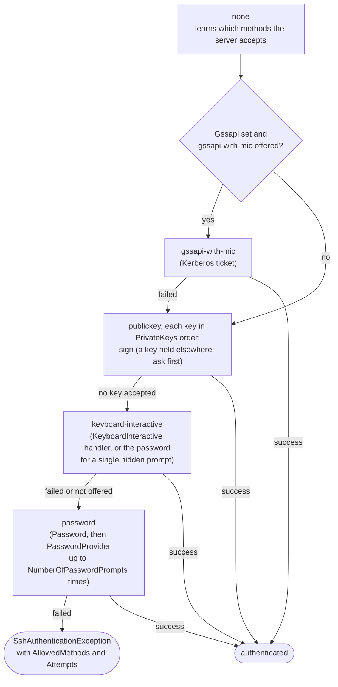
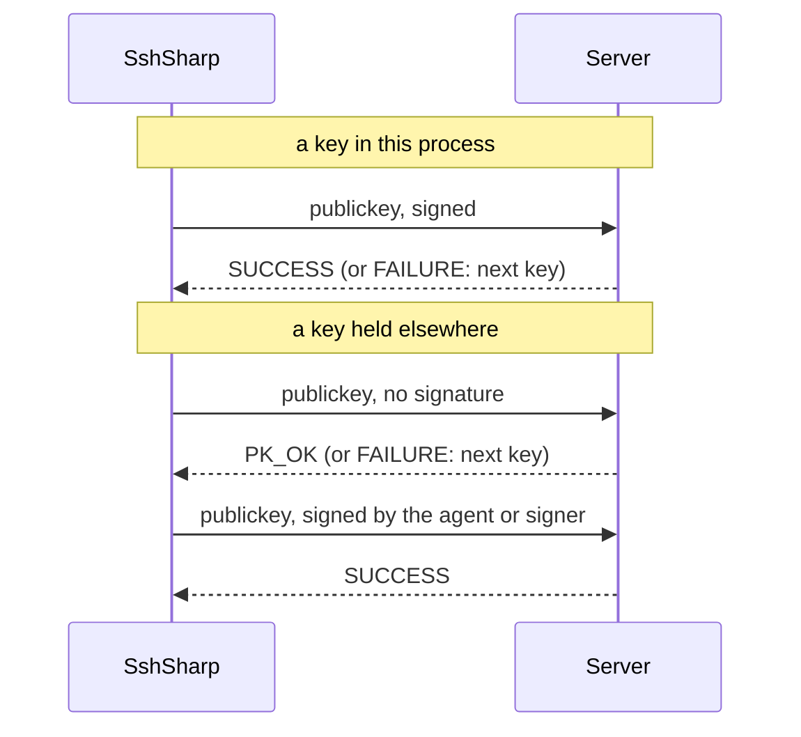

# Authentication

`SshClientOptions` carries the credentials. The client tries methods in `ssh`'s order: `none` (which tells it what the
server accepts), then **publickey** with each key, then **keyboard-interactive**, then **password**. When the server needs
more than one method (sshd's `AuthenticationMethods publickey,keyboard-interactive`, for example), it reports a partial
success and the client continues with the next method. If nothing works, `SshAuthenticationException.AllowedMethods`
lists what the server would accept, and `Attempts` what was tried and what became of each attempt.

For short task-oriented examples, see the how-to guides: [Keys and the SSH agent](how-to/agent-and-keys.md),
[Passwords: prompts, expiry and failures](how-to/passwords.md), [Certificates](how-to/certificates.md) and
[Kerberos](how-to/kerberos.md).

## The order methods are tried in



A method is tried only when the server lists it and you supplied what it needs. After a partial success (the server requires
another method too), the order is walked again with the methods the server still lists, since the one it wants next may come
earlier in the order.

`SshClientOptions.PreferredAuthentications` sets another order, as `ssh_config`'s `PreferredAuthentications` does when connecting
by alias: any of `gssapi-with-mic`, `publickey`, `keyboard-interactive` and `password`. A method left out of it is never tried,
even when its credentials are set, so `["publickey"]` keeps a service account from ever sending a password:

```csharp
var options = new SshClientOptions
{
    UserName = "deploy",
    PrivateKeys = [key],
    HostKeyVerifier = verifier,
    PreferredAuthentications = ["publickey"],
};
```

See [Choose algorithms and authentication methods](how-to/algorithms-and-authentication-order.md).

## Password

```csharp
var options = new SshClientOptions { UserName = "deploy", Password = password, HostKeyVerifier = verifier };
```

When the server takes passwords only through keyboard-interactive (sshd with PAM and `PasswordAuthentication no`), the
password answers a round that asks for exactly one hidden input. It is never sent to a visible prompt or to a second round.

### Asking for the password

`PasswordProvider` asks for the password only when authentication reaches it, after Kerberos and the keys, as `ssh` prompts
`user@host's password:`. It is asked again after each refused password, at most `NumberOfPasswordPrompts` times per connection
(3 by default, as in `ssh`); returning null stops asking. It answers keyboard-interactive the way `Password` does when there is no
`KeyboardInteractive` handler. A `Password` that is set is tried first, and the provider is asked only if the server refuses it.

```csharp
var options = new SshClientOptions
{
    UserName = "deploy",
    PrivateKeys = keys,
    HostKeyVerifier = verifier,
    PasswordProvider = (prompt, ct) => ValueTask.FromResult<string?>(ReadPassword($"{prompt.UserName}@{prompt.Host}'s password: ")),
};
```

The `KeyboardInteractive` handler is not retried after a refusal: its answers may be one-time codes. See
[Prompt for the password only when it is needed](how-to/passwords.md#prompt-for-the-password-only-when-it-is-needed).

### Expired passwords

A server can answer a right but expired password with a request for a new one (`SSH_MSG_USERAUTH_PASSWD_CHANGEREQ`, RFC 4252
section 8). `ChangePassword` gets the server's prompt and returns the new password, or null to leave it unchanged; the client
sends the old password again with the new one. The server may refuse the new password and ask again (at most 3 times per
password). Without a handler, or when it declines, the attempt fails as `PasswordChangeRequired` and the other methods follow.
Servers that change passwords through PAM ask through keyboard-interactive instead, which the `KeyboardInteractive` handler answers.
See [Change an expired password](how-to/passwords.md#change-an-expired-password).

## Private keys

```csharp
using var ed25519 = await SshPrivateKey.LoadAsync("id_ed25519");
using var rsa = await SshPrivateKey.LoadAsync("legacy.pem", passphrase: Environment.GetEnvironmentVariable("KEY_PASSPHRASE"));
var options = new SshClientOptions { UserName = "deploy", PrivateKeys = [ed25519, rsa], HostKeyVerifier = verifier };
```

Formats: the OpenSSH format (`BEGIN OPENSSH PRIVATE KEY`, also encrypted), PKCS#8 (also encrypted, for RSA and ECDSA),
PKCS#1 and SEC1 PEM, and PuTTY `.ppk` versions 2 and 3 (also encrypted). Key types: Ed25519, ECDSA (nistp256/384/521) and
RSA (2048 bits or more; signs with `rsa-sha2-256/512` as the server's `server-sig-algs` allows). `PubkeyAcceptedAlgorithms`
(`SshClientOptions` or `ssh_config`) narrows which keys are offered and picks the RSA algorithm; see
[Choose which keys are offered](how-to/algorithms-and-authentication-order.md#choose-which-keys-are-offered-and-how-they-sign). The client announces
`ext-info-in-auth@openssh.com`, so a server can send `server-sig-algs` again during authentication (for example when a `Match`
block changes them for this user), and each key uses the latest list. `SshPrivateKey.Parse` reads a key from a string.

`Fingerprint`, `Comment`, `PublicKey` and `ToAuthorizedKeysLine()` describe a key. Dispose keys when done: it clears the
private key material.

### Signing straight away, or asking first

RFC 4252 lets a client either send the signed request at once, or first ask whether the server would accept the key (a request
without a signature, answered with `SSH_MSG_USERAUTH_PK_OK`) and sign only then. SshSharp chooses by where the private key is:

- **A key in this process** (loaded from a file, parsed, generated, or paired with a certificate) signs straight away. A signature
  costs it a fraction of a millisecond and has no side effects.
- **A key held elsewhere** (an [agent](#ssh-agent)'s, an [`SshKeySigner`](#keys-held-elsewhere-key-vaults-hsms-tpm)'s,
  `FromRsa`/`FromECDsa`, a FIDO key in an agent) is offered first. Its signature may ask the user to confirm, need a touch or a PIN,
  or cost a call to a key service, so it is never made for a key the server would refuse.



Asking first costs a round trip, and on OpenSSH more: sshd delays every answer to a failed or unfinished authentication request
(other than `none`) to a minimum time, against timing attacks, and the "this key would do" answer is one of them. On a fast network
that delay, a few milliseconds, is a large part of a connect. A refused key costs the same either way: one request, one failure, and
one of sshd's `MaxAuthTries`. OpenSSH's `ssh` asks first for every key whose public half it has (agent keys, and identity files
whose public key it can read), and signs straight away only when it has to load the private key to learn the public one; servers
accept both forms. Everything else is the same on both paths: the signature algorithm chosen from `server-sig-algs`, host-bound
authentication (`publickey-hostbound-v00@openssh.com`) when the server offers it, certificates, and a partial success when the server
requires another method too.

### Generating keys

`SshPrivateKey.Generate` makes a new key pair, and `SaveAsync` writes it as `ssh-keygen` does: the private key in the OpenSSH
format (encrypted with `aes256-ctr` and `bcrypt_pbkdf` when you give a passphrase), and the public key next to it as `.pub`.

```csharp
using var key = SshPrivateKey.Generate(SshKeyType.Ed25519, comment: "deploy@build-agent");
await key.SaveAsync("/home/deploy/.ssh/id_ed25519", passphrase);
Console.WriteLine(key.ToAuthorizedKeysLine()); // for the server's authorized_keys
```

The private key file is created readable only by the current user (mode 0600 on Unix; on Windows an ACL with just the current
user, as OpenSSH for Windows requires). `SaveAsync` never overwrites: it fails if either file exists. Types: `Ed25519`,
`EcdsaNistp256/384/521`, and `Rsa` (3072 bits by default, `rsaBits` for 2048 to 16384). `ToOpenSshPrivateKey(passphrase)` returns
the file's text instead, for a secret store; it holds the private key, so never log it. Keys loaded from any format can be
written this way too, which converts them to the OpenSSH format; keys held by an agent cannot. `SaveAsync(path, passphrase,
kdfRounds)` sets the `bcrypt_pbkdf` rounds, as `ssh-keygen -a` does.

Other tools get the key in their own format: `ToPkcs8PrivateKey` writes PKCS#8 PEM for OpenSSL and the .NET cryptography APIs,
`ToPuttyPrivateKey` a version 3 `.ppk` file for PuTTY, Pageant and WinSCP, and `SaveAsync(path, SshPrivateKeyFormat.Pkcs8 or
.Putty, passphrase)` saves either as the OpenSSH format is saved. PKCS#8 keeps no comment and cannot encrypt an Ed25519 key. See
[Export a key to PKCS#8 or PuTTY](how-to/agent-and-keys.md#export-a-key-to-pkcs8-or-putty).

### Keys held elsewhere (key vaults, HSMs, TPM)

A private key that never leaves a key vault, a KMS, an HSM or a TPM can still be used: SshSharp sees only the public key, and asks
for each signature.

- **A key .NET's `RSA` or `ECDsa` holds:** `SshPrivateKey.FromRsa(rsa)` and `SshPrivateKey.FromECDsa(ecdsa)`, for a software key
  or a non-exportable one, for example a Windows CNG key in the TPM (Microsoft Platform Crypto Provider). The `RSA` or `ECDsa` stays
  yours; disposing the SSH key does not dispose it.
- **Any other signer:** derive from `SshKeySigner` and pass it to `SshPrivateKey.FromSigner`. Each `SshSignRequest` it gets carries
  the SSH algorithm (which fixes the hash), the data, and what the signature is for: `Purpose` is `Authentication` (logging in),
  `FileSignature` (an SSH signature, with its `Namespace`) or `Certificate` (issuing a certificate as its authority, see
  [Certificates](how-to/certificates.md#act-as-a-certificate-authority)), or `Other` (data of another form, signed through an in-process agent's forwarding, see [Agent forwarding](#agent-forwarding)), so a signer can apply a policy or ask its user. It returns the signature as
  .NET produces it: PKCS#1 v1.5 for RSA, r‖s for ECDSA (or DER, by overriding `EcdsaSignatureFormat`), 64 bytes for Ed25519.

```csharp
sealed class VaultSigner(VaultClient vault, byte[] publicKey) : SshKeySigner(publicKey)
{
    // ECDSA P-256 in the vault: it signs a SHA-256 digest and answers DER.
    public override DSASignatureFormat EcdsaSignatureFormat => DSASignatureFormat.Rfc3279DerSequence;

    public override async ValueTask<byte[]> SignAsync(SshSignRequest request, CancellationToken cancellationToken) =>
        request.Purpose == SshSignaturePurpose.Authentication
            ? await vault.SignDigestAsync(SHA256.HashData(request.Data.Span), cancellationToken)
            : throw new UnauthorizedAccessException("The deploy key is for logging in only.");
}

using var key = SshPrivateKey.FromSigner(new VaultSigner(vault, publicKeyBlob), comment: "vault:deploy");
```

Such a key works wherever a key does: in `PrivateKeys`, with `WithCertificate`, and for `SshSignature`. Each signature is checked
against the public key before it is used, so a signer that answers in the wrong format, or with another key, fails at once with a
`CryptographicException`. It cannot be exported or added to an agent. The
[sample tool](https://github.com/zcsizmadia/SshSharp/tree/main/samples/SshSharp.Samples)'s `run-cng` command logs in with a
Windows CNG key through such a signer.

## Certificates

An OpenSSH user certificate (`id_ed25519-cert.pub`, made with `ssh-keygen -s`) lets servers that trust its authority
(`TrustedUserCAKeys`) accept the key without an `authorized_keys` entry.

```csharp
using var key = await SshPrivateKey.LoadAsync("id_ed25519");
var certificate = SshCertificate.Parse(await File.ReadAllTextAsync("id_ed25519-cert.pub"));
var options = new SshClientOptions
{
    UserName = "deploy",
    PrivateKeys = [key.WithCertificate(certificate), key], // the certificate first, then the plain key
    HostKeyVerifier = verifier,
};
```

Connecting by `ssh_config` alias finds certificates as `ssh` does: `CertificateFile` entries and `<identity>-cert.pub`.

An application can also be the certificate authority: `SshCertificateBuilder` issues user and host certificates, signed with any
`SshPrivateKey` (one in an agent or a key service too), and `SshCertificate.IsValidFor` checks one as sshd would. See
[Certificates](how-to/certificates.md#act-as-a-certificate-authority).

## SSH agent

Keys held by `ssh-agent` (or the Windows OpenSSH agent service, or PuTTY's Pageant) never enter your process: the agent signs.

```csharp
var agent = await SshAgent.FromEnvironmentAsync(); // SSH_AUTH_SOCK, or on Windows the OpenSSH agent, else Pageant
var keys = agent is null ? [] : await agent.GetKeysAsync();
var options = new SshClientOptions { UserName = "deploy", PrivateKeys = keys, HostKeyVerifier = verifier };
```

`new SshAgent(path)` names a Unix socket or, on Windows, a pipe such as `\\.\pipe\openssh-ssh-agent`. Agent keys work with
`WithCertificate` too. A key the agent will not sign with (removed, or a declined `ssh-add -c` confirmation) is skipped.
FIDO security keys (`sk-ssh-ed25519@openssh.com`, `sk-ecdsa-sha2-nistp256@openssh.com`) and their certificates work through
the agent: the agent and the key's touch make the signature. `QueryExtensionsAsync` lists the protocol extensions an agent
supports (RFC 9987).

Keys added with destination constraints (`ssh-add -h host`) work as they do with `ssh`. Before each signature the agent connection
is bound to the SSH session (`session-bind@openssh.com`: the server's host key, the session identifier and the host key's
signature over it, which the agent verifies). Authentication is host-bound (`publickey-hostbound-v00@openssh.com`, signing the
server's host key too) whenever the server offers it, as OpenSSH 8.9 and later do. The agent then signs with a constrained key only
for the hosts it allows. Forwarded agent connections are bound as forwarding ones, so constraints along a chain of hosts
(`ssh-add -h "a>b"`) apply too. Agents without the extension sign as before.

Connecting by `ssh_config` alias uses the agent automatically, as `ssh` does: `IdentityAgent`, else `SSH_AUTH_SOCK`.
Agent keys that match an `IdentityFile` (by the `.pub` file next to it) come first, and that identity file is then not opened at
all, and
`IdentitiesOnly yes` leaves the agent's other keys out. `UseAgent = false` turns it off.

Which agent setting to use:

| You want to | Set |
|---|---|
| Authenticate with an agent's keys, connecting with `SshClientOptions` | `PrivateKeys = await agent.GetKeysAsync()` |
| Authenticate with an agent's keys, connecting by alias | nothing (the default agent), `SshConfigConnectOptions.Agent` for another one, or `UseAgent = false` for none |
| Forward an agent to the server, connecting with `SshClientOptions` | `SshClientOptions.ForwardAgent = agent` |
| Forward an agent, connecting by alias | `ForwardAgent yes` in `ssh_config` (read as `SshHostConfig.ForwardAgent`); the agent forwarded is the one used for authentication |
| Serve keys you hold (files, KMS or HSM signers) as an agent, to forward them | `SshAgent.FromKeys(...)`, then as any agent (`SshConfigConnectOptions.Agent` when connecting by alias) |
| Decide what the server may do with a forwarded agent | `SshClientOptions.ForwardAgentFilter` (or `SshConfigConnectOptions.ForwardAgentFilter`) |

### Agent forwarding

`ForwardAgent` (`ssh -A`) offers your agent to the server, so programs there (`ssh`, `git`) can authenticate onward with your
keys while you are connected:

```csharp
var options = new SshClientOptions
{
    UserName = "deploy",
    PrivateKeys = keys,
    HostKeyVerifier = verifier,
    ForwardAgent = agent,
};
```

Each session asks the server for it, and the agent connections the server opens are relayed to the local agent. A server that
announces RFC 9987's `agent-forward` (OpenSSH 10.3+) is asked with the standard `agent-req`; others with OpenSSH's
`auth-agent-req@openssh.com`. Forward only to
servers you trust: while you are connected, anyone with enough rights on the server can make your agent sign (they cannot read
the keys). Connecting by `ssh_config` alias follows `ForwardAgent yes`.

**An agent in your process.** `SshAgent.FromKeys(keys)` serves keys this process holds over the agent protocol: key files,
generated keys, Windows key store keys, keys behind an `SshKeySigner` (a cloud KMS, an HSM) and keys paired with certificates.
Forwarded, it answers the server's agent channels here, so programs on the server can use keys that are in no agent process.
Authenticating through it (`PrivateKeys = await agent.GetKeysAsync()`) behaves as with a real agent, including the session binding
and host-bound authentication; passing the keys in `PrivateKeys` directly is equivalent. It is read-only (adding, removing and
locking keys are refused) and signs RSA with SHA-2 only; like `ssh-agent`, it signs data of any form it is asked to. Keys loaded
from files stay in this process's memory while it is used; for sensitive keys, serve an `SshKeySigner` key instead. See
[Serve an agent from your own keys](how-to/agent-and-keys.md#serve-an-agent-from-your-own-keys).

**Filtering forwarded requests.** `ForwardAgentFilter` decides each request that programs on the server make of the forwarded agent
(in-process or real): which keys a listing shows, and whether each signature is made. It sees the key, what the signature is for
(a login with its user name, an SSH signature with its namespace, a certificate), the host key of the server being logged in to when
the program bound its session (OpenSSH 8.9 and later), and the servers the agent was forwarded through. Data of any other form (a
pam_ssh_agent_auth challenge, say) has no purpose, and the filter decides it like the rest; allowing only known purposes keeps the
agent from signing anything else. It can be asynchronous, to ask the user as `ssh-add -c` does. It is not asked for this client's own
authentication through the agent, only for forwarded requests. A refused request is answered with `SSH_AGENT_FAILURE`. With a filter, a real agent's connection
is read request by request instead of relayed byte for byte, and is read-only: requests to add, remove or lock keys never reach the
agent. OpenSSH's `ssh` has no such filter; it narrows what a compromised server can do with your agent. See
[Decide what a forwarded agent may do](how-to/agent-and-keys.md#decide-what-a-forwarded-agent-may-do).

On Windows, when `SSH_AUTH_SOCK` is not set and the OpenSSH agent service is not running, `FromEnvironment()` finds PuTTY's Pageant
(0.75 and later) on the pipe it creates for the current user; `SshAgent.FromPageant()` asks for Pageant specifically. Pageant's keys work like
any agent's, including for signing (`SshSignature`) and agent forwarding. An agent pipe is used only when it belongs to the current
user, SYSTEM or the Administrators group, so another user cannot pose as the agent by creating its pipe first.

### Managing the agent's keys

`SshAgent` does what `ssh-add` does:

```csharp
var agent = SshAgent.FromEnvironment() ?? throw new InvalidOperationException("No SSH agent is running.");
using var key = await SshPrivateKey.LoadAsync("/home/me/.ssh/id_ed25519", passphrase);
await agent.AddKeyAsync(key, new SshAgentKeyConstraints { Lifetime = TimeSpan.FromHours(1), Confirm = true }); // ssh-add -t 1h -c
await agent.RemoveKeyAsync(key);                                                                                 // ssh-add -d
await agent.RemoveAllKeysAsync();                                                                                // ssh-add -D
await agent.LockAsync(lockPassphrase);                                                                           // ssh-add -x
await agent.UnlockAsync(lockPassphrase);                                                                         // ssh-add -X
```

A key paired with a certificate (`WithCertificate`) is added with it, as `ssh-add` adds a key's `-cert.pub`. `Confirm` makes the
agent ask before each use (OpenSSH's agent runs `ssh-askpass`). Each call throws `SshException` (`AgentFailed`) when the agent
refuses, for example a locked agent or a constraint it does not support.

**Destination constraints** (`ssh-add -h`, OpenSSH 8.9 and later) limit where the agent lets a key sign in: only to the listed
hosts, recognised by their host keys, and so also only there through agent forwarding. Each destination is one `-h` argument,
with host keys looked up in `known_hosts` as `ssh-add` does (`@cert-authority` keys count for the hosts they sign):

```csharp
var knownHosts = await KnownHostsFile.LoadAsync("/home/me/.ssh/known_hosts");
await agent.AddKeyAsync(key, new SshAgentKeyConstraints
{
    Destinations =
    [
        SshAgentDestination.Parse("bastion.example.com", knownHosts),                  // ssh-add -h bastion.example.com
        SshAgentDestination.Parse("bastion.example.com>deploy@app1", knownHosts),     //        -h "bastion.example.com>deploy@app1"
    ],
});
```

A forwarded key needs a destination for every hop, as in the example: from here to the bastion, and from the bastion to the
application server, as `deploy` only. The agent enforces the constraints through the session binding (`session-bind@openssh.com`)
that SshSharp sends with every agent signature, as ssh does; a signature on an unbound agent connection (for example
`SshSignature.SignAsync` with that key) is refused. `SshAgentDestination`, `SshAgentHost` and `SshAgentHostKey` can also be built
directly, with host keys from anywhere: `new SshAgentHostKey(key)` takes an `SshPublicKey` (a server's `.pub` file, or
`client.HostKey.GetPublicKey()`), and `new SshAgentHostKey(caKey, isCertificateAuthority: true)` a host CA's key.

With `ssh_config`, `AddKeysToAgent yes` (or `confirm`, optionally with a lifetime such as `AddKeysToAgent confirm 1h`) adds an
identity file's key to the agent once the server has accepted it, so the next connection uses the agent. The identity file is
matched to the agent's key through its `.pub` file: when one sits next to it, the next connection does not read the private key
file (or ask for its passphrase) again; without one, the private key file is still read to learn its public key, and an encrypted
one still needs its passphrase. Keys you pass in `SshConfigConnectOptions.PrivateKeys` are yours to manage and are never
added. `AddKeysToAgent ask` asks `SshConfigConnectOptions.ConfirmAddKeyToAgent` for each key first, as `ssh` asks through
`SSH_ASKPASS`; without it, or in `BatchMode`, nothing is added. See
[From ssh_config: AddKeysToAgent](how-to/agent-and-keys.md#from-ssh_config-addkeystoagent).

## Keyboard-interactive

One-time codes, PAM prompts and other challenge-response logins (RFC 4256):

```csharp
var options = new SshClientOptions
{
    UserName = "deploy",
    HostKeyVerifier = verifier,
    KeyboardInteractive = async (request, ct) =>
    {
        if (request.Instruction.Length > 0)
        {
            Console.WriteLine(request.Instruction);
        }

        var answers = new List<string>();
        foreach (var prompt in request.Prompts)
        {
            answers.Add(await ReadAnswerAsync(prompt.Text, hidden: !prompt.Echo, ct));
        }

        return answers; // or null to give up on this method
    },
};
```

Prompts and instructions come from the server: strip control characters before showing them in a terminal. A round with
no prompts is answered with an empty list.

## Kerberos (GSSAPI)

With a Kerberos ticket, the server lets you in without a password or key (`gssapi-with-mic`, RFC 4462; ssh's
`GSSAPIAuthentication yes`). The ticket comes from the platform: the Windows logon session (SSPI, in an Active Directory
domain), or elsewhere the credential cache that `kinit` fills (MIT or Heimdal GSS-API).

```csharp
var options = new SshClientOptions
{
    UserName = "deploy",
    HostKeyVerifier = verifier,
    Gssapi = new SshGssapiOptions(), // TargetHost defaults to the host connected to
};
await using var client = await SshClient.ConnectAsync("build.corp.example", 22, options);
```

- Kerberos is tried first when it is on (as in ssh's default order), and only when the server offers it; when it fails (no ticket,
  an unknown service principal), the other methods follow.
- The server's service principal is `host/<TargetHost>@REALM`. Kerberos names services by DNS name, so connecting by address or
  over a stream needs `TargetHost` set to the server's name.
- `DelegateCredentials` forwards the ticket to the server (`GSSAPIDelegateCredentials yes`), so programs there can authenticate
  onward as you; leave it off unless you trust the server. `Credential` takes a user, password and realm instead of the current
  ticket.
- The client asks for mutual authentication, and the MIC binds the Kerberos exchange to this SSH session. The host key is
  verified as always: `gssapi-keyex` (Kerberos instead of host keys) is not supported.
- Needs .NET 10 (`SshGssapiOptions.IsSupported`): it relies on `NegotiateAuthentication.ComputeIntegrityCheck`, which .NET 8
  lacks. On .NET 8 the method is not offered and the other methods are used.

With `ssh_config`, `GSSAPIAuthentication yes` and `GSSAPIDelegateCredentials yes` turn it on, with `HostName` as the target, and
`PreferredAuthentications` can place `gssapi-with-mic` anywhere in the order.

## Banner

```csharp
var options = new SshClientOptions
{
    UserName = "deploy",
    Password = password,
    HostKeyVerifier = verifier,
    AuthenticationBanner = (text, ct) => { Console.Write(text); return ValueTask.CompletedTask; },
};
```

## With `ssh_config`

`PreferredAuthentications`, `PubkeyAuthentication`, `PasswordAuthentication`, `KbdInteractiveAuthentication`,
`NumberOfPasswordPrompts`, `IdentityFile`, `CertificateFile`, `IdentityAgent`, `IdentitiesOnly` and `BatchMode` (no prompts) are
honored; `SshConfigConnectOptions` supplies the password, the password provider and change handler, passphrases and the
keyboard-interactive handler, all for the destination only.

## When authentication fails

`SshAuthenticationException` says what the server would still accept (`AllowedMethods`) and what was tried (`Attempts`): each key by
its SHA-256 fingerprint, each password and keyboard-interactive try, and methods whose credentials were set but that the server did
not offer, each with its outcome (`Rejected`, `PartialSuccess`, `NotOffered`, `NoAcceptedAlgorithm`, `SigningFailed`, `Declined`,
`PasswordChangeRequired`, `Unavailable`). The message lists them too. Neither holds a password, an answer or the user name. See
[Find out why authentication failed](how-to/passwords.md#find-out-why-authentication-failed).

## See also

- How-to guides: [Keys and the SSH agent](how-to/agent-and-keys.md), [Certificates](how-to/certificates.md),
  [Kerberos](how-to/kerberos.md)
- [Signing files and commits](signing.md)
- [Security model](concepts/security-model.md)
- [Troubleshooting: authentication](reference/troubleshooting.md#authentication)
