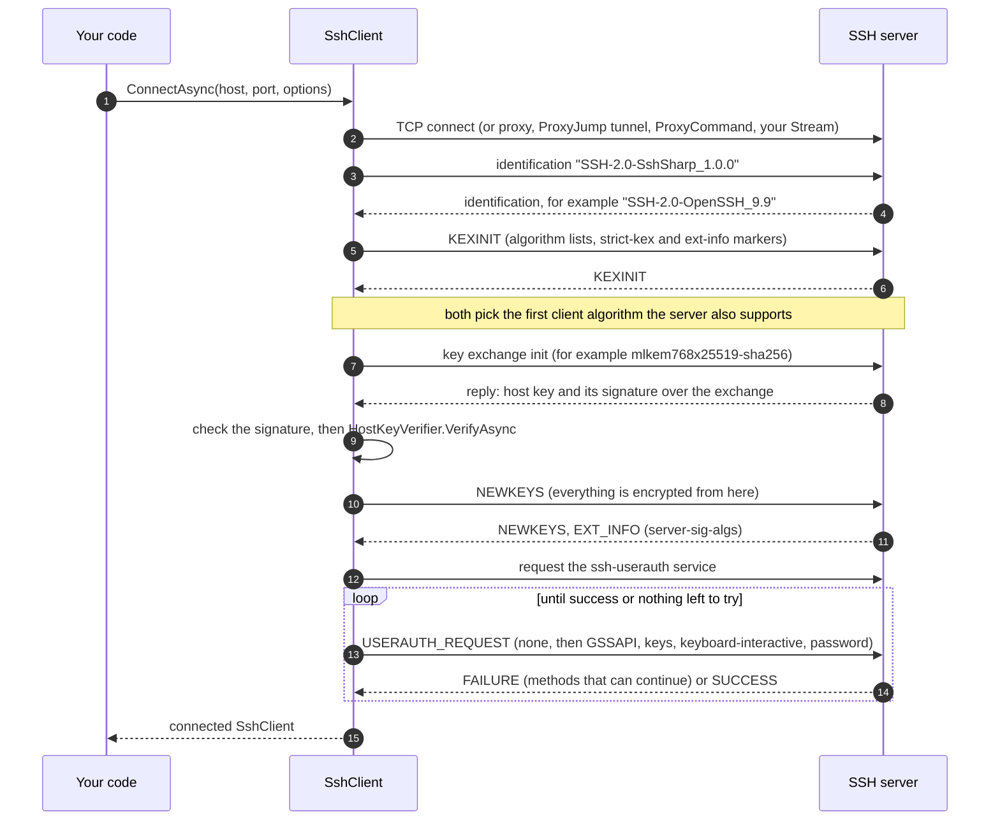
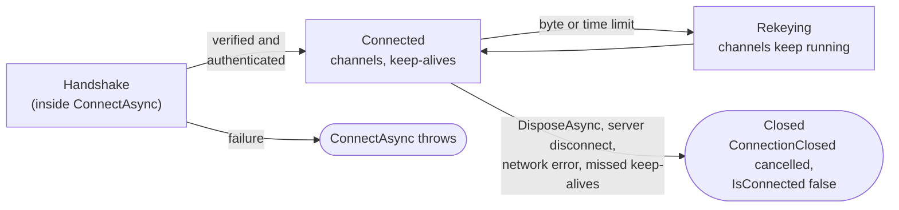

# Architecture and connection lifecycle

This page explains what happens between `SshClient.ConnectAsync` and `DisposeAsync`: the protocol layers, the handshake, the
objects you get, and how a connection ends. None of it is needed to use the library, but it explains much of its behavior.

## Three protocol layers, one object

SSH is three protocols stacked on one byte stream (RFC 4251):

| Layer | RFC | What it does | In SshSharp |
|---|---|---|---|
| Transport | 4253 | Version exchange, key exchange, host key proof, encryption, integrity, rekeying | inside `SshClient`; `client.Algorithms`, `client.HostKey` |
| User authentication | 4252 | Proves who you are: public key, keyboard-interactive, password, GSSAPI | `SshClientOptions` credentials; done before `ConnectAsync` returns |
| Connection | 4254 | Multiplexes channels: sessions, tunnels, forwarded connections, agent forwarding | `SshSession`, `SftpClient`, tunnels and forwarders |

`SshClient` is the whole stack for one connection. Everything else (sessions, SFTP clients, forwarders, tunnel streams) is a
channel on it, and lives no longer than it.

## The handshake

`ConnectAsync` returns only after the whole handshake has succeeded, so a client you hold is always verified and authenticated:

- The host key is verified **before** any credential is sent. A rejected key ends the connection with `SshHostKeyException`, and
  the server never sees a password or a signature.
- Strict key exchange (OpenSSH's fix for the Terrapin attack) is always on; with a server that supports it, the packet sequence is
  reset at each `NEWKEYS`.
- The order in which credentials are tried is described in [Authentication](../authentication.md#the-order-methods-are-tried-in).

## The lifecycle

- **Rekeying** renews the keys after `RekeyAfterBytes` (1 GiB) or `RekeyAfterTime` (1 hour), and whenever the server asks. It is
  transparent: transfers and sessions continue.
- **Closing.** However the connection ends, `client.ConnectionClosed` (a `CancellationToken`) is cancelled once, `IsConnected` turns
  false and `ConnectionError` says why the connection failed. Every channel ends with it: pending reads end, and
  calls fail with `SshException` (`ConnectionClosed`).
- **No automatic reconnect.** A closed client stays closed; open a new one. See
  [Keep-alive and reconnecting](../how-to/keepalive-and-reconnect.md).

## Ways in

All three `ConnectAsync` overloads run the same handshake; they differ in how the byte stream is made and where the settings come
from.

| Overload | Transport | Settings |
|---|---|---|
| `ConnectAsync(host, port, SshClientOptions)` | TCP, optionally through `Proxy` (HTTP/SOCKS) from `LocalEndPoint` | the options you pass |
| `ConnectAsync(Stream, SshClientOptions, leaveOpen)` | any duplex stream you provide | the options you pass; `HostKeyAlias` names the host |
| `ConnectAsync(destination, SshConfigConnectOptions)` | TCP, `ProxyJump` chain or `ProxyCommand`, as `ssh_config` says | `ssh_config`, plus what only code can supply (passphrases, prompts, policies) |

## Ownership

| Object | Owned by | Disposing it |
|---|---|---|
| `SshClient` | you | closes every channel and the connection; for a `ProxyJump` chain, every hop |
| `SshSession` | you | closes its channel; a running program loses its streams |
| `SftpClient` | you | ends the SFTP session; the connection stays |
| Forwarders (`SshLocalPortForwarder`, ...) | you | stops listening and closes their connections |
| Tunnel streams | you | closes that one channel |
| `SshPrivateKey` | you (the client never disposes keys you pass) | clears the private key material |
| Clients from `ISshConnectionProvider` | the provider | do not dispose |

## See also

- [Channels and flow control](channels.md)
- [Threading and concurrency](threading.md)
- [Security model](security-model.md)
- [Design notes](../design.md)
