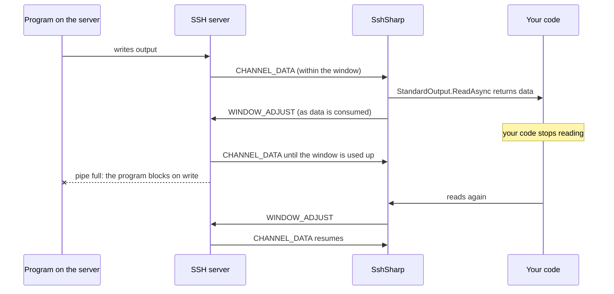

# Channels and flow control

Everything that carries data over an SSH connection is a channel (RFC 4254): each command, shell and SFTP session, each tunnel and
forwarded connection. Many channels share one connection at once, each with its own flow control. Knowing this explains when
operations run in parallel, why unread output stalls a program, and what the server's limits mean.

## Channel types

| Channel type | Opened by | Created by |
|---|---|---|
| `session` | client | `RunCommandAsync`, `StartCommandAsync`, `StartShellAsync`, `StartSubsystemAsync`, `OpenSftpAsync`, SCP transfers |
| `direct-tcpip` | client | `OpenTcpTunnelAsync`, each connection to a local forwarder or SOCKS proxy, `CreateHttpConnectCallback`, ProxyJump hops |
| `direct-streamlocal@openssh.com` | client | `OpenUnixSocketTunnelAsync` |
| `forwarded-tcpip` | server | each connection to a remote forwarding (`ForwardRemotePortAsync`, to a host and port or to a handler, `ForwardRemoteDynamicPortAsync`) |
| `forwarded-streamlocal@openssh.com` | server | each connection to a remote Unix-socket forwarding |
| `auth-agent@openssh.com` | server | each use of a forwarded agent: relayed to the agent, or answered request by request for an in-process agent (`SshAgent.FromKeys`) or behind `ForwardAgentFilter` |

Channels the server opens are accepted only when you asked for them (a forwarding, agent forwarding); anything else is refused.

## Flow control

Each side of a channel grants the other a window: how many bytes it may send before it must wait. SshSharp grants 2 MiB per
channel and tops the window up as your code consumes data. If your code stops reading, the window runs out and the server stops
sending on that channel, which pushes back all the way to the program on the server:

Consequences:

- **Memory is bounded.** A channel buffers at most its window, however fast the server sends.
- **stdout and stderr share one window.** Reading only one of them stalls the program once the other has filled the window; read
  both, as [Stream large output](../how-to/stream-output.md) shows.
- **Throughput per channel** is at most one window per round trip. On a 100 ms link that is about 20 MiB/s per channel, which is
  why SFTP's `Segments` uses several channels.
- **Channels do not block each other.** A stalled channel does not slow the others on the same connection.

## Receive buffering

Received data is copied as little as possible on its way to your code:

- **Socket reads are large.** The connection reads from the network into a 128 KiB buffer, with room for at least 32 KiB in each
  read, so one read usually brings in several packets. Smaller reads cost far more CPU per GiB, as each one is a separate
  asynchronous completion. The buffer comes from the shared array pool. Each open connection holds one while it waits for data,
  idle or not, and returns it when it closes.
- **Each packet is decrypted into a pooled buffer** that holds its data until your code has read it. The bytes the packet used are
  then zeroed and the buffer is returned to the pool, and the data counts as consumed for the window.
- **Stream reads return what has arrived.** `ReadAsync` on `StandardOutput`, `StandardError` or a tunnel waits only until some data
  is there. It then copies everything already received, across as many packets as fit in your buffer. A buffer of 64 KiB or more
  takes a fast transfer in fewer reads. Read boundaries do not follow the server's writes or packets.

## Limits

- **Sessions per connection.** Servers limit open session channels (sshd's `MaxSessions`, 10 by default). Commands, shells and SFTP
  sessions count; tunnels do not.
- **Packet size.** SshSharp accepts packets up to 256 KiB and asks for at most 32 KiB of data per channel packet.
- **Forwarded connections.** At most `SshClientOptions.MaxForwardedConnections` (1,000) channels opened by the server at a time.
- **Idle channels.** `SshClientOptions.ChannelTimeouts` closes channels of a given type that carry no data for a while (OpenSSH's
  `ChannelTimeout`), without closing the connection.

## Closing

A channel closes when either side closes it: your code disposes the session or stream, the program on the server exits, or the
connection ends. Half-close is supported: `CloseInputAsync` sends end-of-file on your side while output keeps coming, and forwarded
connections pass a half-close through as TCP does.

## See also

- [Architecture and connection lifecycle](architecture.md)
- [Threading and concurrency](threading.md)
- [Port forwarding and tunnels](../how-to/port-forwarding.md)
