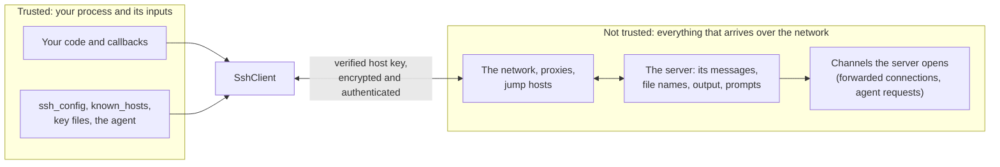

# Security model

SSH protects a connection only as well as the client checks what the server sends and guards what it holds. This page summarizes
what SshSharp trusts, what it does not, and what is left to your application. The [threat model](../threat-model.md) is the full,
item-by-item version.

## Trust boundaries

- **Trusted:** your code, the callbacks you supply, and local configuration (`ssh_config`, `known_hosts`, key files, the agent
  socket). A configuration file that is not under your control can run programs (`ProxyCommand`, `Match exec`,
  `KnownHostsCommand`); see below.
- **Not trusted:** the network and anything on the path (proxies, jump hosts), and the server itself, beyond what host key
  verification establishes. Everything the server sends is parsed defensively and has limits.

## What SshSharp guarantees

| Area | Guarantee |
|---|---|
| Server identity | A host key verifier is required; there is no "accept anything" default. The key is verified before any credential is sent. |
| Cryptography | Only modern algorithms (no CBC, SHA-1 MACs, `ssh-rsa` signatures, DH group 1, RSA under 2048 bits); strict key exchange offered on every connection and used whenever the server supports it; post-quantum hybrid key exchange preferred. |
| Credentials | Passwords (given, or asked for through `PasswordProvider`), new passwords for an expired one, and keyboard-interactive answers go only to the destination, never to `ProxyJump` hops; with `JumpHosts`, each hop gets only its own options' credentials and the destination's go to the destination alone. Keys held in memory sign at once (the signature is useless to anyone but that session); agent, signer and hardware keys are offered only after the server says it would accept them. Authentication failures list methods and key fingerprints, never secrets or user names. |
| Secrets in memory | Key material is wiped (`CryptographicOperations.ZeroMemory`) when no longer needed, and disposing a key clears it. Passwords are managed strings and cannot be wiped. |
| Logs and telemetry | Never contain passwords, private keys, command text, user names or host names. |
| Downloads | SFTP and SCP directory downloads treat names from the server as hostile: no path separators, `..`, device names or control characters; nothing lands outside the target (CVE-2019-6111). |
| Server-opened channels | Accepted only for forwardings and agent forwarding you started; at most `MaxForwardedConnections` at a time. |
| Parsers and limits | Every parser treats its input as hostile and is mutation-fuzzed in each test run (and coverage-guided fuzzed nightly); packets, banners, listings and command output are bounded. |

## What is left to you

- **Host key policy.** Choose a verifier that fits ([Verify host keys](../how-to/verify-host-keys.md)). `StrictHostKeyChecking.No`
  and a verifier that always accepts turn off protection against interception.
- **Shell quoting.** Command lines are run by the server's shell; quote untrusted input
  ([Run a command](../how-to/run-a-command.md#pass-arguments-safely)).
- **Agent forwarding** lets anyone with enough rights on the server use your agent while you are connected. Forward only to trusted
  servers, and prefer destination-constrained keys.
- **Listeners.** Local forwarders and SOCKS proxies have no authentication; bind them to loopback. Remote dynamic forwarding lets
  the server's side reach your network; pass an `allowDestination` filter.
- **Configuration from elsewhere.** `ProxyCommand` is allowed by default (as in `ssh`); `KnownHostsCommand` and `Match exec` are
  opt-in. For configuration files you do not control, set `AllowProxyCommand = false` and leave the others off.
- **Server text.** Banners, prompts, error messages and command output come from the server. Strip control characters before showing
  them in a terminal, and do not put them in public responses.
- **Disk space.** Downloads do not limit total size or file count: a server can fill the target's disk.
- **Secrets at rest.** Read passwords and passphrases from a secret store or environment variables, never from source code or
  checked-in configuration.

## Reporting a vulnerability

See the [security policy](https://github.com/zcsizmadia/SshSharp/blob/main/SECURITY.md). The managed cryptography has had an
internal constant-time review but not yet an outside one; the [cryptography review](../crypto-review.md) describes what was checked.

## See also

- [Threat model](../threat-model.md)
- [Cryptography review](../crypto-review.md)
- [Testing and validation](../testing.md)
