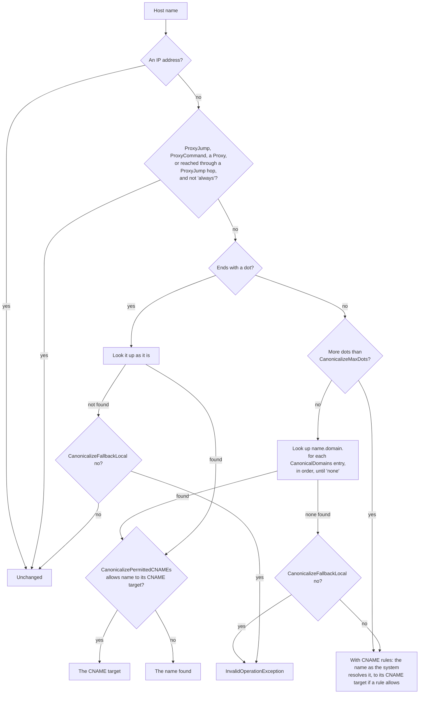
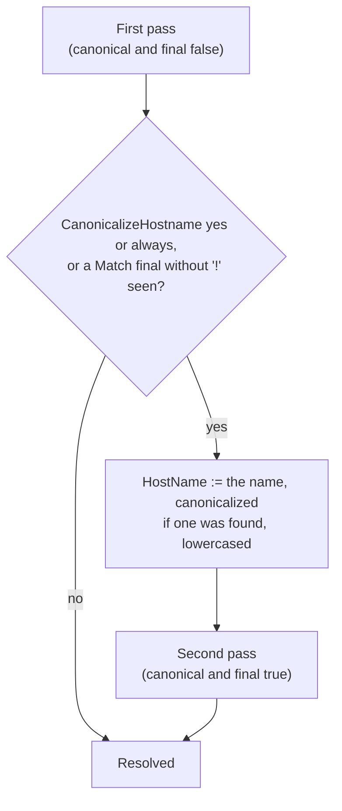

# Configuration files

The `SshSharp.Config` namespace reads OpenSSH's `ssh_config` and `known_hosts` with the same semantics as `ssh`, for
applications that want the values without connecting.

## `ssh_config`

```csharp
using SshSharp.Config;

var config = SshConfig.LoadDefault();         // ~/.ssh/config, then the system file
SshHostConfig host = config.Resolve("prod-db");
Console.WriteLine($"{host.User}@{host.HostName}:{host.Port}");
Console.WriteLine(string.Join(", ", host.IdentityFiles));
Console.WriteLine(string.Join(" -> ", host.ProxyJump));
```

Resolution follows `ssh -G`: first value wins, `Host` and `Match` (`host`, `originalhost`, `user`, `localuser`,
`canonical`, `final`, `all`, `exec`, `tagged`, `localnetwork`, `sessiontype`, `command`), `Include` with globs, `%` tokens, `~`
and environment variables, and algorithm lists with `+`, `-` and `^`. `SshConfig.Parse(text)` reads a configuration from a string,
and `SshConfigResolveOptions` supplies the home directory, environment, local user and host name (for tests, or another user).

- `Match localnetwork 10.0.0.0/8,fd00::/8` compares the addresses of the network interfaces that are up with the networks (CIDR,
  IPv4 or IPv6; a bare address is one host). `SshConfigResolveOptions.LocalAddresses` replaces the interface list. As
  ssh_config(5) warns, a network address is not a trustworthy criterion in many situations.
- `Match sessiontype` (`shell`, `exec`, `subsystem`, `none`) and `Match command` describe the session about to start, which `ssh`
  knows from its command line and a library does not: set `SshConfigResolveOptions.SessionType` and `Command` (the command, or the
  subsystem name such as `sftp`). Without `SessionType`, blocks with these criteria never apply, negated or not, rather than guess;
  the same holds for `Match version`, which concerns another OpenSSH release. ProxyJump hops are resolved with session type
  `none` and no command, as ssh resolves the `ssh -W` it runs for each hop.
- `RefuseConnection yes` (OpenSSH 10.0) makes connecting by that alias fail at once, before any network activity.

`Match exec` runs a local command, so it is evaluated only when `SshConfigResolveOptions.ExecMatcher` is set, for configuration files
you trust (`ExecMatcher = (command, ct) => new(SshExecMatcher.RunShellAsync(command, ct))` runs it in the system shell); without
it, `Match exec` does not match. `ProxyCommand`
and `Match exec` inputs from the caller (host and user names) are validated so they cannot inject shell syntax.

`ExecMatcher` and `HostCanonicalizer` are asynchronous (they run a process, or look a name up), so a config that needs either
resolves with `ResolveAsync`; `Resolve` throws `NotSupportedException` for it. Connecting by alias always resolves
asynchronously.

### Host name canonicalization

`CanonicalizeHostname yes` (or `always`) replaces the host name with a fully qualified one, and the configuration is read again
for it, so `Host` blocks written for full names apply and `Match canonical` is true. The name comes from
`SshConfigResolveOptions.HostCanonicalizer` (your own lookup, given the host and `CanonicalDomains`), or, with
`UseDnsCanonicalizer = true` and no `HostCanonicalizer`, from the built-in one, which follows OpenSSH's `resolve_canonicalize`:



"A Proxy" is `SshConfigConnectOptions.Proxy`: an HTTP or SOCKS proxy resolves the name itself, so, as with `ProxyCommand`, the
name is not looked up here unless the configuration says `always`.

The lookups go to the system resolver (`System.Net.Dns`, the hosts file and DNS, as `getaddrinfo` for `ssh`), for the configured
`AddressFamily` (or `SshConfigConnectOptions.AddressFamily`, when it overrides it). It reports the end of a CNAME chain, not the names in between, which is also what `ssh` sees; when the platform
reports no canonical name, the rules have nothing to act on. Each name is looked up once per resolution, second pass included.
`CanonicalizePermittedCNAMEs` without `CanonicalizeHostname` follows no CNAMEs here, unlike `ssh`. The built-in canonicalizer is
off by default, because resolving a configuration then makes network queries.

The second pass and `Match canonical` behave as in `ssh` (OpenSSH 10.1 and later):

- The configuration is read a second time when `CanonicalizeHostname` is `yes` or `always`, whether or not a canonical name is
  found (or looked up at all: through a proxy, or with no canonicalizer configured), or when a `Match final` without `!` appears.
  `Match !final` or `Match canonical` alone does not cause a second pass.
- `Match canonical` and `Match final` are both true in the second pass, and only there, however it came about.
- In the second pass, `Host`, `Match host` and `%h` see the name the first pass settled on: `HostName` substituted, canonicalized
  if a name was found, and lowercased. That is also the resolved `HostName`: a `HostName` that only the second pass reaches is
  ignored, as in `ssh`.



Before 1.2, SshSharp read the configuration again only when a canonical name was found or any `Match final` or `Match canonical`
appeared, `Match canonical` was true only when a name was found, and a `HostName` in the second pass could still set the name.

Within one resolution, each distinct `Match exec` command runs once and its answer is reused, as is each canonicalization. That
includes the second pass that `Match final` or canonicalization causes, where OpenSSH runs the command again. A command whose
tokens expand differently in that pass (`%h` after canonicalization, say) is a different command, and runs.

`KnownHostsCommand` asks a program for host keys, in addition to the known_hosts files, as OpenSSH 8.5+ does: its output is read
as known_hosts lines. As in OpenSSH:

- The command is split into arguments; no shell is involved. The program must be given by absolute path and is taken as written
  (on Windows it cannot be a `.bat` or `.cmd` file, which Windows would run through `cmd.exe`).
- Each argument after it has its environment variables (`${VAR}`) and tokens expanded, in one pass, so a variable's value is not
  expanded again. Besides the usual tokens there are `%H`, the name looked up (`[host]:port` for another port); `%I`, `HOSTNAME`,
  or `ORDER` when it runs before the key is known; and the presented key's `%K` (base64), `%f` (fingerprint) and `%t` (type),
  `NONE` before it is known.
- While a host certificate is checked, `%K` and `%t` are the certificate's; if the check falls back to the plain key, the command
  runs again with that.
- A non-zero exit status fails the connection. Unlike OpenSSH, the run is limited to 30 seconds and 1 MiB of output.
Because its output decides which host keys are trusted, connecting by alias runs it only with
`SshConfigConnectOptions.AllowKnownHostsCommand = true` (off by default); otherwise a configuration that names one fails the
connection, rather than quietly checking fewer keys than it says, unless the application supplies its own `HostKeyVerifier`,
which then decides alone. `KnownHostsVerifier.FromConfig` never runs it.

## `known_hosts`

```csharp
var knownHosts = await KnownHostsFile.LoadAsync(Path.Combine(home, ".ssh", "known_hosts"));
foreach (var entry in knownHosts.Find("example.com", 22))
{
    Console.WriteLine($"{entry.Marker} {entry.KeyType}");
}

var key = client.HostKey.GetPublicKey();
KnownHostsCheckResult check = knownHosts.Check("example.com", 22, key);
// Match, Unknown, Changed or Revoked

await KnownHostsFile.AppendAsync(path, "new.example.com", 22, key, hash: true);
```

Hashed host names (`|1|salt|hash`), `[host]:port`, wildcards and negation, `@cert-authority` and `@revoked` are supported.
`SshHostConfig.RevokedHostKeys` is the resolved `RevokedHostKeys` file (`~` and tokens expanded); `KnownHostsVerifier.FromConfig`
checks host keys against it (see [Host keys](host-keys.md#revoked-host-keys)).
`AppendAsync` only appends, so comments and the order of existing lines are kept.

## See also

- [Use ssh_config and known_hosts](how-to/ssh-config-and-known-hosts.md)
- [ssh_config directives](reference/ssh-config.md): every directive and how a connection applies it
- [Unit-test code that uses SshSharp](how-to/unit-testing.md#test-configuration-logic-directly)
