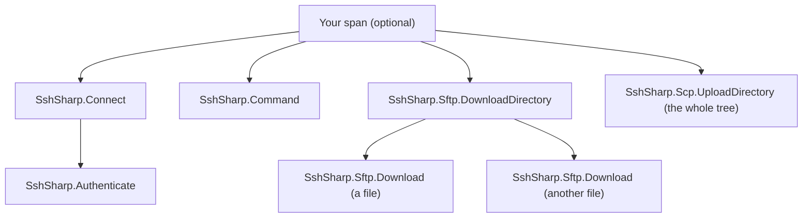

# Errors and diagnostics

## Exceptions

Everything SshSharp raises for SSH-level problems is an `SshException` with a `Reason`:

| `SshFailureReason` | Meaning | Type |
|---|---|---|
| `ConnectFailed` | The TCP connection (or ProxyJump hop, or ProxyCommand) could not be established | `SshException` |
| `HostKeyRejected` | The host key verifier refused the server's key; `HostKey` has the key | `SshHostKeyException` |
| `AuthenticationFailed` | No credential was accepted; `AllowedMethods` lists what the server takes, `Attempts` what was tried and why each attempt failed | `SshAuthenticationException` |
| `KeyExchangeFailed` | No common algorithms, or the key exchange failed | `SshException` |
| `ProtocolError` | The server sent something that violates the protocol | `SshProtocolException` |
| `ConnectionClosed` | The connection was lost or the server disconnected | `SshException` |
| `ChannelClosed` | A channel was refused or closed (for example the server refused a command or a terminal) | `SshException` |
| `Timeout` | `ConnectTimeout` passed, or the server missed `KeepAliveCountMax` keep-alives | `SshException` |
| `AgentFailed` | The SSH agent could not be reached or refused a request | `SshException` |
| `TransferFailed` | An SCP transfer failed on the server's side (a missing file, no permission; the message has the server's words), or an SCP or SFTP directory download met a name it will not write (`..`, a path separator, a device name) | `SshException` |
| `SftpFailed` | An SFTP request failed; `Status` has the server's status code (`NoSuchFile`, `PermissionDenied`, ...) and `Path` the path | `SftpException` |
| `Unknown` | Not otherwise classified | `SshException` |

```csharp
try
{
    await using var client = await SshClient.ConnectAsync("prod-db");
}
catch (SshHostKeyException ex)
{
    Console.Error.WriteLine($"Host key not trusted: {ex.HostKey?.Fingerprint}: {ex.Message}");
}
catch (SshAuthenticationException ex)
{
    Console.Error.WriteLine($"Login failed; the server accepts {string.Join(", ", ex.AllowedMethods)}.");
}
catch (SshException ex) when (ex.Reason is SshFailureReason.ConnectFailed or SshFailureReason.Timeout)
{
    Console.Error.WriteLine($"Unreachable: {ex.Message}");
}
```

Cancellation is reported as `OperationCanceledException`, and invalid arguments as `ArgumentException`, as usual in .NET.
`RunCommandAsync` throws `InvalidOperationException` when a command's output exceeds `SshClientOptions.MaxCommandOutputBytes`
(a safety limit, not a connection problem): stream such output with `StartCommandAsync` instead.

## Logging

Pass an `ILogger` (`Microsoft.Extensions.Logging`) in `SshClientOptions.Logger` or `SshConfigConnectOptions.Logger`:

```csharp
using var loggerFactory = LoggerFactory.Create(builder => builder.AddConsole().SetMinimumLevel(LogLevel.Debug));
var options = new SshClientOptions
{
    UserName = "deploy",
    Password = password,
    HostKeyVerifier = verifier,
    Logger = loggerFactory.CreateLogger("SshSharp"),
};
```

Information: connected (algorithms and host key fingerprint), authenticated (method), identity files and agent keys that
were skipped, host keys recorded by `UpdateHostKeys`, forwardings started (never with a socket path), connection attempts that will be tried again (`ConnectionAttempts`). Debug: key exchanges, rekeys, channels, sessions, authentication
attempts. Logs never contain passwords, private keys, command text or user names. An agent that cannot be reached is logged
without its socket or pipe path, which can hold the user's name (Pageant's pipe does): a system error shows as its type or socket
error code (`Could not reach the SSH agent (socket error ConnectionRefused).`).

## Tracing and metrics

SshSharp publishes an `ActivitySource` and a `Meter` named `SshTelemetry.SourceName` (`"SshSharp"`). With OpenTelemetry:

```csharp
builder.Services.AddOpenTelemetry()
    .WithTracing(tracing => tracing.AddSource(SshTelemetry.SourceName))
    .WithMetrics(metrics => metrics.AddMeter(SshTelemetry.SourceName));
```

| Activity | Kind | Tags |
|---|---|---|
| `SshSharp.Connect` | Client | `network.protocol.name` (`ssh`), `network.protocol.version` (`2.0`), `network.transport` (`tcp`) and `server.port` when SshSharp makes a direct TCP connection (not through a proxy, `ProxyCommand` or `ProxyJump`, nor over your own stream), `ssh.kex`, `ssh.kex.post_quantum`, `ssh.cipher`, `ssh.host_key.type`; on failure `error.type` |
| `SshSharp.Authenticate` | Internal | Inside `SshSharp.Connect`, from the `ssh-userauth` service request to the end of authentication: `ssh.auth.method` (the method that completed it: `password`, `publickey`, `keyboard-interactive`, `gssapi-with-mic`, or `none` on a server that lets anyone in), `ssh.auth.attempts` (the authentication requests sent with a credential; the first `none` request, which only asks for the methods, is not counted, a key held by an agent or a signer can take two, a query and then the signature, and a password change is one more); on failure `error.type` |
| `SshSharp.Command` | Internal | `ssh.command.exit_status`; on failure `error.type` |
| `SshSharp.Sftp.Upload` / `SshSharp.Sftp.Download` | Internal | One per `UploadAsync`, `UploadFileAsync`, `DownloadAsync` and `DownloadFileAsync` (and the conveniences built on them, such as `WriteAllBytesAsync`): `ssh.sftp.bytes` (what the call returns); on failure `error.type` |
| `SshSharp.Sftp.UploadDirectory` / `SshSharp.Sftp.DownloadDirectory` | Internal | One per `UploadDirectoryAsync` and `DownloadDirectoryAsync`, with a file span inside it for each file: `ssh.sftp.bytes`, `ssh.sftp.files`, `ssh.sftp.directories` (as in `SftpTransferSummary`); on failure `error.type` |
| `SshSharp.Scp.Upload` / `SshSharp.Scp.Download` | Internal | One per SCP `UploadAsync`, `UploadFileAsync`, `DownloadAsync` and `DownloadFileAsync` (`SshScpExtensions`): `ssh.scp.bytes` (the file data moved); on failure `error.type` |
| `SshSharp.Scp.UploadDirectory` / `SshSharp.Scp.DownloadDirectory` | Internal | One per SCP `UploadDirectoryAsync` and `DownloadDirectoryAsync`: `ssh.scp.bytes`, `ssh.scp.files`, `ssh.scp.directories` (directories below the top one, as SFTP counts them); on failure `error.type`. The whole tree goes through one `scp` run, so its files are not spans of their own |

| Instrument | Unit | Description |
|---|---|---|
| `sshsharp.connections` | `{connection}` | Open connections |
| `sshsharp.connect.duration` | `s` | Time to connect, exchange keys and authenticate, successful (tagged `ssh.kex.post_quantum`) or not (tagged `error.type`) |
| `sshsharp.bytes.sent` / `sshsharp.bytes.received` | `By` | Message payload bytes, across connections (each connection's own are `SshClient.BytesSent` and `BytesReceived`); with compression on, the uncompressed sizes |
| `sshsharp.key_exchanges` | `{exchange}` | Completed key exchanges |
| `sshsharp.channels` | `{channel}` | Open channels |
| `sshsharp.commands` | `{command}` | Commands run, tagged `result` (`success`, `failure` for a non-zero exit status, `error`) and, for errors, `error.type` |
| `sshsharp.sftp.bytes` | `By` | File data moved by SFTP transfers (the methods of the transfer spans above), tagged `ssh.sftp.direction` (`upload`, `download`). Counted as it moves, so a transfer that fails counts what it moved first; an upload counts what the server acknowledged. Reads and writes through `OpenAsync`'s streams are not counted |
| `sshsharp.scp.bytes` | `By` | File data moved by SCP transfers, tagged `ssh.scp.direction` (`upload`, `download`). Counted as it moves, so a transfer that fails counts what it moved first. SCP acknowledges a file only once all of it has arrived, so an upload counts what was written to the channel |
| `sshsharp.forwarding.connections` | `{connection}` | Forwarded connections, tagged `ssh.forwarding.type` and `result`: `opened` when one reaches its destination (or its handler), `failed` when it does not (the server refuses the channel, nothing listens at the local destination, a SOCKS request is refused or malformed, a forwarding's connection limit is reached). Connections cut short because their forwarding is stopping are not counted |
| `sshsharp.forwarding.active` | `{connection}` | Open forwarded connections, tagged `ssh.forwarding.type` |
| `sshsharp.keep_alive.round_trip_time` | `s` | Time from a keep-alive probe (`KeepAliveInterval`) to the server's answer: a `ping@openssh.com` transport ping where the server has one, otherwise the `keepalive@openssh.com` request. A ping sent while the last one is still unanswered is not timed. `PingAsync` returns its own round trip and is not recorded here |
| `sshsharp.connection_provider.reconnects` | `{reconnect}` | `SshSharp.Extensions.DependencyInjection`: attempts of `ISshConnectionProvider` to replace a shared connection that ended, tagged `result` (`success`, `error`) and, for errors, `error.type`. The first connection, and attempts before any connection was made, are not counted. Its meter has the name `SshTelemetry.SourceName` too, so `AddMeter(SshTelemetry.SourceName)` collects it |

`ssh.forwarding.type` is `local` (`ForwardLocalPortAsync`, `ForwardLocalUnixSocketAsync` and `LocalForward`), `dynamic` (a local SOCKS
proxy, `ForwardDynamicPortAsync` and `DynamicForward`), `remote` (`ForwardRemotePortAsync`, `ForwardRemoteUnixSocketAsync`, a
forwarding to a handler, and `RemoteForward` with a destination) or `remote_dynamic` (`ForwardRemoteDynamicPortAsync`, and
`RemoteForward` without one). `OpenTcpTunnelAsync` and `OpenUnixSocketTunnelAsync` are channels of their own, counted in
`sshsharp.channels` only.

The spans nest like this; each file of an SFTP directory transfer is a span of its own, while an SCP directory transfer is one
span:



`error.type` follows OpenTelemetry's semantic conventions: an `SshException`'s `Reason` (`AuthenticationFailed`, `Timeout`,
`HostKeyRejected`, ...), otherwise the exception's type name; failed spans also get the `Error` status. The connect span and
duration start before the network connection, so a refused connection, a DNS failure or a proxy that fails are recorded too; with
`ProxyJump`, each jump host's connect is a span of its own inside the destination's. `server.address` is not
recorded, because this library never records host names (see the [threat model](threat-model.md)). To have it, add it to a parent
span of your own, or in an `ActivityListener`:

```csharp
using var span = MyActivitySource.StartActivity("connect to build host");
span?.SetTag("server.address", host);
await using var client = await SshClient.ConnectAsync(host, 22, options);
```

For the same reason, no span or instrument records a user name, a file or directory path (SFTP or SCP), a forwarding's addresses, ports or
socket paths, a SOCKS destination, or the name of a dependency injection endpoint (often a host name). Add what your policy allows
to a span of your own around the call, as above.

Nothing is recorded unless something listens.

## See also

- [Errors and failure reasons](reference/errors.md): every reason, and what to do about it
- [Logging and diagnostics](how-to/logging-and-diagnostics.md): short examples, including listeners without OpenTelemetry
- [Troubleshooting](reference/troubleshooting.md)
