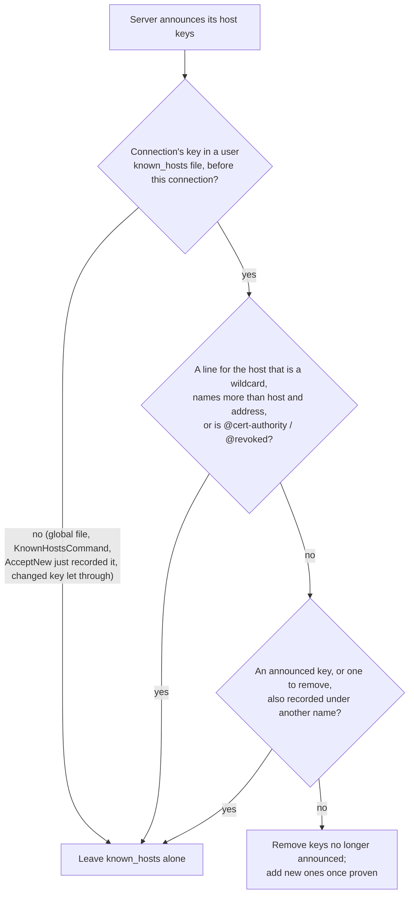
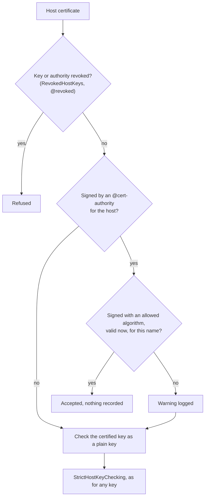

# Host keys

Host key verification is what stops a man-in-the-middle, so `SshClientOptions.HostKeyVerifier` is required. The verifier
sees the host, port, alias and the key (or host certificate) the server proved it holds, and returns a verdict.

## `known_hosts`

```csharp
// ~/.ssh/known_hosts plus the system file, with OpenSSH's policies.
var verifier = KnownHostsVerifier.ForCurrentUser(StrictHostKeyChecking.Yes);

// Or name the files.
var custom = new KnownHostsVerifier(["/etc/myapp/known_hosts"])
{
    Policy = StrictHostKeyChecking.AcceptNew,
    HashNewEntries = true, // HashKnownHosts yes
};
```

| Policy | Known key | Unknown host | Changed key |
|---|---|---|---|
| `Yes` | accepted | rejected | rejected |
| `AcceptNew` | accepted | recorded and accepted, unless another key type is already known for the host | rejected |
| `Ask` (default) | accepted | `AskHostKey` decides (rejected without it); recorded when accepted | rejected |
| `No` | accepted | accepted and recorded | accepted (not recorded) |

`No` turns off protection against a changed key, so use it only where interception is not a concern. `@revoked` entries
reject a key in every mode, and one written without a port (`@revoked server.example <key>`) rejects it on every port of the
host, as in OpenSSH 10.6p2. `@cert-authority`
entries accept host certificates signed by that authority for the host (one that cannot be used falls back to its plain key,
[as in `ssh`](#host-certificates-that-cannot-be-used)). The `known_hosts` format is fully supported:
hashed hosts, `[host]:port`, wildcards and negation.

```csharp
var verifier = new KnownHostsVerifier([knownHostsPath])
{
    Policy = StrictHostKeyChecking.Ask,
    AskHostKey = (prompt, ct) =>
    {
        Console.WriteLine($"Unknown host key {prompt.Context.HostKey.KeyType} {prompt.Context.HostKey.Fingerprint}.");
        if (prompt.KnownKeyTypes.Count > 0)
        {
            Console.WriteLine($"Already known for this host: {string.Join(", ", prompt.KnownKeyTypes)}.");
        }

        return ValueTask.FromResult(Confirm("Trust it?"));
    },
};
```

`UpdateHostKeys = true` (`UpdateHostKeys yes`) keeps `known_hosts` in step with the keys the server announces after login:
keys it proves it holds are added, and this host's keys it no longer announces are removed (that needs no proof, as in `ssh`), so
a key rotation does not break the next connection. Only the first user file changes, and never the key the connection was
verified with. To confirm changes first (as `UpdateHostKeys ask`), set `ConfirmHostKeyUpdate`:

```csharp
var verifier = new KnownHostsVerifier([knownHostsPath])
{
    UpdateHostKeys = true,
    ConfirmHostKeyUpdate = (update, ct) => ValueTask.FromResult(
        Confirm($"Update known_hosts for {update.Host}: add {string.Join(", ", update.Added)}; remove {string.Join(", ", update.Removed)}?")),
};
```

As `ssh` does, the update leaves `known_hosts` alone when it cannot tell what a change would mean for other hosts or names, or when
the connection was not trusted through the user's own file:



- **The connection's key comes from the user's file.** A key trusted through `GlobalKnownHostsFile` or `KnownHostsCommand`, or a
  changed key let through by `StrictHostKeyChecking no`, updates nothing. A key that `AcceptNew` records is trusted on first use
  only, so that connection records it and nothing else; the update starts with the next connection. A key you accept at the
  `AskHostKey` prompt counts as confirmed, and updates on the same connection.
- **Only lines `ssh` writes itself.** One `@cert-authority` or `@revoked` line for the host (even `@cert-authority *.example.com`),
  a wildcard line, or a line naming more than `host,address` cancels the whole update: those lines are yours, and may stand for
  other hosts too.
- **One key, one set of names.** When an announced key, or a key about to be removed, is also recorded under another name or
  address, nothing changes, so the names of one host do not end up with different keys.
- **Host certificates** are never used for an update.

> [!WARNING]
> Behind a load balancer, each backend announces only its own keys. With the keys of all backends pinned under one name, one
> connection removes the others' keys, and the next connection to another backend fails with "the key changed". Use a host
> certificate there, or leave `UpdateHostKeys` off for that host.

### Host certificates that cannot be used

A certificate from a trusted authority can still be unusable: expired, not yet valid, not issued for the name connected to (an
IP address or a short name, when the certificate lists the full name), or signed with an algorithm `CASignatureAlgorithms` leaves
out ([`SshClientOptions.CASignatureAlgorithms`](how-to/algorithms-and-authentication-order.md#trust-host-certificates-only-from-some-kinds-of-authority)
<span class="badge text-bg-primary">1.2</span>, an Ed25519-only policy, say). As `ssh` does, the verifier then logs a warning (the key's
and the authority's fingerprints and the problem, never the host name) and checks the certified key as a plain key, exactly as it
checks the key of a certificate from an authority `known_hosts` does not list:



So a host whose plain key is also in `known_hosts` keeps connecting when its certificate expires. Without that line, the key is
an unknown key: `Yes` refuses it, and the refusal says why the certificate could not be used; `AcceptNew` and `No` record it, and
`Ask` offers it to `AskHostKey`, as `ssh` does. What is recorded is the plain key, never the certificate. A revoked key or
authority (`@revoked`, `RevokedHostKeys`) is refused with no fallback. To accept only certificates, use `StrictHostKeyChecking.Yes`
and keep plain lines for the host out of `known_hosts`, or [write a verifier](how-to/verify-host-keys.md#write-a-verifier).

### Revoked host keys

`RevokedHostKeys` (ssh_config's `RevokedHostKeys`) names a file of host keys never to accept, checked before anything else
and in every mode, even for a key `known_hosts` trusts:

```csharp
var verifier = new KnownHostsVerifier([knownHostsPath]) { RevokedHostKeys = "/etc/ssh/revoked_host_keys" };
```

The file is an OpenSSH Key Revocation List, the binary file `ssh-keygen -k` writes, or a list of public keys, one per line as
in `authorized_keys` (as with ssh, lines that do not parse are skipped, except a certificate line whose key cannot be read, which
refuses the file; a certificate line revokes the key it certifies). A KRL can revoke:

- plain keys, by the key itself or by its SHA-1 or SHA-256 fingerprint;
- host certificates, by serial number (single, range or bitmap) or key id, for one certificate authority or for any.

A host certificate is also refused when its certified key or its authority's key is revoked. The refusal reads as ssh's:
`Host key ssh-ed25519 SHA256:... revoked by file (RevokedHostKeys).` The file's path is left out: it comes from ssh_config, often
with the home directory (and so the user's name) in it.

As with ssh, a file that cannot be read, or a KRL that is malformed or uses a section or critical extension this library does
not know, refuses every host key ("Error checking host key ... in the revoked keys file (RevokedHostKeys): ..." and what is wrong,
such as "the file does not exist"): a revocation list that cannot be checked must not let a revoked key through. In a text list of
keys, a malformed certificate line of a type SshSharp accepts (Ed25519, ECDSA, RSA, FIDO) does the same, while lines that are not
keys, plain keys that do not parse and certificates of types SshSharp never accepts (DSA) are skipped, as OpenSSH skips them. A KRL's signature sections are read but not verified; the file is trusted as local
configuration. `UpdateHostKeys` never learns a revoked key.

To check a key or certificate against such a file yourself (a user's, in a bastion or a portal, as sshd's `RevokedKeys` does), use
`SshKeyRevocationList`; see [Certificates: check revocation](how-to/certificates.md#check-revocation).

## Pinning

```csharp
var verifier = SshHostKeyVerifier.Pinned("SHA256:47DEQpj8HBSa+/TImW+5JCeuQeRkm5NMpJWZG3hSuFU");
```

Or pin the keys themselves, read from the server's `.pub` files with `SshPublicKey.Parse`; the server's key must then be one of
them byte for byte (the certified key, for a host certificate):

[!code-csharp[](snippets/HostKeys.cs#pinned-keys)]

## Your own rule

```csharp
var verifier = SshHostKeyVerifier.FromDelegate(async (context, ct) =>
    await myInventory.IsTrustedAsync(context.Host, context.HostKey.Fingerprint, ct));
```

Or derive from `SshHostKeyVerifier` and return `SshHostKeyVerdict.Accept()` or `SshHostKeyVerdict.Reject(reason)`; the
reason ends up in the `SshHostKeyException`.

## Scanning a server's keys

`SshClient.ScanHostKeysAsync` fetches a server's host keys without logging in, as `ssh-keyscan` does. It runs one key exchange
for each key type the server has and disconnects before authentication:

```csharp
var keys = await SshClient.ScanHostKeysAsync("new-server.example.com");
foreach (var key in keys)
{
    Console.WriteLine($"{key.KeyType} {key.Fingerprint}");
    await KnownHostsFile.AppendAsync(knownHostsPath, "new-server.example.com", 22, key.GetPublicKey(), hash: true);
}
```

Each key is one the server proved it holds, but a scan cannot tell whether you reached the right server. Compare the fingerprints
with ones you got another way (the server's console or its provisioning output) before you trust them, or use host certificates.

`SshHostKeyScanOptions` limits the scan to some algorithms (`HostKeyAlgorithms`), adds host certificates (`IncludeCertificates`),
or keeps to FIPS-approved algorithms (`FipsMode`); `Timeout` bounds each connection (5 seconds, as `ssh-keyscan -T`;
`Timeout.InfiniteTimeSpan` for none). For a host behind a jump host, pass a callback that opens each connection:
`SshClient.ScanHostKeysAsync(ct => new ValueTask<Stream>(jump.OpenTcpTunnelAsync("internal-host", 22, ct)))`.

## After connecting

`client.HostKey` is the verified key (`KeyType`, `Algorithm`, `Fingerprint`, `PublicKey`, `KeySizeBits`, and `Certificate`
when the server presented a host certificate). `Algorithm` is the signature algorithm the server used (`rsa-sha2-512`), `KeyType`
the key's type (`ssh-rsa`).

`client.HostKey.GetPublicKey()` gives the key as an `SshPublicKey`: equal to another `SshPublicKey` when the key bytes are, with
`ToAuthorizedKeysLine()` for the `<type> <base64>` text and `GetFingerprint(HashAlgorithmName.MD5)` for the legacy `MD5:aa:bb:...`
form. `KnownHostsEntry.GetPublicKey()`, `KnownHostsEntry.ForHost(host, port, key)` and `new KnownHostsEntry(patterns, key)`,
`KnownHostsFile.Add(host, port, key)`, `KnownHostsFile.AppendAsync(path, host, port, key)` and `KnownHostsFile.Check(host, port, key)`
work with the same type, and `SshCertificate.GetPublicKey()` and `GetAuthorityKey()` give a certificate's two keys. To check a host
certificate outside a connection, as `KnownHostsVerifier` does, use
`certificate.IsValidFor(ca, SshCertificateType.Host, hostName, now, out var reason)`; to issue one, see
[Certificates](how-to/certificates.md#act-as-a-certificate-authority).

[!code-csharp[](snippets/HostKeys.cs#compare-key)]

## See also

- [Verify host keys](how-to/verify-host-keys.md): choosing a policy, with short examples
- [Configuration files: known_hosts](config-files.md#known_hosts)
- [Security model](concepts/security-model.md)
