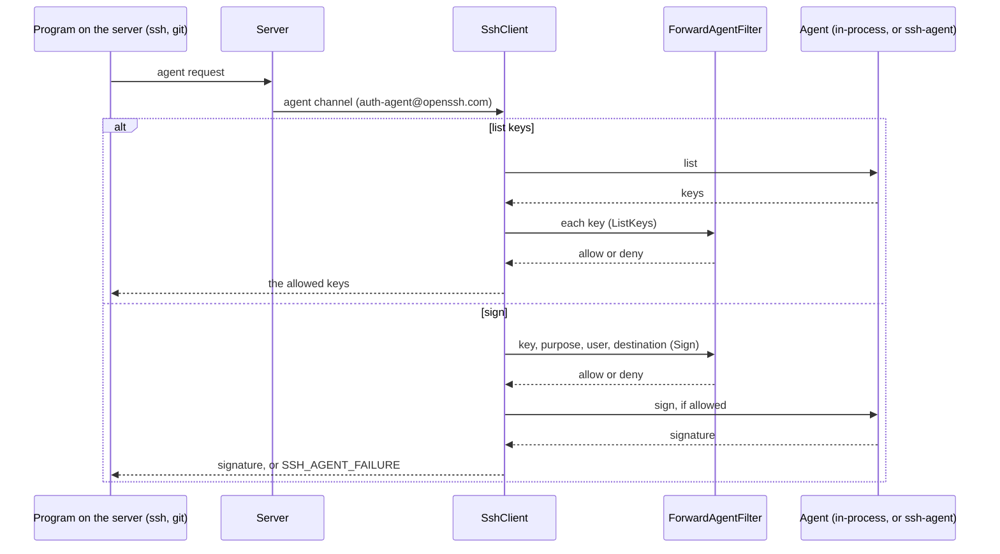

# Keys and the SSH agent

Public-key authentication is the usual way to log in to SSH servers. SshSharp loads key files, uses the keys an SSH agent holds,
generates new keys, and signs with keys that never leave a TPM, smart card, HSM or cloud key service.

## When to use which

| Where the key lives | Use |
|---|---|
| A file (`~/.ssh/id_ed25519`, a `.pem`, a PuTTY `.ppk`) | `SshPrivateKey.LoadAsync` |
| A secret store or CI variable | `SshPrivateKey.Parse` |
| `ssh-agent`, the Windows OpenSSH agent, or Pageant (including FIDO security keys) | `SshAgent.FromEnvironment()` and `GetKeysAsync` |
| A Windows key store, the TPM, a smart card | `SshPrivateKey.FromRsa` / `FromECDsa` with `RSACng` / `ECDsaCng` |
| A cloud KMS, an HSM, a signing service | `SshPrivateKey.FromSigner` with your `SshKeySigner` |
| Any of these, served as an agent to forward (no `ssh-agent` running) | `SshAgent.FromKeys` |

Connecting by `ssh_config` alias needs none of this: `IdentityFile` and the agent are used automatically.

## Load a key file

[!code-csharp]

Formats: OpenSSH (`BEGIN OPENSSH PRIVATE KEY`, encrypted too), PKCS#8 (encrypted too), PKCS#1 and SEC1 PEM, and PuTTY `.ppk` versions
2 and 3. Key types: Ed25519, ECDSA (P-256, P-384, P-521) and RSA of 2048 bits or more.

## Load a key from a secret

[!code-csharp]

## Use the SSH agent

[!code-csharp]

Agent keys work wherever key files do, including with certificates and for [signing files](../signing.md). FIDO security keys
(`sk-ssh-ed25519@openssh.com`, `sk-ecdsa-sha2-nistp256@openssh.com`) work through the agent: the agent and a touch of the key make
each signature.

## Forward the agent

[!code-csharp]

> [!WARNING]
> While you are connected, anyone with enough rights on the server can ask your forwarded agent to sign (they cannot read the keys).
> Forward only to servers you trust, and narrow what they can do: with a [filter](#decide-what-a-forwarded-agent-may-do), or with
> keys added with destination constraints
> ([`SshAgentKeyConstraints.Destinations`](../authentication.md#managing-the-agents-keys)).

## Serve an agent from your own keys

`SshAgent.FromKeys` makes an agent in your process from any keys SshSharp holds: key files, generated keys, keys in the Windows key
store, keys behind an `SshKeySigner` (a cloud KMS, an HSM), and keys paired with certificates. Use it wherever an `SshAgent` goes:
authenticate through it, and forward it, so `ssh` and `git` on the server can use keys that are in no agent process, from a container
or a service where none runs.

[!code-csharp]

When to use it:

- **Forwarding a key that is not in an agent:** a KMS or HSM key, a deploy key from a secret store, a key generated for one job.
- **No agent process:** containers, services, CI runners.
- **Authenticating only:** it works, but passing the keys in `PrivateKeys` directly does the same with less machinery.

It answers as `ssh-agent` does, read-only:

- It lists its keys (a key paired with a certificate twice, as `ssh-add` adds it: the key, then the certificate) and signs with them.
- RSA keys sign with `rsa-sha2-256` or `rsa-sha2-512`, as the request asks; a request for SHA-1 `ssh-rsa` is refused.
- Like `ssh-agent`, it signs whatever data it is asked to: login requests, SSH signatures (`ssh-keygen -Y sign`, `git` commit
  signing), certificates (`ssh-keygen -s` with `-U`), and other programs' own formats, such as pam_ssh_agent_auth's challenge for
  `sudo`. A key behind an `SshKeySigner` sees data of another form as `SshSignaturePurpose.Other`, and a
  [filter](#decide-what-a-forwarded-agent-may-do) can limit a forwarded agent to the purposes you know.
- It binds connections to sessions (`session-bind@openssh.com`) and answers RFC 9987's `query`. On a connection bound for a login,
  it signs only that session's login request, as `ssh-agent` does for destination-constrained keys.
- Adding, removing and locking keys are refused (`AddKeyAsync` and the others throw `SshException` with `AgentFailed`).

`IsInProcess` tells such an agent from one reached through a socket or pipe, and its `Path` is `(in-process)`.

## Decide what a forwarded agent may do

`ForwardAgentFilter` sees every request that programs on the server make of the forwarded agent, an in-process one or a real one, and
decides it. It gets an `SshAgentRequest`:

| Member | What it is |
|---|---|
| `Operation` | `ListKeys` (asked once for each key in a listing) or `Sign` |
| `Key`, `Certificate` | The key (with its comment, when known), and the certificate when the agent's identity is one |
| `Purpose`, `Namespace`, `UserName` | For a signature: a login (with the user name it logs in as), an SSH signature (with its namespace), a certificate, or null for data of any other form |
| `DestinationHostKey` | The host key of the server being logged in to, when the program bound its agent connection to that session (OpenSSH 8.9 and later do), verified |
| `ForwardingHostKeys` | The servers the agent was forwarded through, starting with the one this client connected to |

[!code-csharp]

Data that is not a login request, an SSH signature or a certificate reaches the filter with a null `Purpose`. Programs sign their own
formats through agents (pam_ssh_agent_auth, for `sudo` through the forwarded agent), so the filter decides. To restrict a forwarded
agent to known purposes, allow only those; this policy allows logins and SSH signatures and refuses certificates and unknown data:

[!code-csharp]

The filter can be asynchronous, to ask the user before each signature, as `ssh-add -c` does:

[!code-csharp]

Listing and signing are decided separately. A key the filter refuses to list is hidden, but a public key is no secret, so a sign
request can name a key that was never listed: every signature is decided on its own. To confirm each use as `ssh-add -c` does, allow
every listing and decide at sign time; to hide a key from the server altogether, refuse it in both.

With a filter, the forwarded agent is read-only and narrowed, whichever agent it is:

- Requests to add, remove or lock keys are refused; they never reach a real agent.
- RSA keys never sign with SHA-1: a request without a SHA-2 flag is refused and never reaches a real agent.
- A login request on a connection bound to a session must be for that session, and a host-bound one must name its host key.
- Keys whose type `SshPublicKey` does not read (DSA in a real agent, security-key certificates) are hidden and cannot sign.
- Anything the filter throws refuses the request (logged at Warning); refused requests are logged at Information with the key's
  fingerprint.

Without a filter, a real agent's connection is relayed byte for byte, as `ssh -A` relays it. The filter applies only to requests
that come through agent forwarding; this client's own authentication through an agent is not filtered.

## Add a key to the agent

[!code-csharp]

## Generate a key

[!code-csharp]

`SaveAsync` writes the private key in the OpenSSH format (encrypted with `aes256-ctr` and `bcrypt_pbkdf` when given a passphrase),
readable only by the current user, and the public key next to it as `.pub`. It never overwrites an existing file.

## Read a public key and its fingerprint

`SshPublicKey` is a public key on its own: a `.pub` file, an `authorized_keys` line, or the key of a private key
(`GetPublicKey()`), an agent key, a host key or a `known_hosts` entry.

[!code-csharp]

`SshPublicKey.Parse` reads the plain `<type> <base64> [comment]` form. It refuses `authorized_keys` options in front of the key
(`restrict,command="..." ssh-ed25519 ...`) rather than drop them, so a key you write back out never loses its restrictions; pass the
key part of the line. `FromBlob` reads the SSH wire format (what the `PublicKey` members hold). A malformed key, a type name that does
not match the key, or a type SshSharp does not read fails with `FormatException`; `TryParse` returns false instead.

The types it reads are Ed25519, ECDSA (nistp256, nistp384, nistp521), RSA, and the FIDO security-key types
`sk-ssh-ed25519@openssh.com` and `sk-ecdsa-sha2-nistp256@openssh.com`. Certificates (`-cert.pub`) are `SshCertificate.Parse`'s.

To check a signature that the key's holder made (an agent's, or one from your `SshKeySigner`):

[!code-csharp]

A security key's signatures carry authenticator data (a user-presence flag and a counter) that `VerifySignature` does not check:
for those keys it throws `NotSupportedException`. For signed files and commits, use [`SshSignature`](../signing.md), which also
checks the namespace.

## Use a key in the Windows key store or the TPM

[!code-csharp]

The same works with `ECDsaCng` and `SshPrivateKey.FromECDsa`, and with any software `RSA` or `ECDsa`. The
[sample tool](https://github.com/zcsizmadia/SshSharp/tree/main/samples/SshSharp.Samples)'s `run-cng` command logs in this way.

## Use a key held by a remote service

Derive from `SshKeySigner`: SshSharp gives it each request to sign, with the algorithm and what the signature is for, and checks
the answer against the public key before using it.

[!code-csharp]

[!code-csharp]

## Notes and pitfalls

- **Order.** Keys are tried in the order given. A key held in your process signs its request straight away; an agent's or a
  signer's key is offered first and signs only if the server would accept it (see
  [Signing straight away, or asking first](../authentication.md#signing-straight-away-or-asking-first)). A
  server that allows few attempts (sshd's `MaxAuthTries`, 6 by default) may disconnect before it reaches a key late in a long
  list: put the right key first.
- **Dispose keys.** Disposing a loaded key clears its private key material. The client does not dispose the keys you pass it.
- **RSA.** RSA keys sign with `rsa-sha2-256` or `rsa-sha2-512`, never SHA-1 `ssh-rsa`. Keys under 2048 bits are refused.
- **ssh.com format** keys are not read; convert them with `ssh-keygen -i`.
- **Never log a key.** `ToOpenSshPrivateKey` returns the private key's text, for a secret store.
- **An in-process agent holds its keys in your process.** Keys loaded from files stay in memory while the agent is used, and it
  does not dispose them: keep them alive as long as the clients that forward it, and dispose them afterwards. For sensitive keys,
  serve a key behind an `SshKeySigner` (a KMS, an HSM), whose private half never enters the process.
- **The filter runs on the connection's background work,** for several agent channels at once, with a token that is cancelled when the
  connection closes. Keep it quick, or make it asynchronous: a slow answer holds that one agent request, not the connection.

## See also

- [Authentication](../authentication.md) (in-depth: method order, agent constraints, keyboard-interactive, banners)
- [Certificates](certificates.md)
- [Signing files and commits](../signing.md)
- [Scenario: a KMS-held key forwarded through a bastion](../scenarios/kms-agent-forwarding.md)
- [Threat model: agent forwarding](../threat-model.md#channels-the-server-opens)
- <xref:SshSharp.SshPrivateKey>, <xref:SshSharp.SshPublicKey>, <xref:SshSharp.SshAgent> and <xref:SshSharp.SshKeySigner> in the API
  reference
