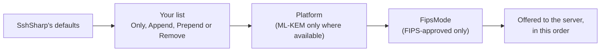

# Choose algorithms and authentication methods

SshSharp's defaults are modern only and need no tuning for most servers. When a policy, an audit or an odd server asks for more
control, `SshClientOptions` takes the same settings as `ssh_config`, typed:

| `SshClientOptions` | `ssh_config` | Sets |
|---|---|---|
| `KexAlgorithms` | `KexAlgorithms` | Key exchange methods offered. |
| `HostKeyAlgorithms` | `HostKeyAlgorithms` | Host key algorithms accepted. |
| `Ciphers` | `Ciphers` | Ciphers offered. |
| `Macs` | `MACs` | MACs offered (used only with the `aes*-ctr` ciphers). |
| `PreferredAuthentications` | `PreferredAuthentications` | Which authentication methods are tried, in what order. |
| `RequiredRsaSize` | `RequiredRSASize` | The smallest RSA host key accepted, in bits. |

## When to use

- A security policy rules algorithms out (no finite-field Diffie-Hellman, encrypt-then-MAC only), or lists the only ones allowed.
- You want to prefer an algorithm the defaults rank lower, such as AES-128-GCM on a CPU-bound link.
- A service account must log in with its key only, never fall back to a password prompt.
- Servers' RSA host keys must be larger than 2048 bits.

When you connect by `ssh_config` alias, the directives in the table apply instead; see
[Use ssh_config and known_hosts](ssh-config-and-known-hosts.md).

## Change the defaults, or replace them

An `SshAlgorithmList` takes one of `ssh_config`'s four forms:

| Form | `ssh_config` | Result |
|---|---|---|
| `SshAlgorithmList.Remove("a", "b*")` | `-a,b*` | The defaults without these. Wildcards `*` and `?` match several. |
| `SshAlgorithmList.Prepend("a")` | `^a` | The defaults, with these moved to the front. |
| `SshAlgorithmList.Append("a")` | `+a` | The defaults, with these added at the end. |
| `SshAlgorithmList.Only("a", "b")` | `a,b` | Exactly these, in this order. |

The first three follow the defaults as they change in later versions (a new post-quantum method, say); `Only` fixes the list. Every
name must be one SshSharp implements for that option (see [Algorithms](../reference/algorithms.md)): a typo or an unsupported
algorithm such as `aes128-cbc` throws `ArgumentException` when the option is set, with the supported names in the message. This
is stricter than `ssh_config`, where SshSharp ignores names it does not implement.

Remove what a policy rules out:

[!code-csharp]

Allow only a fixed set:

[!code-csharp]

Prefer an algorithm without dropping the others:

[!code-csharp]

Read a list from your own settings, in `ssh_config`'s syntax. `ToString()` writes it back the same way.

[!code-csharp]

## Choose the authentication methods

`PreferredAuthentications` lists the methods to try, in order: any of `gssapi-with-mic`, `publickey`, `keyboard-interactive` and
`password`. A method that is left out is never tried, even when its credentials are set:

[!code-csharp]

Without it, the client uses `ssh`'s order (see [Authentication](../authentication.md#the-order-methods-are-tried-in)). Either way, a
method is tried only when the server offers it and its credentials are set.

## Require larger RSA host keys

[!code-csharp]

A smaller RSA host key fails the connection with `SshFailureReason.HostKeyRejected`. The default is 2048 bits. The setting can go as
low as 1024 for an old device that cannot have a larger key, as `ssh_config`'s `RequiredRSASize` can, but no lower; prefer
replacing the key.

## Notes and pitfalls

- **No algorithm in common.** A list that leaves nothing the server offers fails the connection with
  `SshFailureReason.KeyExchangeFailed`, and the message lists what each side offered. A list that leaves nothing at all (for
  example `Only` with a cipher `FipsMode` excludes) throws `ArgumentException` before anything is sent.
- **FIPS mode still applies.** With `FipsMode = true`, the algorithms it excludes are removed from your lists too; see
  [FIPS mode](fips-mode.md).
- **ML-KEM needs the platform.** The `mlkem*` methods are accepted everywhere but offered only on .NET 10 with platform ML-KEM, so
  the same options work on .NET 8.
- **Host certificates.** When the host key verifier trusts a certificate authority for the host, the certificate versions of the
  allowed host key algorithms are asked for first, as `ssh` does. They may be listed in `HostKeyAlgorithms` too.
- **Strict key exchange** (the Terrapin fix) and `ext-info-c` are always offered; they are not part of `KexAlgorithms`.
- **What was negotiated:** `client.Algorithms`, also for an audit log.

## See also

- [Algorithms](../reference/algorithms.md): every algorithm, its default position, and whether FIPS mode allows it
- [FIPS mode](fips-mode.md)
- [Authentication](../authentication.md)
- <xref:SshSharp.SshAlgorithmList> and <xref:SshSharp.SshClientOptions> in the API reference
