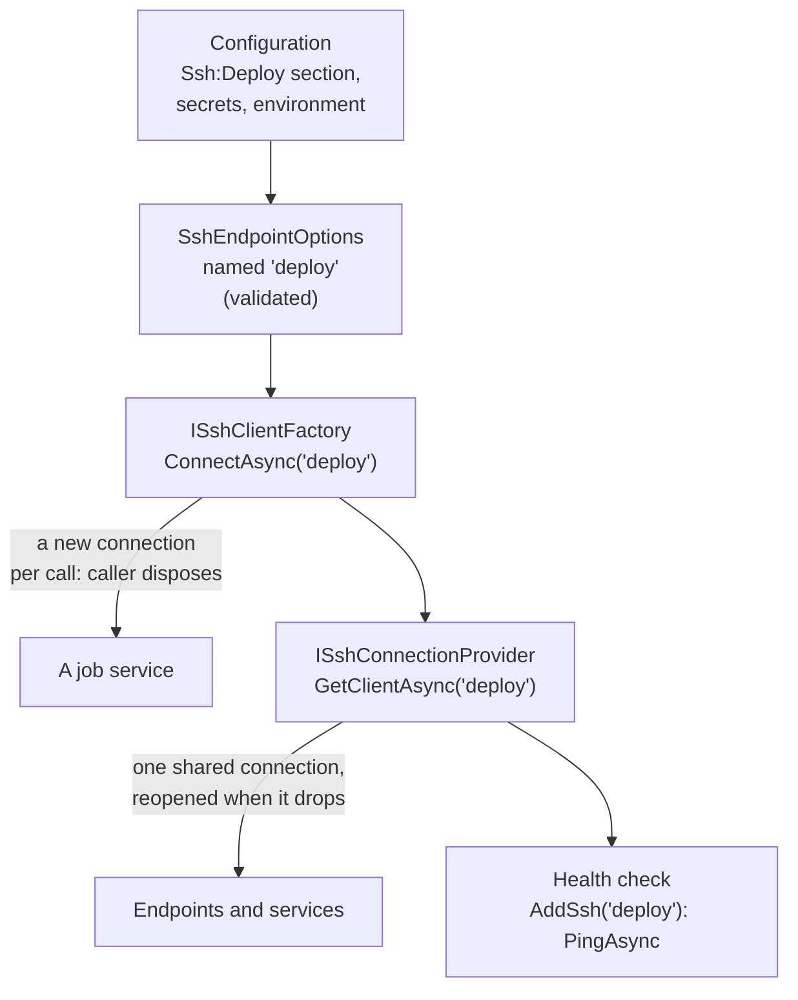

# ASP.NET Core and dependency injection

`SshSharp.Extensions.DependencyInjection` registers SSH endpoints with `Microsoft.Extensions.DependencyInjection`, the way
`AddHttpClient` registers HTTP clients: named endpoints bound from configuration, a factory for new connections, one shared
connection per endpoint that is opened again when it drops, and a health check.

```
dotnet add package SshSharp.Extensions.DependencyInjection
```

## When to use

- ASP.NET Core applications, worker services, and anything built on the generic host.
- Several components talk to the same servers, and the server details belong in configuration, not code.

## How it fits together



## Register endpoints

[!code-csharp[](../snippets/DependencyInjection.cs#register)]

```json
{
  "Ssh": {
    "Deploy": {
      "Host": "deploy.example.com",
      "UserName": "deploy",
      "PrivateKeyFiles": [ "~/.ssh/deploy_ed25519" ],
      "KnownHostsFiles": [ "/etc/myapp/known_hosts" ],
      "KeepAliveInterval": "00:00:30"
    }
  }
}
```

Keep secrets out of `appsettings.json`: bind `Password` or `PrivateKeyPassphrase` from user secrets in development
(`dotnet user-secrets set "Ssh:Deploy:Password" ...`) and from environment variables or a secret store in production.

## Use the shared connection

Most code should use `ISshConnectionProvider`: one connection per endpoint, shared by every caller (SSH runs many channels over one
connection at once), opened on first use and again after it drops.

[!code-csharp[](../snippets/DependencyInjection.cs#provider)]

[!code-csharp[](../snippets/DependencyInjection.cs#endpoint)]

## Open a connection of your own

`ISshClientFactory` opens a new connection on each call, which the caller owns. Use it for long jobs that should not share, or
for something that holds a session for the application's lifetime.

[!code-csharp[](../snippets/DependencyInjection.cs#factory)]

## Customize the client options

`ConfigureClientOptions` adjusts the `SshClientOptions` the endpoint builds: a different host key policy, a proxy, keys held
elsewhere:

[!code-csharp[](../snippets/DependencyInjection.cs#customize)]

## Notes and pitfalls

- **Do not dispose the shared client.** `GetClientAsync` returns a client the provider owns; the provider disposes it with the
  container. Dispose clients from `ISshClientFactory`.
- **No automatic retries.** After a drop, the next `GetClientAsync` reconnects (with a growing delay after failures; a call during
  the delay fails at once with the last error). A command that was running when the connection dropped fails, and your code
  decides whether to run it again.
- **Host keys.** Without `ConfigAlias`, the endpoint verifies against `KnownHostsFiles` (default `~/.ssh/known_hosts`) with
  `StrictHostKeyChecking yes`; `AcceptNewHostKeys` switches to `accept-new`. In a container, mount a `known_hosts` file.
- **`ConfigAlias`** connects through `ssh_config` instead; then `Host`, `Port`, `UserName`, `PrivateKeyFiles`, `KnownHostsFiles`,
  `AcceptNewHostKeys`, `KeepAliveInterval` and `ConfigureClientOptions` are not used.
- **Timeouts.** `ConnectTimeout` (30 s) bounds each attempt, authentication included, and fails with `TimeoutException`.
- **Health endpoints are often public.** The check's description names no server software; the exception is attached for logging,
  so keep it out of public responses.
- **Testing.** `ISshClientFactory` and `ISshConnectionProvider` are interfaces, but they return `SshClient`, which only a server can
  create. Put your own interface in front of the operations you use; see [Unit-test code that uses SshSharp](unit-testing.md).

## See also

- [Dependency injection](../dependency-injection.md) (in-depth: every setting)
- [A background worker](../scenarios/background-worker.md)
- The runnable [ASP.NET Core](https://github.com/zcsizmadia/SshSharp/tree/main/samples/SshSharp.Samples.AspNetCore) and
  [worker service](https://github.com/zcsizmadia/SshSharp/tree/main/samples/SshSharp.Samples.Worker) samples
