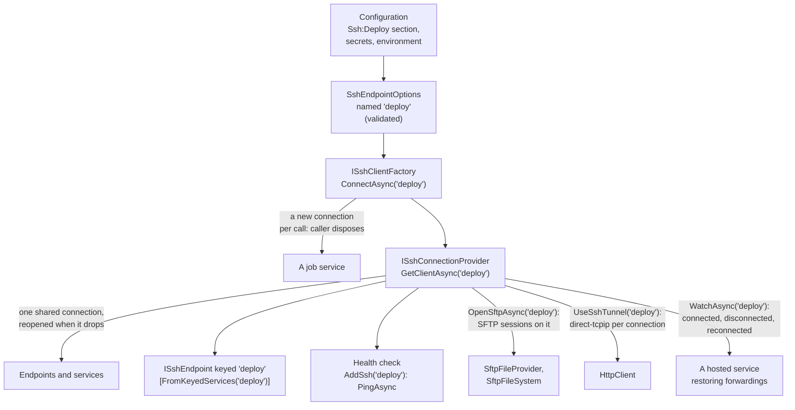

# ASP.NET Core and dependency injection

`SshSharp.Extensions.DependencyInjection` registers SSH endpoints with `Microsoft.Extensions.DependencyInjection`, the way
`AddHttpClient` registers HTTP clients: named endpoints bound from configuration, a factory for new connections, one shared
connection per endpoint that is opened again when it drops, and a health check.

```
dotnet add package SshSharp.Extensions.DependencyInjection
```

## When to use

- ASP.NET Core applications, worker services, and anything built on the generic host.
- Several components talk to the same servers, and the server details belong in configuration, not code.

## How it fits together



## Register endpoints

[!code-csharp[](../snippets/DependencyInjection.cs#register)]

```json
{
  "Ssh": {
    "Deploy": {
      "Host": "deploy.example.com",
      "UserName": "deploy",
      "PrivateKeyFiles": [ "~/.ssh/deploy_ed25519" ],
      "KnownHostsFiles": [ "/etc/myapp/known_hosts" ],
      "KeepAliveInterval": "00:00:30"
    }
  }
}
```

Keep secrets out of `appsettings.json`: bind `Password` or `PrivateKeyPassphrase` from user secrets in development
(`dotnet user-secrets set "Ssh:Deploy:Password" ...`) and from environment variables or a secret store in production.

## Run it in a container or Kubernetes

A pod gets secrets as values, not as files in `~/.ssh`, and has no `known_hosts` of its own. Give the endpoint the key's text
(`PrivateKeys`) and pin the server's host key (`HostKeyFingerprints`) instead:

```json
{
  "Ssh": {
    "Deploy": {
      "Host": "deploy.example.com",
      "UserName": "deploy",
      "HostKeyFingerprints": [ "SHA256:47DEQpj8HBSa+/TImW+5JCeuQeRkm5NMpJWZG3hSuFU" ]
    }
  }
}
```

The key and its passphrase are not in the file. Set them where the secrets live:

```shell
# Development: user secrets.
dotnet user-secrets set "Ssh:Deploy:PrivateKeys:0:Key" "$(cat ~/.ssh/deploy_ed25519)"
dotnet user-secrets set "Ssh:Deploy:PrivateKeys:0:Passphrase" "$(cat ~/.ssh/deploy_ed25519.passphrase)"

# A container: environment variables (a double underscore is the section separator).
Ssh__Deploy__PrivateKeys__0__Key=...
Ssh__Deploy__PrivateKeys__0__Passphrase=...
Ssh__Deploy__HostKeyFingerprints__0=SHA256:...
```

In Kubernetes, map a secret's entries to those variables:

```yaml
env:
  - name: Ssh__Deploy__PrivateKeys__0__Key
    valueFrom:
      secretKeyRef: { name: deploy-ssh, key: key }
  - name: Ssh__Deploy__PrivateKeys__0__Passphrase
    valueFrom:
      secretKeyRef: { name: deploy-ssh, key: passphrase }
```

The registration does not change. With `ValidateOnStart`, a malformed fingerprint, a key that cannot be read or a wrong passphrase
stops the start, with an error that names the entry and never shows the key or passphrase:

[!code-csharp[](../snippets/DependencyInjection.cs#containers)]

- **Fingerprints replace known_hosts.** Setting `KnownHostsFiles` or `AcceptNewHostKeys` as well fails validation. List more than one
  fingerprint to roll a host key over.
- **Keys from files come first.** `PrivateKeyFiles`, then `PrivateKeys`, then `Password`.
- **A proxy** is a setting too: `"Proxy": "http://proxy.example.com:3128"` (or `socks5://`). Bind it from a secret store if it
  carries a password.

The full rules, Key Vault names and the key-per-file provider are in
[Dependency injection: containers and Kubernetes](../dependency-injection.md#containers-and-kubernetes).

## Use the shared connection

Most code should use `ISshConnectionProvider`: one connection per endpoint, shared by every caller (SSH runs many channels over one
connection at once), opened on first use and again after it drops.

[!code-csharp[](../snippets/DependencyInjection.cs#provider)]

[!code-csharp[](../snippets/DependencyInjection.cs#endpoint)]

## Take an endpoint by name

Each endpoint is also a keyed service, `ISshEndpoint`, so a service names its endpoint once, where it is injected:

[!code-csharp[](../snippets/DependencyInjection.cs#keyed)]

`GetClientAsync` is the shared connection and `ConnectAsync` a new one, as on the provider and the factory; the keyed service is a
singleton over them.

## Use SFTP on the shared connection

`OpenSftpAsync(name)`, an extension method on `ISshConnectionProvider`, opens a new SFTP session on the endpoint's shared connection,
connecting first if it is down. The session is yours to dispose; the connection stays the provider's.

[!code-csharp[](../snippets/DependencyInjection.cs#sftp)]

It is also the session factory that lets the [file adapters](file-system-adapters.md#follow-a-connection-that-drops) follow the
shared connection: they keep one session, and open a new one on the reconnected connection after a drop. Static files from the server:

[!code-csharp[](../snippets/FileSystems.cs#file-provider)]

An `IFileSystem` for services that take one, owned by the container:

[!code-csharp[](../snippets/DependencyInjection.cs#file-system)]

- **Lifetime.** A provider or file system built this way owns its SFTP session: register it as a singleton (the container disposes
  it), or dispose it when the application stops. Register it with a factory delegate, as above, so the container owns it; an instance
  passed to `AddSingleton(instance)` is not disposed by the container.
- **One session per adapter.** Each adapter keeps its own SFTP session on the shared connection; SSH runs them side by side with the
  commands and other sessions on that connection.

## Call an internal API through the server

`UseSshTunnel` makes an `HttpClient` from `IHttpClientFactory` connect through an endpoint's shared connection, so it reaches a
service only the SSH server can reach, such as an API behind a bastion. No local port is opened.

[!code-csharp[](../snippets/DependencyInjection.cs#http-client)]

[!code-csharp[](../snippets/DependencyInjection.cs#http-client-use)]

The SSH server resolves the host name, and TLS runs end to end. See
[Dependency injection: HttpClient through an endpoint](../dependency-injection.md#httpclient-through-an-endpoint) for what happens
across a drop.

## Restore a forwarding after a reconnect

Forwardings, sessions and running commands end with their connection. `WatchAsync` reports the shared connection's changes, so a
hosted service can set them up again on each new connection:

[!code-csharp[](../snippets/DependencyInjection.cs#watch)]

```csharp
builder.Services.AddHostedService<ReverseTunnel>();
```

- **Connect, then watch.** The first event is the current state (`Connected`, or `Disconnected` when it dropped in between), so
  nothing is missed.
- **Watching does not reconnect.** After `Disconnected`, call `GetClientAsync` (here in a loop); `Reconnected` follows when it
  succeeds.
- **Events name the endpoint only.** No host or user name is in them; `Error` may hold the server's disconnect text, so log it rather
  than returning it to a caller.

## Reach the server through a bastion

`JumpHosts` lists bastions in configuration, each with its own user, keys and host key pins:

```json
{
  "Ssh": {
    "Deploy": {
      "Host": "app1.internal.example.com",
      "UserName": "deploy",
      "PrivateKeyFiles": [ "~/.ssh/deploy_ed25519" ],
      "KnownHostsFiles": [ "/etc/myapp/known_hosts" ],
      "JumpHosts": [ { "Host": "bastion.example.com", "UserName": "jump", "PrivateKeyFiles": [ "~/.ssh/jump_ed25519" ] } ]
    }
  }
}
```

The endpoint's password and keys never reach the bastion, and a hop without host key settings of its own is checked against the
endpoint's `KnownHostsFiles`. See [Dependency injection: jump hosts](../dependency-injection.md#jump-hosts).

## Use the SSH agent

`UseAgent` offers the agent's keys after the endpoint's own; the keys never enter the process:

[!code-csharp[](../snippets/DependencyInjection.cs#agent)]

The agent is an `SshAgent` registered in the container, if any (`SshAgent.FromKeys` serves keys held by the application), otherwise
the user's agent. A server process often has no agent; then the endpoint connects with its other credentials. See
[Dependency injection: the SSH agent](../dependency-injection.md#the-ssh-agent).

## Open a connection of your own

`ISshClientFactory` opens a new connection on each call, which the caller owns. Use it for long jobs that should not share, or
for something that holds a session for the application's lifetime.

[!code-csharp[](../snippets/DependencyInjection.cs#factory)]

## Customize the client options

`ConfigureClientOptions` adjusts the `SshClientOptions` the endpoint builds, for what the settings do not cover: a host key policy
of your own, keys held elsewhere (`SshPrivateKey.FromSigner`), a custom proxy. Pinned keys, keys as values, a proxy, jump hosts and
the agent need no code: they are settings. Keep what the endpoint built, jump hosts included:

[!code-csharp[](../snippets/DependencyInjection.cs#customize)]

## Notes and pitfalls

- **Do not dispose the shared client.** `GetClientAsync` returns a client the provider owns; the provider disposes it with the
  container. Dispose clients from `ISshClientFactory`.
- **No automatic retries.** After a drop, the next `GetClientAsync` reconnects (with a growing delay after failures; a call during
  the delay fails at once with the last error). A command that was running when the connection dropped fails, and your code
  decides whether to run it again. The file adapters are the exception: built on `OpenSftpAsync`, they try a read that met the
  dropped connection once more on a new session (never a write).
- **Host keys.** Without `ConfigAlias`, the endpoint verifies against `KnownHostsFiles` (default `~/.ssh/known_hosts`) with
  `StrictHostKeyChecking yes`; `AcceptNewHostKeys` switches to `accept-new`. In a container, pin `HostKeyFingerprints` or mount a
  `known_hosts` file.
- **`ConfigAlias`** connects through `ssh_config` instead; then `Host`, `Port`, `UserName`, `PrivateKeyFiles`, `KnownHostsFiles`,
  `AcceptNewHostKeys`, `KeepAliveInterval` and `ConfigureClientOptions` are not used, and `PrivateKeys`, `HostKeyFingerprints`,
  `Proxy` and `JumpHosts` fail validation. `AddressFamily`, when set, overrides `ssh_config`'s.
- **IPv4 or IPv6 only.** `AddressFamily` (`Inet` or `Inet6`, `"AddressFamily": "Inet"` in configuration) limits which of the server's
  addresses are tried, as `ssh -4` and `-6` do: for a host whose IPv6 address is published but not reachable from the cluster. It
  is the built `SshClientOptions.AddressFamily`.
- **Timeouts.** `ConnectTimeout` (30 s) bounds each attempt, authentication included, and fails with `TimeoutException`. It is
  also the `SshClientOptions.ConnectTimeout` that `ConfigureClientOptions` receives; a shorter one set there applies, and still fails
  with `TimeoutException`. With `ConfigAlias`, `ssh_config`'s own `ConnectTimeout` applies too, and fails with `SshException`
  (`Reason = Timeout`) when it is the shorter.
- **Health endpoints are often public.** The check's description names no server software; the exception is attached for logging,
  so keep it out of public responses.
- **Testing.** `ISshClientFactory`, `ISshConnectionProvider` and `ISshEndpoint` are interfaces, but they return `SshClient`, which only a server can
  create. Put your own interface in front of the operations you use; see [Unit-test code that uses SshSharp](unit-testing.md).

## See also

- [Dependency injection](../dependency-injection.md) (in-depth: every setting)
- [A background worker](../scenarios/background-worker.md)
- The runnable [ASP.NET Core](https://github.com/zcsizmadia/SshSharp/tree/main/samples/SshSharp.Samples.AspNetCore) and
  [worker service](https://github.com/zcsizmadia/SshSharp/tree/main/samples/SshSharp.Samples.Worker) samples
