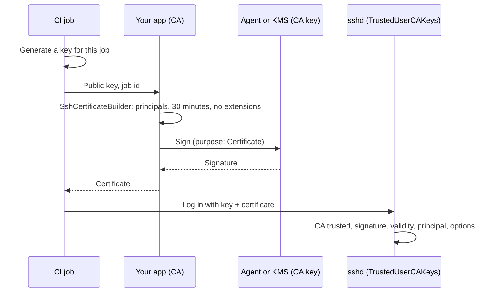

# Certificates

An OpenSSH user certificate is a public key signed by a certificate authority (CA), with the principals (user names) it may log in
as and a validity period. Servers that trust the CA (sshd's `TrustedUserCAKeys`) accept it without an `authorized_keys` entry, which
is how many organizations hand out short-lived SSH access. Host certificates work the other way, letting clients trust servers by
their CA.

SshSharp logs in with certificates, checks them, and issues them: an application can be the CA.

## When to use

- Your organization issues SSH certificates (`ssh-keygen -s`, HashiCorp Vault's SSH secrets engine, step-ca, Teleport, cloud
  identity-aware proxies).
- You want access that expires on its own instead of keys in `authorized_keys`.
- You want to issue them yourself, from an application: short-lived certificates for CI jobs or a bastion, or host certificates
  for servers you provision, without running `ssh-keygen -s`.

## Log in with a certificate

[!code-csharp[](../snippets/Keys.cs#certificate)]

`WithCertificate` pairs the key with its certificate; the pair is offered first, and the plain key after it in case the server
does not take the certificate.

## A certificate for an agent key

[!code-csharp[](../snippets/Keys.cs#certificate-agent)]

## From `ssh_config`

Connecting by alias finds certificates as `ssh` does: `CertificateFile` entries, and `<identity>-cert.pub` next to each identity
file.

## Trust hosts by their certificates

A host certificate lets clients trust every server the CA signed, without a `known_hosts` line per server. Add the CA to
`known_hosts`:

```
@cert-authority *.example.com ssh-ed25519 AAAAC3NzaC1lZDI1NTE5AAAA...
```

`KnownHostsVerifier` then accepts a host certificate from that CA for matching host names, within its validity period. To apply
your own rules, see the [custom verifier](verify-host-keys.md#write-a-verifier).

## Check a certificate

An application that receives certificates (a bastion, a portal, a job runner) checks one as sshd does with `IsValidFor`: issued by
the CA you trust, of the right type, with a valid signature, within its validity window, for the principal, and without critical
options it would have to enforce. It returns why not:

[!code-csharp[](../snippets/Keys.cs#certificate-check)]

The parts are public too, for your own rules:

[!code-csharp[](../snippets/Keys.cs#certificate-check-parts)]

What they mean, as OpenSSH has it:

| Check | Rule |
|---|---|
| `VerifySignature()` | The CA's signature over the certificate. SHA-1 (`ssh-rsa`) signatures are refused, an RSA CA needs 2048 bits or more, and Ed25519 is checked strictly. It does **not** say you trust the CA: anyone can make one. |
| `IsValidAt(time)` | `valid_after <= time < valid_before`, in whole seconds. `ValidAfter` is `DateTimeOffset.UnixEpoch` for "always", `ValidBefore` is `DateTimeOffset.MaxValue` for "forever" (`0xffffffffffffffff`). |
| Principals | A user certificate must list the user name exactly. A host certificate's principals are patterns (`*.example.com`), matched without regard to case. A certificate with no principals is refused, as sshd refuses one from `TrustedUserCAKeys` and ssh a host's; only an `authorized_keys` `cert-authority` line without `principals=` takes it as any user. |
| Critical options | `IsValidFor` refuses a certificate with any (`force-command`, `source-address`, `verify-required`): they restrict what it allows, and only your code can enforce them. |

`IsValidFor` does not check revocation.

## Act as a certificate authority

`SshCertificateBuilder` issues certificates as `ssh-keygen -s` does. Give it the key to certify, the type and a key id, set the
principals and the end of the validity window, and sign with the CA's key:

[!code-csharp[](../snippets/Keys.cs#certificate-issue-user)]



A host certificate, for `sshd_config`'s `HostCertificate`:

[!code-csharp[](../snippets/Keys.cs#certificate-issue-host)]

What the builder does for you:

- **Validity.** There is no default end: set `ValidBefore` (`DateTimeOffset.MaxValue` for a certificate that never expires, which is
  rarely what you want). `ValidAfter` defaults to one minute before signing, so a server whose clock is a little behind accepts a new
  certificate at once.
- **Extensions.** A user certificate starts with what `ssh-keygen` gives one: `permit-X11-forwarding`, `permit-agent-forwarding`,
  `permit-port-forwarding`, `permit-pty` and `permit-user-rc`. `Extensions.Remove(...)` takes one away, `Extensions.Clear()` all of
  them (as `ssh-keygen -O clear`). A host certificate starts with none.
- **Critical options.** `ForceCommand` and `SourceAddress` take a value; `VerifyRequired` takes none. Host certificates have none.
- **Checks.** At least one principal; option and extension names that are standard or a vendor's own (`name@example.com`); a
  `source-address` list of addresses or CIDR blocks; a validity window that is not empty. A mistake throws `InvalidOperationException`
  before anything is signed.
- **Encoding.** As `PROTOCOL.certkeys` has it, for Ed25519, ECDSA and RSA keys: a 32-byte random nonce, options and extensions
  sorted by name and each once, and an RSA CA signing with `rsa-sha2-512` (as `ssh-keygen` by default), never SHA-1 `ssh-rsa`. The
  signature is checked against the CA's key before the certificate is returned.

Write a certificate with `certificate.ToAuthorizedKeysLine()`, the line a `-cert.pub` file holds; `ssh-keygen -L -f` lists it.

### Keep the CA key out of the process

`SignAsync` takes any `SshPrivateKey`, including one an SSH agent holds:

[!code-csharp[](../snippets/Keys.cs#certificate-ca-agent)]

or one in a key vault, KMS or HSM through an `SshKeySigner`. The signer sees `SshSignaturePurpose.Certificate`, so the CA key can be
allowed to issue certificates and nothing else:

[!code-csharp[](../snippets/Keys.cs#certificate-ca-signer)]

```csharp
using var ca = SshPrivateKey.FromSigner(new CertificateAuthoritySigner(caPublicKeyBlob, kms.SignDigestAsync), comment: "kms:user-ca");
```

## Notes and pitfalls

- **Principals.** The server checks that the user name you log in as is one of the certificate's principals
  (`certificate.Principals`); a mismatch is an ordinary authentication failure.
- **Expiry.** An expired certificate is refused by the server; check `ValidBefore` and renew in time, as above.
- **Critical options** such as `force-command` or `source-address` are enforced by the server (`certificate.CriticalOptions` lists
  them).
- **Revocation.** Servers revoke user certificates with `RevokedKeys`; on the client side, `RevokedHostKeys` can revoke host
  certificates by serial or key id. Give each certificate you issue its own `Serial` so that a revocation list can name it; better
  still, issue certificates short enough that revoking them is rarely needed.
- **The CA key is the keys to the kingdom.** Whoever can sign with it can log in as any principal on every server that trusts it.
  Keep it in an agent or a key service, allow it to sign certificates only, issue for the shortest time that works, and name
  principals exactly. See the [threat model](../threat-model.md#certificates-the-application-checks-or-issues).
- **Key ids** are logged by sshd when a certificate is used: make them say who or what it was for (a job id, a ticket).

## See also

- [Scenario: short-lived certificates for CI jobs](../scenarios/ci-certificates.md)
- [Authentication: certificates](../authentication.md#certificates)
- [Keys held elsewhere](../authentication.md#keys-held-elsewhere-key-vaults-hsms-tpm)
- [Host keys](../host-keys.md)
- <xref:SshSharp.SshCertificate> and <xref:SshSharp.SshCertificateBuilder> in the API reference
