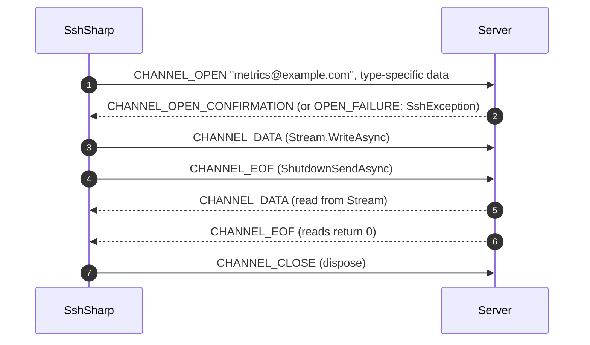

# Vendor channels and global requests

SSH lets a server define channel types and global requests of its own, named like `name@example.com` (RFC 4251 section 6).
Appliances, commercial servers and in-house `sshd` builds use them for things the standard ones do not cover. When SshSharp has no
API for the one you need, `SshClient.OpenChannelAsync` opens a channel of any type, and `SshClient.SendGlobalRequestAsync` sends a
global request of any name. Encode the data each carries as the server's documentation defines it.

## When to use

- The server's documentation names a channel type or a global request that SshSharp does not support itself.
- You are writing both ends: a server of your own, and a client that talks to it over SSH.

For anything SshSharp supports itself, use its API. That includes commands, shells, subsystems, tunnels, forwarding and keep-alives.
Session channels (`session`) are refused here: open them with `StartCommandAsync`, `StartShellAsync` or `StartSubsystemAsync`.

## Open a channel

`OpenChannelAsync` sends `SSH_MSG_CHANNEL_OPEN` with the type and the bytes you pass as its type-specific data. If the server
confirms, it returns an `SshCustomChannel`, whose `Stream` carries the channel's data both ways. `ShutdownSendAsync` ends your side
(`SSH_MSG_CHANNEL_EOF`) and leaves the channel open for the answer. Disposing the channel closes it.

[!code-csharp]

## Send a global request

`SendGlobalRequestAsync` sends `SSH_MSG_GLOBAL_REQUEST` with `want reply` set, followed by your data. It waits for the answer and
returns an `SshGlobalRequestResult`:
- `Success` says whether the server granted it.
- `Data` is whatever followed the server's answer.

A server answers a request it does not know with a failure. That's the usual way to tell it is unsupported, so it is returned, not
thrown.

[!code-csharp]

## Notes and pitfalls

- **Names** are printable US-ASCII without spaces or commas, at most 64 characters, with at most one `@`. Use your own domain after
  the `@`: names without one are reserved for the IETF.
- **The data is sent as is.** An SSH `string` is a big-endian `uint32` length followed by its bytes; `uint32` and `uint64` are
  big-endian. At most 32,000 bytes go in one open or request, so that every server takes the packet.
- **Parse the answer defensively.** It is what the server sent, and the server is not trusted
  ([threat model](../threat-model.md)).
- **A refused channel** is an `SshException` with `Reason = ChannelClosed`, and the connection stays usable.
- **Extended data** (`SSH_MSG_CHANNEL_EXTENDED_DATA`) on a custom channel is dropped. Channel requests on it are not supported.
- **Channels and requests the server sends** are not passed to your code. SshSharp refuses channel types it does not handle and
  answers unknown global requests with a failure, as OpenSSH does.
- **Idle timeouts** (`ChannelTimeout`) match a custom channel by its type, like any other.

## See also

- [Port forwarding and tunnels](port-forwarding.md) for `direct-tcpip` and Unix-socket channels
- [Transfer files with SFTP](transfer-files-sftp.md#call-a-vendor-extension) for SFTP's own vendor extensions
- <xref:SshSharp.SshClient.OpenChannelAsync*> and <xref:SshSharp.SshClient.SendGlobalRequestAsync*> in the API reference
