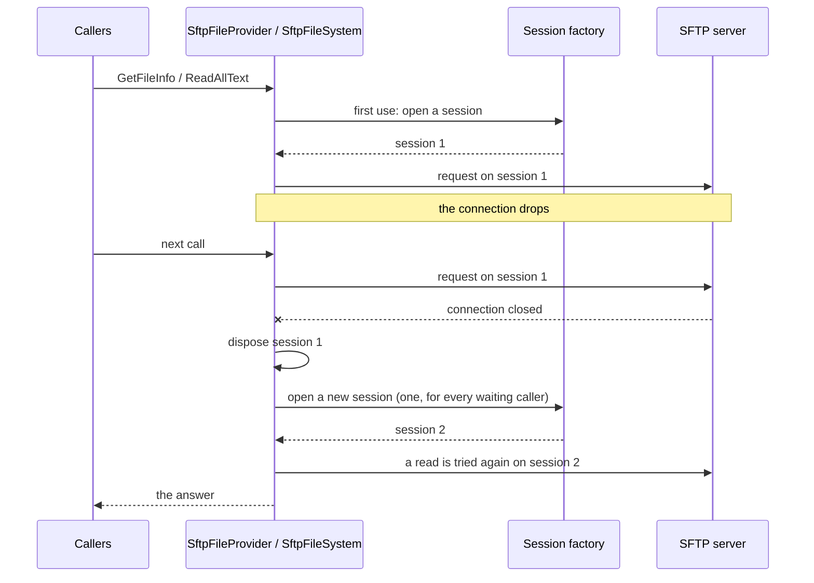

# IFileSystem and IFileProvider

Two adapter packages let code written against .NET's file abstractions use files on an SSH server, unchanged, over SFTP. Nothing
is mounted: only your application sees the files.

| Package | Type | Interface |
|---|---|---|
| `SshSharp.IO.Abstractions` | `SftpFileSystem` | [System.IO.Abstractions](https://github.com/TestableIO/System.IO.Abstractions)' `IFileSystem`: `File`, `Directory`, `Path`, `FileInfo`, streams. Read and write. |
| `SshSharp.FileProviders` | `SftpFileProvider` | `Microsoft.Extensions.FileProviders.IFileProvider`: ASP.NET Core static files, Razor views, configuration. Read-only. |

## When to use

- **`IFileSystem`**: you already have (or want) code that takes an `IFileSystem`, so it can run against the local disk, an
  in-memory file system in tests, or a server.
- **`IFileProvider`**: a framework component reads files through `IFileProvider` and you want it to read them from a server.
- For transfers and full control, use [`SftpClient`](transfer-files-sftp.md) directly: the adapters add convenience, not speed.

## Code against IFileSystem

```
dotnet add package SshSharp.IO.Abstractions
```

[!code-csharp[](../snippets/FileSystems.cs#report-writer)]

[!code-csharp[](../snippets/FileSystems.cs#file-system)]

Streams from the adapter are ordinary streams, so local and remote combine:

[!code-csharp[](../snippets/FileSystems.cs#copy-between)]

## Serve files with IFileProvider

```
dotnet add package SshSharp.FileProviders
```

[!code-csharp[](../snippets/FileSystems.cs#file-provider)]

The provider above gets its sessions from a factory, so it keeps serving after the connection drops (see
[Follow a connection that drops](#follow-a-connection-that-drops)). It can also use one session you give it, for as long as that
session lives:

[!code-csharp[](../snippets/FileSystems.cs#file-provider-session)]

It also feeds configuration:

[!code-csharp[](../snippets/FileSystems.cs#configuration)]

## Follow a connection that drops

Both adapters take either one `SftpClient` or a **session factory**, `Func<CancellationToken, Task<SftpClient>>`. With one
`SftpClient`, the adapter uses it for its lifetime: when its connection drops, every later call fails until you build a new adapter,
which `UseStaticFiles` and a container's singletons have no way to do. With a factory, the adapter follows the connection:

- It opens a session on first use and shares it between all its callers.
- When the session or the connection under it fails, it disposes that session and opens a new one. Ordinary SFTP errors (a missing
  file, a denied request) and timeouts do not count: the session stays.
- Callers that find no session share one call to the factory, so a drop is followed by one reconnect, not one per request.
- A call that only reads (a lookup, a listing, a whole-file read, opening a file to read) and meets the dropped connection is tried once
  more on the new session. A call that writes is not, because the server may have done it before the connection dropped: it fails, and
  the next call uses the new session.



With dependency injection, `ISshConnectionProvider.OpenSftpAsync(name)` is the factory: it opens a session on the endpoint's shared
connection, which the provider itself opens again after a drop (the static files example above uses it). Without it, open the session
on a connection you keep alive, such as the wrapper from [Keep-alive and reconnecting](keepalive-and-reconnect.md#reconnect):

[!code-csharp[](../snippets/FileSystems.cs#file-system-reconnecting)]

- **The adapter owns what the factory returns.** It disposes each session it replaces, and the last one when it is disposed, so
  dispose the adapter (`Dispose` or `DisposeAsync`) when the application stops, or register it with the container, which does. The
  connection under the sessions stays yours (or the provider's).
- **The factory is not called concurrently** by one adapter, and is called again after it fails: the next call tries again, so the
  factory (or the connection behind it) decides how often to connect. `ISshConnectionProvider` waits longer after each failed attempt.
- **Opening counts against the timeout.** Each open is bounded by the adapter's `OperationTimeout`; a call that waits for an open
  fails when its own timeout passes.
- **Open streams stay on their session.** A stream opened before a drop fails; open the file again.

## Notes and pitfalls

- **Paths are POSIX.** `SftpFileSystem.Path` uses `/` on every client OS, and `\` is an ordinary character. Relative paths start
  at the login directory.
- **Synchronous calls block.** `IFileProvider` is synchronous by contract, and so are many `IFileSystem` methods: each waits for an
  SFTP round trip and holds a thread meanwhile. Prefer the `...Async` methods of `IFileSystem` under load, and keep the provider's
  cache on (`SftpFileProviderOptions.CacheDuration`, 5 seconds by default).
- **Timeouts.** `SftpFileSystemOptions.OperationTimeout` (60 s) and `SftpFileProviderOptions.OperationTimeout` (30 s) bound each
  request; for whole-file reads and writes the file system's timeout bounds time without progress, so large files are not cut off.
- **Errors.** `SftpFileSystem` throws the `System.IO` exceptions code expects (`FileNotFoundException`,
  `UnauthorizedAccessException`, `IOException`). `SftpFileProvider` reports a missing or unreadable file as `Exists == false`.
- **No change notifications.** SFTP has none: `FileSystemWatcher` is not supported, and the provider's `Watch` never fires, so
  `reloadOnChange` has no effect.
- **Ownership.** An adapter built from one `SftpClient` does not own it: dispose it (and the `SshClient`) after the adapter is no
  longer used, and disposing the adapter leaves it open. An adapter built from a session factory owns the sessions it opens, and
  disposes them when it is disposed.
- **Errors after a drop.** With one `SftpClient`, a dropped connection is an `SshException` from the provider and an `IOException`
  from the file system, on every call. With a session factory, a failed open is reported the same way, with the factory's exception
  inside, and the next call tries again.
- **Not supported** by `SftpFileSystem`: `DriveInfo`, `FileVersionInfo`, `RandomAccess`, encryption, `Replace`; SFTP has no creation
  times. The [SFTP guide](../sftp.md#using-ifilesystem-systemioabstractions) has the full table.

## See also

- [File transfer (SFTP)](../sftp.md#serving-files-with-ifileprovider) (in-depth guide)
- [ASP.NET Core and dependency injection](aspnetcore-and-di.md)
- [Keep-alive and reconnecting](keepalive-and-reconnect.md)
- <xref:SshSharp.IO.Abstractions.SftpFileSystem> and <xref:SshSharp.FileProviders.SftpFileProvider> in the API reference
