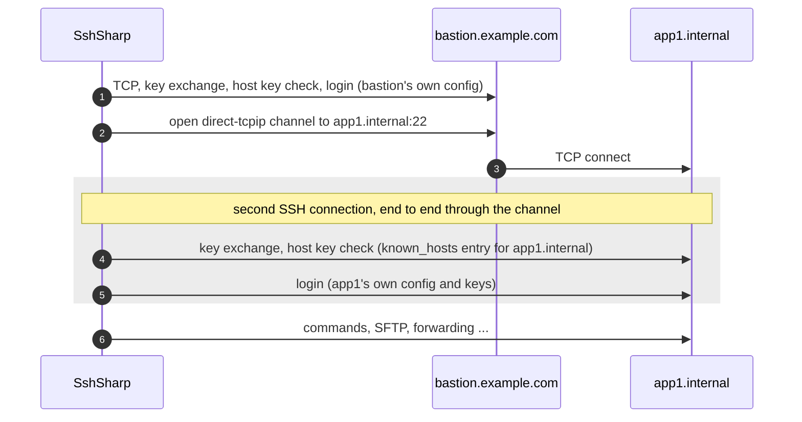

# Jump hosts (ProxyJump)

Servers inside a private network are often reachable only through a bastion (jump host). SshSharp follows `ssh_config`'s
`ProxyJump` and `ProxyCommand` like `ssh` does. Without `ssh_config`, `SshClientOptions.JumpHosts` builds the same chain in code,
and it can also be done by hand: open a tunnel through one connection and run a second SSH connection over it.

## When to use

- The target is not reachable directly, only through one or more bastions.
- You want each hop authenticated and verified on its own, with the bastion unable to read the traffic to the target.

## How a ProxyJump chain connects

With `ProxyJump bastion` (or `ssh -J bastion app1`), the client connects and logs in to the bastion, asks it for a TCP connection to
the target's SSH port (a `direct-tcpip` channel), and runs a complete second SSH connection over that channel. The bastion relays
bytes it cannot decrypt; the target's host key is verified against `known_hosts` as for a direct connection.



`ProxyJump a,b` repeats this: `b` is reached through `a`, and the target through `b`. Each hop is resolved, verified and
authenticated with its own `ssh_config` settings, and each hop's `ConnectTimeout` applies to it.

## From `ssh_config`

```
Host bastion
  HostName bastion.example.com
  User jump

Host app1
  HostName app1.internal
  User deploy
  ProxyJump bastion
```

[!code-csharp[](../snippets/Connecting.cs#alias)]

The configuration can also ship with your application instead of living in `~/.ssh/config`:

[!code-csharp[](../snippets/Connecting.cs#custom-config)]

## In code

`SshClientOptions.JumpHosts` lists the hops, first to last, as `ssh -J a,b` does. Each `SshJumpHost` names a host and port and
carries its own `SshClientOptions`: user, keys or password, `HostKeyVerifier`, algorithms, keep-alives. The options you pass to
`ConnectAsync` stay the destination's.

[!code-csharp[](../snippets/Connecting.cs#jump-hosts)]

What applies where:

| Setting | Applies to |
| --- | --- |
| The destination's `UserName`, `Password`, `PrivateKeys`, `KeyboardInteractive`, `HostKeyVerifier` | The destination only. |
| A hop's `UserName`, credentials, `HostKeyVerifier`, algorithm lists, `KeepAliveInterval`, `ForwardAgent` | That hop only. |
| The destination's `ConnectTimeout` | The whole chain: every hop, every tunnel, and the destination's handshake and login. |
| A hop's `ConnectTimeout` | That hop's connection, within the destination's limit. |
| The destination's `Proxy`, `LocalEndPoint`, `AddressFamily`, `ConfigureSocket`, `ConnectionAttempts` | The first network connection, which is the first hop's. |
| A hop's `AddressFamily`, `ConfigureSocket`, `ConnectionAttempts` | Not used: the first hop's connection takes the destination's. |
| A hop's `Proxy`, `LocalEndPoint`, `JumpHosts` | Not allowed: `SshJumpHost` throws `ArgumentException`. |

The destination's host name is resolved by the last hop, and each hop's by the one before it, so names that exist only inside
the private network work. A hop's host key is checked under the name and port given in its `SshJumpHost`, so a
`KnownHostsVerifier` finds it in `known_hosts` as it would for a direct connection.

### In an ASP.NET Core application

An endpoint registered with `AddSshClient` takes its jump hosts as settings (`JumpHosts`), each with its own user, credentials and
host key settings, so they can come from `appsettings.json` with no code:

[!code-csharp[](../snippets/DependencyInjection.cs#jump-hosts)]

A hop without host key settings of its own is checked against the endpoint's `KnownHostsFiles`; behind an endpoint that pins
`HostKeyFingerprints`, each hop needs its own. See [Dependency injection: jump hosts](../dependency-injection.md#jump-hosts) for the
configuration keys and the rules.

## Through your own tunnel

When the first hop is reached through something other than TCP, HTTP or SOCKS (a cloud provider's tunnel, a WebSocket, a named
pipe), `SshProxy.FromConnector` makes it a proxy: the connector is asked for a stream to a host and port. It goes wherever a proxy
goes, so it carries the first `JumpHosts` or `ProxyJump` host, or the server itself:

[!code-csharp[](../snippets/Connecting.cs#custom-proxy)]

The connector's token ends with the caller's and with `ConnectTimeout`; nothing else limits it. An exception it throws fails the
connection with `ConnectFailed` (the exception is inside), and the stream it returns belongs to the connection, which disposes it.
See [Connecting: your own transport](../connecting.md#your-own-transport).

## By hand

Without `ssh_config` or `JumpHosts`, open a tunnel through the bastion and connect over it with `SshClient.ConnectAsync(Stream, ...)`:

[!code-csharp[](../snippets/Connecting.cs#manual-jump)]

The connection over a stream has no host name of its own, so `HostKeyAlias` names the target for `known_hosts` lookups (or use a
pinned key).

## Scan a host behind a bastion

[!code-csharp[](../snippets/Connecting.cs#scan-jump)]

## Notes and pitfalls

- **Credentials go to the destination only.** When connecting by alias, `SshConfigConnectOptions.Password`, the
  keyboard-interactive handler and `SshConfigConnectOptions.PrivateKeys` are offered to the final host, never to a jump host. Hops
  log in with their own `IdentityFile`s and the agent, as `ssh` asks for each host's password separately. With `JumpHosts`, each
  host gets only what its own options hold: a hop may have a password or keys of its own, and the destination's are never offered
  to it.
- **Upgrading from 1.0:** `SshConfigConnectOptions.PrivateKeys` used to be offered to every hop as well. A hop that logged in with
  one of them now needs that key in its own `IdentityFile` (in the configuration) or in the agent (`SshConfigConnectOptions.Agent`,
  for example `SshAgent.FromKeys(key)` for a key held in the application). With `IdentitiesOnly yes` for the hop, the agent's keys
  are offered only when they match one of its `IdentityFile` lines (by the public key in `<file>.pub`), so also name a file holding
  the key's public key there, or leave `IdentitiesOnly` off for that hop.
- **Which host refused.** A hop that refuses to log in fails with `SshAuthenticationException` "Authentication to ProxyJump hop N
  failed", N being its place in the `ProxyJump` list; the hop's own failure is the `InnerException`. Without it, a hop's refusal
  looks like the destination's. See [Troubleshooting](../reference/troubleshooting.md#authentication-to-proxyjump-hop-n-failed).
- **Reusing one options object** for a hop and the destination offers its credentials to both. Give each host its own options
  unless they really share a login.
- **Disposal.** Disposing the destination client tears down the whole chain, and a connection that fails partway closes the hops
  it had opened. When chaining by hand, dispose the target before the bastion (the `await using` order above does that).- **ProxyCommand** runs a local program and speaks SSH over its standard input and output. It is allowed by default, as in `ssh`;
  set `SshConfigConnectOptions.AllowProxyCommand = false` when the configuration file is not under your control.
- **Forwarding is the bastion's call.** sshd's `AllowTcpForwarding no` on the bastion refuses the tunnel, and the connection fails
  with `ConnectFailed` ("the jump host could not open a connection to the next host").
- **A proxy for the first hop.** `SshConfigConnectOptions.Proxy` and `SshClientOptions.Proxy` (HTTP, SOCKS or your own connector)
  apply to the first network connection: the destination, or the first `ProxyJump` or `JumpHosts` host.

## See also

- [Jump host sample](https://github.com/zcsizmadia/SshSharp/tree/main/samples/SshSharp.Samples.JumpHost): `JumpHosts` in code, with a certificate issued in the program
- [Connecting: jump hosts and proxy commands](../connecting.md#jump-hosts-and-proxy-commands)
- [Threat model: jump hosts](../threat-model.md#jump-hosts)
- [Use ssh_config and known_hosts](ssh-config-and-known-hosts.md)
- [A database through a jump host](../scenarios/database-tunnel.md)
