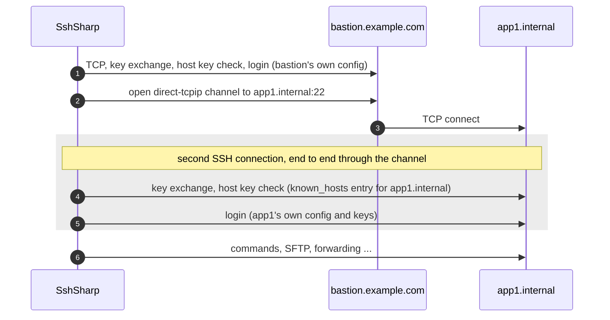

# Jump hosts (ProxyJump)

Servers inside a private network are often reachable only through a bastion (jump host). SshSharp follows `ssh_config`'s
`ProxyJump` and `ProxyCommand` like `ssh` does, and the same thing can be done by hand: open a tunnel through one connection and
run a second SSH connection over it.

## When to use

- The target is not reachable directly, only through one or more bastions.
- You want each hop authenticated and verified on its own, with the bastion unable to read the traffic to the target.

## How a ProxyJump chain connects

With `ProxyJump bastion` (or `ssh -J bastion app1`), the client connects and logs in to the bastion, asks it for a TCP connection to
the target's SSH port (a `direct-tcpip` channel), and runs a complete second SSH connection over that channel. The bastion relays
bytes it cannot decrypt; the target's host key is verified against `known_hosts` as for a direct connection.



`ProxyJump a,b` repeats this: `b` is reached through `a`, and the target through `b`. Each hop is resolved, verified and
authenticated with its own `ssh_config` settings, and each hop's `ConnectTimeout` applies to it.

## From `ssh_config`

```
Host bastion
  HostName bastion.example.com
  User jump

Host app1
  HostName app1.internal
  User deploy
  ProxyJump bastion
```

[!code-csharp[](../snippets/Connecting.cs#alias)]

The configuration can also ship with your application instead of living in `~/.ssh/config`:

[!code-csharp[](../snippets/Connecting.cs#custom-config)]

## By hand

Without `ssh_config`, open a tunnel through the bastion and connect over it with `SshClient.ConnectAsync(Stream, ...)`:

[!code-csharp[](../snippets/Connecting.cs#manual-jump)]

The connection over a stream has no host name of its own, so `HostKeyAlias` names the target for `known_hosts` lookups (or use a
pinned key).

## Scan a host behind a bastion

[!code-csharp[](../snippets/Connecting.cs#scan-jump)]

## Notes and pitfalls

- **Passwords go to the destination only.** When connecting by alias, `SshConfigConnectOptions.Password` and the
  keyboard-interactive handler are offered to the final host, never to a jump host. Hops log in with keys or the agent, as `ssh`
  asks for each host's password separately.
- **Disposal.** Disposing the destination client tears down the whole chain. When chaining by hand, dispose the target before the
  bastion (the `await using` order above does that).
- **ProxyCommand** runs a local program and speaks SSH over its standard input and output. It is allowed by default, as in `ssh`;
  set `SshConfigConnectOptions.AllowProxyCommand = false` when the configuration file is not under your control.
- **Forwarding is the bastion's call.** sshd's `AllowTcpForwarding no` on the bastion refuses the tunnel, and the connection fails
  with `ConnectFailed` ("the jump host could not open a connection to the next host").
- **A proxy for the first hop.** `SshConfigConnectOptions.Proxy` (HTTP or SOCKS) applies to the first network connection: the
  destination, or the first `ProxyJump` host.

## See also

- [Connecting: jump hosts and proxy commands](../connecting.md#jump-hosts-and-proxy-commands)
- [Use ssh_config and known_hosts](ssh-config-and-known-hosts.md)
- [A database through a jump host](../scenarios/database-tunnel.md)
