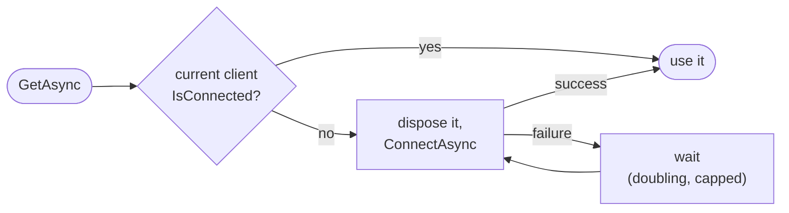

# Keep-alive and reconnecting

TCP connections die quietly: a NAT gateway forgets them, a VPN drops, a server reboots. Keep-alive notices a dead connection within
a bounded time, and `ConnectionClosed` tells your code. SshSharp never reconnects behind your back: a connection that ended stays
ended, and your code (or the dependency injection package) opens a new one.

## When to use

- Long-lived connections: services, workers, forwarders, anything that holds a connection for minutes or more.
- Connections through firewalls or NAT that drop idle flows.

## Turn on keep-alive

[!code-csharp]

After `KeepAliveInterval` without traffic from the server the client sends a probe (OpenSSH's `ping@openssh.com` where the server
announces it, `keepalive@openssh.com` otherwise); any packet from the server counts as an answer. After `KeepAliveCountMax`
intervals without one, the connection fails with `SshFailureReason.Timeout`. The probes do not wait behind pending writes, so a
server that stops reading is detected too.

With `ssh_config`, `ServerAliveInterval` and `ServerAliveCountMax` do the same when connecting by alias.

## Check a connection on demand

[!code-csharp]

`IsConnected` is a cheap local check; `PingAsync` proves the server answers, and measures the round trip.

## Stop work when the connection ends

`client.ConnectionClosed` is a `CancellationToken` cancelled when the connection ends for any reason. Link it with your own token so
reads and waits stop at once instead of failing one by one:

[!code-csharp]

## Reconnect

In an application with dependency injection, `ISshConnectionProvider` does exactly this, with a backoff after failures and one
attempt shared by concurrent callers; see [ASP.NET Core and dependency injection](aspnetcore-and-di.md). Without it, a small wrapper
is enough:

[!code-csharp]

Then retry the work, not the connection: only you know whether an operation is safe to run twice.

[!code-csharp]

## Notes and pitfalls

- **Nothing is retried for you.** A command that was running when the connection dropped fails with `ConnectionClosed`. It may or
  may not have run on the server.
- **Sessions, SFTP clients and forwarders die with their connection.** After reconnecting, open them again. The file adapters
  (`SftpFileProvider`, `SftpFileSystem`) can do it for you: give them a session factory instead of an `SftpClient`; see
  [Follow a connection that drops](file-system-adapters.md#follow-a-connection-that-drops).
- **OpenSSH for Windows.** The server built into Windows (OpenSSH for Windows 9.5) often fails to answer keep-alives, so connections
  to it end after `KeepAliveCountMax` intervals; `ssh -o ServerAliveInterval` sees the same. Against it, leave `KeepAliveInterval`
  unset or use a long interval with a generous count.
- **Idle channels.** To close channels (not the connection) that carry no data for a while, use `SshClientOptions.ChannelTimeouts`
  (OpenSSH's `ChannelTimeout`).

## See also

- [Connecting: keep-alive and connection state](../connecting.md#keep-alive-and-connection-state)
- [Cancellation and timeouts](cancellation-and-timeouts.md)
- [A background worker](../scenarios/background-worker.md)
