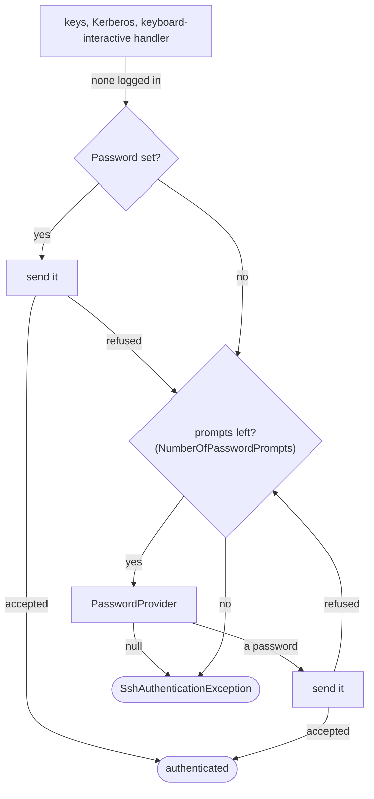
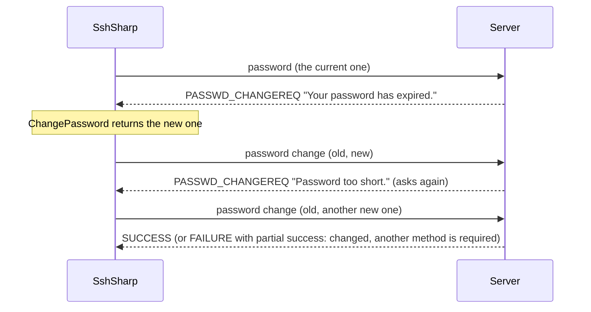

# Passwords: prompts, expiry and failures

A password can be given up front (`SshClientOptions.Password`), asked for only when it is needed (`PasswordProvider`), and changed
when the server says it has expired (`ChangePassword`). When nothing logs in, `SshAuthenticationException.Attempts` says what
was tried and what became of each attempt.

## When to use

- An interactive tool should prompt for a password only when the user's keys did not work, as `ssh` does.
- Accounts whose passwords expire: the server asks for a new one at login (`SSH_MSG_USERAUTH_PASSWD_CHANGEREQ`, RFC 4252).
- A service should report which key or method a server refused, without logging any secret.

For services, prefer keys or certificates: see [Keys and the SSH agent](agent-and-keys.md). Read a fixed password from a secret
store or an environment variable, never from source code.

## Prompt for the password only when it is needed

[!code-csharp]

The provider is called when authentication reaches a password: after Kerberos and every key, in `ssh`'s order. After the server
refuses a password, it is asked again, at most `NumberOfPasswordPrompts` times per connection (3 by default, as in `ssh`; 0 never
asks). Returning null stops asking. `SshPasswordPrompt` has what a prompt shows: `UserName`, `Host` (as you gave it; null over a
`Stream`), `Port`, `Attempt`, `IsRetry` (a password was already refused), and `Method`.

`Password` and `PasswordProvider` work together: a `Password` that is set is tried first and does not count as a prompt, and the
provider is asked only if the server refuses it, for example a saved password that has since been changed.

### Servers that ask through keyboard-interactive (PAM)

sshd with `PasswordAuthentication no` and `KbdInteractiveAuthentication yes` asks for the password through keyboard-interactive.
Without a `KeyboardInteractive` handler, the provider answers there too, as `Password` does: a round that asks for exactly one
hidden input gets the password (`Method` is then `keyboard-interactive`), and a refused one is asked for again. It is never sent to a
visible question or a second round (a one-time code); those need a [`KeyboardInteractive` handler](../authentication.md#keyboard-interactive).
A `KeyboardInteractive` handler, when set, answers keyboard-interactive itself, and is not retried after a refusal.

## Change an expired password

[!code-csharp]

When the password was right but has expired, the server asks for a new one. `ChangePassword` gets the server's `Prompt` (often
the reason, such as "Password too short.") and its `Language`, with the `UserName`, `Host` and `Port` it is for and the `Attempt` (1 for the server's first request, more
when it refused the new password and asks again, up to 3), and returns the new password, or null to leave it unchanged. The
client sends the old password again with the new one, in one request, as RFC 4252 section 8 specifies:

- The server may ask again when it refuses the new password; the client answers at most 3 requests for one password.
- Without `ChangePassword`, or when it returns null, the password stays as it was and the attempt fails with
  `PasswordChangeRequired`; the client does not prompt for another password, since the one it had was right. The other methods
  follow, if the server offers any.
- Store the new password only once `ConnectAsync` succeeds. A `FAILURE` without partial success means the change was refused
  (`Rejected` in `Attempts`).

## Find out why authentication failed

[!code-csharp]

`Attempts` lists every attempt in order, and the message repeats it:

| `Outcome` | Meaning |
|---|---|
| `Rejected` | The server refused it: a wrong password, a key not in `authorized_keys`. |
| `PartialSuccess` | Accepted, but the server requires another method too. |
| `NotOffered` | You set credentials for a method the server does not offer (keys, and a server that takes only passwords). |
| `NoAcceptedAlgorithm` | The key has no signature algorithm the server accepts (`server-sig-algs`), or none that `PubkeyAcceptedAlgorithms` allows; it was not offered. |
| `SigningFailed` | The server would take the key, but the agent did not sign: the key is gone, or the user declined a confirmation. |
| `Declined` | This side gave up: a handler or the provider returned null, or keyboard-interactive asked something a password does not answer. |
| `PasswordChangeRequired` | The password has expired and was not changed. |
| `Unavailable` | Kerberos could not run here: no ticket, no GSS-API library, or .NET 8. |

Each key appears by its SHA-256 fingerprint. `Attempts` and the message never contain a password, an answer or the user name, so
they can be logged.

## From `ssh_config`

[!code-csharp]

`NumberOfPasswordPrompts` sets the limit, and `SshConfigConnectOptions.PasswordProvider` and `ChangePassword` answer for the
destination. Neither is called in `BatchMode`, or for a `ProxyJump` hop, which logs in with keys or the agent. The provider is not
called either when both `PasswordAuthentication` and `KbdInteractiveAuthentication` are `no`.

## Notes and pitfalls

- **Lockouts.** Each refused password counts against the server's `MaxAuthTries`, and against account lockout policies. Keep
  `NumberOfPasswordPrompts` low for unattended use; a fixed `Password` without a provider is tried once.
- **Cancellation.** The provider and `ChangePassword` get the connect's `CancellationToken`. Throwing (an
  `OperationCanceledException` when the user cancels) fails the connect; `ConnectTimeout` keeps running while they wait.
- **Secrets in memory.** Passwords are .NET strings and cannot be wiped; the library does not keep them after authentication.
- **Server text.** `SshPasswordChangeRequest.Prompt` comes from the server: strip control characters before showing it.

## See also

- [Authentication](../authentication.md)
- [Choose algorithms and authentication methods](algorithms-and-authentication-order.md)
- [Troubleshooting: authentication](../reference/troubleshooting.md#authentication)
- <xref:SshSharp.SshClientOptions.PasswordProvider>, <xref:SshSharp.SshClientOptions.ChangePassword> and
  <xref:SshSharp.SshAuthenticationException.Attempts> in the API reference
