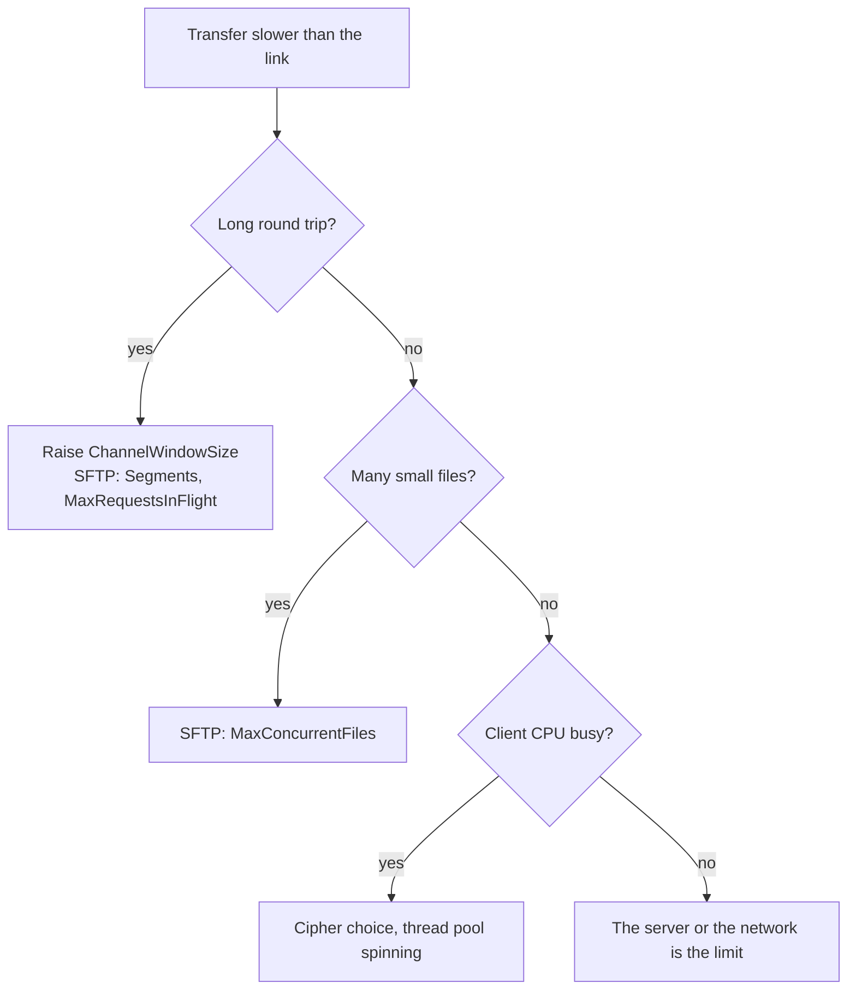

# Tune for throughput

The defaults suit most connections: on a local network or a link with a short round trip, SshSharp keeps up with the server
without any tuning ([Benchmarks](../benchmarks.md) has the measurements). This page brings together the settings that matter when a
transfer is slower than the link: what limits it, which option addresses that limit, and what it costs.

## When to use

- A download, command output or tunnel is much slower than the link, and the link has a long round trip.
- An SFTP transfer of one large file, or of a tree of many small files, takes longer than the bandwidth explains.
- Copying into a remote file stream (`OpenWriteAsync`) is slower than `UploadAsync`.
- The client's CPU, not the network, is the limit.

## Find the limit first

Each option below helps against one limit and does nothing against the others. A larger window does not help when the bandwidth is
the limit, and more segments do not help when the server's disk is.

## Long round trips: the channel window

One channel (a command's session, an SFTP session, a tunnel) moves at most one flow-control window per round trip. With the default
2 MiB window that is about 20 MiB/s at 100 ms, whatever the bandwidth. Size the window from the bandwidth-delay product, and give the
socket a receive buffer to match:

[!code-csharp]

| Option | Default | What it changes |
|---|---|---|
| `ChannelWindowSize` | 2 MiB (1 KiB to 1 GiB) | How much the server may send on a channel before it waits for SshSharp to consume it. |
| `ChannelMaxPacketSize` | 32 KiB (1 KiB to 255 KiB) | The most data the server may put in one packet: fewer, larger packets for bulk data. |
| `ConfigureSocket` | System defaults | Socket options before connecting, such as `ReceiveBufferSize` for TCP window scaling. |

Costs and limits:

- **Memory:** each channel may hold up to its window of data your code has not read yet.
- **Uploads** are limited by the window the server grants, which only the server can raise (OpenSSH's sshd uses 2 MiB).
- `ConfigureSocket` applies only to a direct connection made by `ConnectAsync(host, port, options)`: not through a `Proxy`, over a
  stream you opened, or by `ssh_config` alias.

[Tune and inspect a connection](tune-and-inspect-connections.md#move-more-data-per-round-trip-on-long-links) has the details.

## SFTP transfers

[!code-csharp]

| Option | Default | Helps with | Does not help with |
|---|---|---|---|
| `SftpTransferOptions.MaxRequestsInFlight` | 64 (1 to 1,024) | Latency within one session's window: more reads or writes outstanding at once. | A transfer already limited by the channel window or the bandwidth. |
| `SftpTransferOptions.Segments` | 1 (1 to 16) | One large download on a link with a long round trip: each segment is its own session, with its own window and (on OpenSSH) its own `sftp-server` process. | Bandwidth: the sessions share one TCP connection. Uploads, `DownloadAsync` into a stream, and `Resume` ignore it. |
| `SftpTransferOptions.MaxConcurrentFiles` | 1 (1 to 64) | Directory transfers of many small files, where each file's open, attributes and close round trips dominate. | A few large files, which already keep requests in flight. |
| Write-behind on `OpenWriteAsync` | Always on, 16 writes per stream | `CopyToAsync` into a remote file keeps the link busy, as `UploadAsync` does. | Many tiny writes, each of which is a request: put a `BufferedStream` in front. |

Memory stays bounded: a transfer holds at most `MaxRequestsInFlight` reads or writes of the server's size (about 16 MiB with
OpenSSH's 255 KiB limit and the default 64), shared by all its files, and a file stream at most 16 writes. `Segments` and
`ChannelWindowSize` combine: both raise how much is in flight per round trip. The server may allow fewer sessions than `Segments`
asks for (sshd's `MaxSessions`, 10 by default).

In the benchmarks, `CopyToAsync` into `OpenWriteAsync` took 226 ms for 32 MiB against 244 ms for `UploadAsync`, on a Linux client
over loopback ([Benchmarks](../benchmarks.md#a-second-machine-windows-and-wsl)). See
[Transfer files with SFTP](transfer-files-sftp.md#download-large-files-faster) and [Writes in flight](../sftp.md#writes-in-flight).

## Cipher choice

The cipher is the first one on the client's list that the server also offers. SshSharp's default list puts AES-GCM first when the
CPU has AES instructions and ChaCha20-Poly1305 first when it does not:

| Cipher | Implementation | 16 KiB packet, encode (seal) |
|---|---|---:|
| `aes256-gcm@openssh.com` | The platform's, on AES instructions | 1.96 µs |
| `chacha20-poly1305@openssh.com` | Managed, vectorized ChaCha20 | 14.6 µs |
| `aes256-ctr` with `hmac-sha2-256-etm@openssh.com` | The platform's | 13.7 µs |

These are single-packet micro-benchmarks on one machine (Intel Core i7-12800H, .NET 10; see
[Benchmarks](../benchmarks.md#packet-encode-and-decode-one-packet-in-memory)). In a 2 GiB stream over loopback, throughput was the
same with either AEAD cipher (157 against 156 MiB/s), but the client spent 7.0 s of CPU per GiB with
AES-256-GCM and 10.8 s with ChaCha20-Poly1305. So the default is right for throughput and CPU, and changing it matters only for a
server that offers no AES-GCM:

[!code-csharp]

`client.Algorithms.EncryptionClientToServer` shows what was negotiated. See
[Choose algorithms and authentication methods](algorithms-and-authentication-order.md).

## Socket options and Nagle's algorithm

SshSharp turns Nagle's algorithm off on the sockets it opens (`Socket.NoDelay`), so small writes (keystrokes, short commands) are
not delayed; there is nothing to set. Buffer sizes, TCP keep-alive and the type of service go through `ConfigureSocket`; see
[Set socket options](tune-and-inspect-connections.md#set-socket-options).

## Client CPU

When the client's CPU is the limit:

- **Run work in parallel on one connection.** Commands, SFTP sessions and tunnels are separate channels; eight commands in parallel on
  one connection took 3.9 ms in the benchmarks, against 1.7 to 1.8 ms for one.
- **Thread pool spinning.** Much of the client CPU while streaming was the .NET thread pool spin-waiting between packets, not SSH
  work. In the benchmarks, `DOTNET_ThreadPool_UnfairSemaphoreSpinLimit=0` cut the CPU per GiB (from 5.57 s to 2.40 s on Linux, and
  from 4.4 s to 2.2 s on Windows) without costing throughput. It is a process-wide runtime setting: measure your own application
  before and after.
- **SFTP or SCP.** Both reached similar times for a 32 MiB upload in the benchmarks (244 ms and 211 ms). SFTP has resume,
  segments and directory concurrency; see [SFTP or SCP?](../sftp.md#sftp-or-scp).

## Notes and pitfalls

- **Measure before and after** with your server and network: the numbers above are from the benchmark machines in
  [Benchmarks](../benchmarks.md), not guarantees.
- **The server can set the pace** on a fast link: in the benchmarks, OpenSSH's single encryption thread per connection did, and
  both libraries and OpenSSH's own client kept up with it.
- **A server with a low `RekeyLimit`** renews keys often, which stalls transfers (the benchmarks met 2 MiB/s with `RekeyLimit 32K`).
- **`MaxSessions`** on the server bounds `Segments` and parallel channels on one connection.

## See also

- [Tune and inspect a connection](tune-and-inspect-connections.md)
- [Transfer files with SFTP](transfer-files-sftp.md)
- [Channels and flow control](../concepts/channels.md)
- [Benchmarks](../benchmarks.md)
