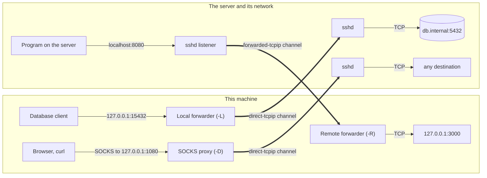

# Port forwarding and tunnels

An SSH connection can carry other connections. The server opens them on your behalf (to reach services only it can reach), or
accepts them and hands them to you (to give the server a way back). SshSharp does what `ssh -L`, `-R` and `-D` do, and also returns
a tunnel as a plain `Stream` or plugs it into `HttpClient`.

## When to use

| You want to | Use |
|---|---|
| Reach a service behind the server from a program that connects to a port (a database client, a browser) | [Local forwarding](#local-forwarding-ssh--l), `ssh -L` |
| Reach it from your own code, without opening a port | [A tunnel stream](#tunnels-without-a-local-port) or [`HttpClient`](#httpclient-through-the-server) |
| Let programs reach many destinations through the server | [Dynamic forwarding](#dynamic-forwarding-a-socks-proxy-ssh--d), `ssh -D` |
| Let the server reach a service on your side | [Remote forwarding](#remote-forwarding-ssh--r), `ssh -R` |

## How each kind flows

Every forwarded connection is its own channel inside the one encrypted SSH connection. What differs is who listens and who makes
the final TCP connection:

## Local forwarding (`ssh -L`)

[!code-csharp]

Port 0 lets the system pick a free port, which avoids collisions when several jobs run at once:

[!code-csharp]

The server resolves `db.internal`, so names that only the server's network knows work.

## Tunnels without a local port

A tunnel is one forwarded connection, returned as a `Stream`. Nothing listens locally, so no other process on this machine can use
it:

[!code-csharp]

## `HttpClient` through the server

`CreateHttpConnectCallback()` opens each of `HttpClient`'s connections as a tunnel, so web services that only the server can reach
work with the usual HTTP stack. TLS still runs end to end, from this machine to the service:

[!code-csharp]

The same handler works with `IHttpClientFactory` (`ConfigurePrimaryHttpMessageHandler`).

## Dynamic forwarding: a SOCKS proxy (`ssh -D`)

[!code-csharp]

## Remote forwarding (`ssh -R`)

The direction is reversed: the server listens, and each connection made to it there is relayed to a host and port reached from
this machine.

[!code-csharp]

Remote dynamic forwarding (`ssh -R 1080`, OpenSSH 7.6+) makes this machine the SOCKS proxy for programs on the server. Restrict
what they may reach:

[!code-csharp]

## Notes and pitfalls

- **Bind to loopback.** A local forwarder or SOCKS proxy has no authentication: anyone who can reach its port can use the server's
  network. Use `IPAddress.Loopback` unless other machines should use it.
- **Server policy.** sshd's `AllowTcpForwarding no` refuses tunnels: each forwarded connection is closed, and `OpenTcpTunnelAsync`
  throws `SshException` with `ChannelClosed`. A bind address other than loopback for remote forwarding needs `GatewayPorts`.
- **Lifetime.** Forwarding runs until the forwarder is disposed, the client is disposed, or the connection ends. Watch
  `client.ConnectionClosed` if you need to know (see [Keep-alive and reconnecting](keepalive-and-reconnect.md)).
- **Remote destinations come from the server's side.** With remote dynamic forwarding, every destination is allowed when
  `allowDestination` is null, as with `ssh`. Pass a filter unless you trust everyone on the server.
- **Limits.** The server can open at most `SshClientOptions.MaxForwardedConnections` (1,000) forwarded connections at a time.
- **From `ssh_config`.** `LocalForward`, `RemoteForward` and `DynamicForward` start with the connection when
  `SshConfigConnectOptions.StartForwardings` is true.

## See also

- [Connecting: tunnels and port forwarding](../connecting.md#tunnels-and-port-forwarding) (in-depth: Unix sockets, remote Unix-socket
  forwarding, forwardings from `ssh_config`)
- [A database through a jump host](../scenarios/database-tunnel.md)
- [Channels and flow control](../concepts/channels.md)
