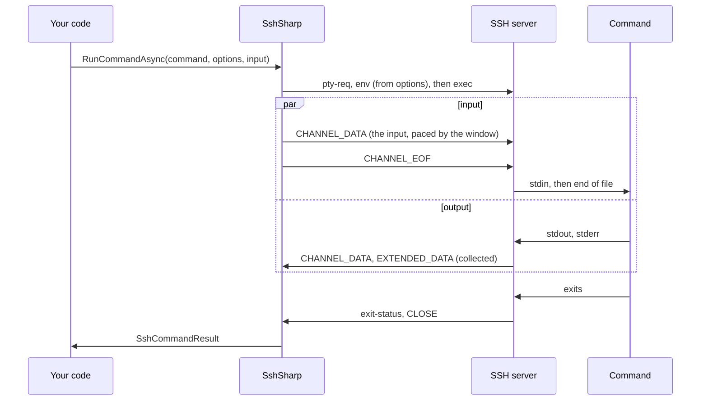

# Run a command

`SshClient.RunCommandAsync` runs a command on the server, waits for it to finish, and returns its standard output, standard error and
exit status. It is the SSH equivalent of `Process.Start` with redirected streams, for commands whose output fits in memory.

## When to use

- The command finishes on its own and prints a bounded amount of output: `systemctl status`, `df`, `git rev-parse`, a script.
- You need the exit status to decide what happens next, or want a failure to throw (`EnsureSuccess()`).
- The command reads input you have in memory or in a file: a script for `sh -s`, a configuration for `cat > file`, a dump for
  `psql`.

For output that is large, endless or needed while the command runs, use [`StartCommandAsync`](stream-output.md) instead. For a
program that asks questions (a password prompt, a device CLI), see [Interactive shells](interactive-shell.md).

## Read stdout, stderr and the exit status

[!code-csharp]

stdout and stderr arrive separately, as they do from `ssh host command`. `StandardOutputText` and `StandardErrorText` decode them
as UTF-8; `StandardOutput` and `StandardError` are the raw bytes:

[!code-csharp]

## Act on the result

A command that fails on the server is a result, not an exception: check `ExitStatus`. When the program was killed by a signal
there is no exit status, and `ExitSignal` says which signal:

[!code-csharp]

## Fail on a non-zero exit status

When anything but success is an error, `EnsureSuccess()` saves the check. It returns the result when the exit status is 0, so the
calls chain, and throws `SshCommandException` otherwise:

[!code-csharp]

The exception says why the command failed. `ExitStatus` holds the status, and `ExitSignal` the signal when one ended the
command. A command that ended without reporting either also fails. `StandardError` and `StandardErrorText` hold the end of what the
command wrote to stderr (the last 4 KiB, `IsStandardErrorTruncated` when there was more), where a failing program usually says why:

[!code-csharp]

`SshCommandException` is an `SshException` with `Reason` `CommandFailed`. A handler for `SshException` therefore also catches
failed commands; catch `SshCommandException` first when they need handling of their own. The message names only the status or the
signal. The command line, standard output and standard error stay out of it, since exception messages often end up in logs.
Decide whether stderr is safe to log before you log `StandardErrorText`.

## Send standard input

The overload `RunCommandAsync(command, options, standardInput, cancellationToken)` gives the command its standard input. The input
is written while the output is collected. End-of-file follows it, so `cat`, `sh -s`, `tee` and other commands that read their input
to the end finish:

[!code-csharp]

`SshCommandInput` holds the input:

| Factory | Input |
|---|---|
| `SshCommandInput.FromText(text, encoding)` | The text, encoded as UTF-8 (or the `Encoding` given), without a byte order mark. Line endings are sent as written: use `\n` for a Unix server. |
| `SshCommandInput.FromBytes(bytes)` | The bytes as they are. |
| `SshCommandInput.FromStream(stream)` | The stream, from its current position to its end, read while the command runs. The stream stays open; dispose it yourself. |

A script on standard input avoids quoting it into a command line:

[!code-csharp]

A stream is sent as it is read, so a large file does not have to fit in memory:

[!code-csharp]

With `standardInput: null` the command's input is empty: end-of-file is sent at once. A command may exit, or close its input, before
reading all of it, as `head` does. Like a pipe, that is not an error, and the rest is not sent. A failure reading your stream
fails the call with that exception, and the connection stays usable.

## Set environment variables or a terminal

The same overload takes `SshSessionOptions`, the options `StartCommandAsync` and `StartShellAsync` take. `Environment` sets
variables for the command, and `Terminal` gives it a pseudo-terminal:

[!code-csharp]

The server sets only the names it allows (sshd's `AcceptEnv`) and drops the others without an error. Many distributions'
`sshd_config` accept `LANG` and `LC_*`, so an `LC_` prefix often gets an application's own variable through. To be sure, set the
variable in the command line instead (`DEPLOY_STAGE=staging ./deploy.sh`, with the value quoted).

[!code-csharp]

With a terminal, the server merges stderr into stdout. The input passes through the terminal, which echoes it into the output and
does not turn end-of-file into the end of the program's input. Use a terminal only for programs that need one.

The overload sets up the session as `StartCommandAsync` does, including agent forwarding when `SshClientOptions.ForwardAgent` is
set.

## Pass arguments safely

The command text is a shell command line, parsed by the user's login shell on the server, exactly as with `ssh host 'command'`.
Quote every value you did not write yourself:

[!code-csharp]

[!code-csharp]

> [!WARNING]
> Never build a command line by concatenating unquoted input: a file name such as `x; rm -rf ~` runs as two commands. The quoting
> above is for POSIX shells (`sh`, `bash`, `zsh`). A Windows server whose default shell is `cmd.exe` or PowerShell parses
> differently.

## Run several commands at once

One connection carries many channels, so independent commands can run concurrently. Each `RunCommandAsync` is its own session on
the server:

[!code-csharp]

The server limits how many sessions one connection may have open (sshd's `MaxSessions`, 10 by default). Commands are independent:
a `cd` in one does not affect the next. Chain dependent steps in one command line (`cd /srv/app && ./deploy.sh`).

## Notes and pitfalls

- **Output limit.** Output is collected in memory up to `SshClientOptions.MaxCommandOutputBytes` (128 MiB), with either overload.
  Beyond that, `RunCommandAsync` throws `InvalidOperationException`: stream such output with `StartCommandAsync`.
- **No terminal.** Unless you ask for one, commands run without a pseudo-terminal, so they do not prompt, colorize or page. A
  program that asks questions (`sudo` without `NOPASSWD`) needs [an interactive session](interactive-shell.md), where you can answer.
- **The two overloads.** `RunCommandAsync(command, cancellationToken)` leaves the command's input open and empty, as 1.0 did: a
  command that reads its input waits until it is cancelled. The overload with options and input closes the input (pass `null` for
  empty input) and sets up the session as `StartCommandAsync` does. Both ask for agent forwarding when
  `SshClientOptions.ForwardAgent` is set (in 1.0, `RunCommandAsync(command, cancellationToken)` did not).
- **Environment.** The server runs the command through the user's shell non-interactively (as `shell -c command`), so startup
  files that only interactive shells read do not run, and `PATH` may differ from what you see in a terminal. Use full paths in
  scripts.
- **Cancellation.** Cancelling the token closes the command's channel; the connection stays usable. See
  [Cancellation and timeouts](cancellation-and-timeouts.md) for stopping the program on the server too.
- **Errors.** From `RunCommandAsync`, `SshException` means the command could not be run at all (the server refused it, or the
  connection failed), not that the command failed. A failed command throws only when you call `EnsureSuccess()`, as an
  `SshCommandException`.

## See also

- [Stream large output](stream-output.md)
- [Commands and shells](../sessions.md) (in-depth guide)
- [Errors and failure reasons](../reference/errors.md)
- <xref:SshSharp.SshClient.RunCommandAsync*>, <xref:SshSharp.SshCommandInput>, <xref:SshSharp.SshCommandResult> and
  <xref:SshSharp.SshCommandException> in the API reference
