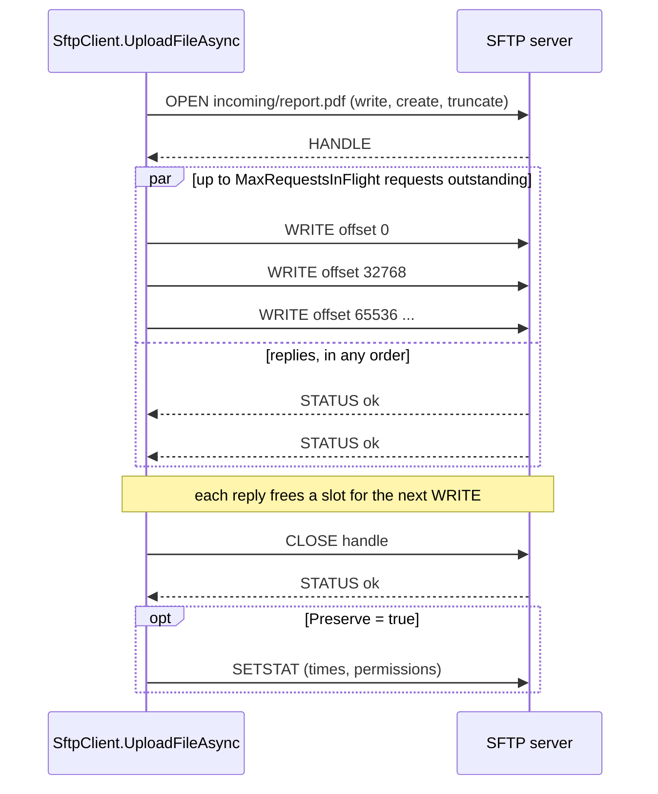
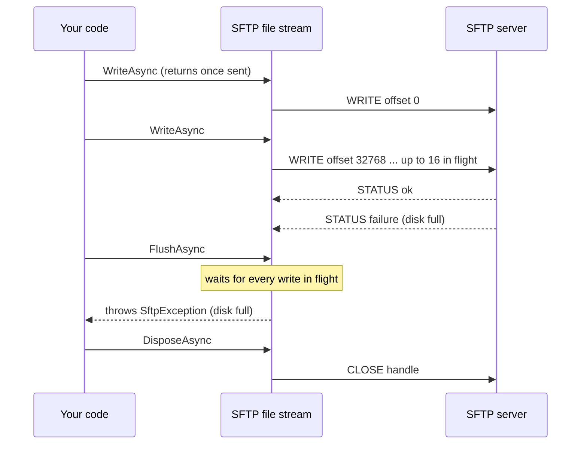

# Transfer files with SFTP

SFTP is SSH's file protocol. `client.OpenSftpAsync()` opens an SFTP session over an existing connection; the `SftpClient` it returns
uploads and downloads files, streams and whole directories, and browses and changes the server's file system.

## When to use

- Copying files to or from a server: releases, backups, reports, logs.
- Working on remote files in place: appending to a log, reading the end of a large file, renaming, setting permissions.
- Prefer SFTP to [SCP](transfer-files-scp.md) whenever the server offers it (OpenSSH always does): it can list, resume and
  change files, and OpenSSH's own `scp` command uses SFTP by default since 9.0.

## Open a session

[!code-csharp]

An `SftpClient` is one SFTP session (one SSH channel). Several can share an `SshClient`, and one can be used by several tasks at
once. Disposing it ends the session; the connection stays up.

## Upload and download

[!code-csharp]

## How a transfer runs

SFTP is a request-and-reply protocol, and on a link with latency, waiting for each reply before sending the next request would be
slow. The transfer methods keep many requests in flight at once (64 by default, as OpenSSH's `sftp` does), each as large as the
server allows (`limits@openssh.com`, or 32 KiB):

Downloads work the same way with `READ`. A transfer is still bounded by the channel's flow-control window (2 MiB), which is where
segmented downloads help (below).

## Progress, overwrite and preserved attributes

[!code-csharp]

## Resume an interrupted transfer

With `Resume = true`, a transfer sends only the part the destination lacks, as `reget` and `reput` do; a failed download keeps what
arrived. Retry in a loop, with a new connection when the old one broke:

[!code-csharp]

> [!WARNING]
> Resuming trusts that the bytes already at the destination are the start of the same file; nothing compares them. Resume only
> into a destination that nothing else writes.

## Download large files faster

One SFTP session moves at most about one window (2 MiB) per round trip: some 20 MiB/s at 100 ms of latency, however many requests
are in flight. `Segments` splits a download into ranges and fetches each over its own session on the same connection:

[!code-csharp]

It helps on high-latency links and where one server process is the limit; it does not help where bandwidth is the limit. The
server may allow fewer sessions than asked (sshd's `MaxSessions`). Segments apply to `DownloadFileAsync` and
`DownloadDirectoryAsync` only, and not together with `Resume`.

## Copy whole directories

[!code-csharp]

Symbolic links and special files are skipped in both directions. A download treats the server as untrusted: a name that cannot be
a safe file name here is skipped and counted in `Skipped`, and a path that would land outside the target stops the download.

## Copy many small files faster

A directory transfer moves one file after another by default, and each file costs a few round trips (open, size, close) however
small it is. Over a link with latency, a tree of many small files spends most of its time waiting. `MaxConcurrentFiles` transfers
several files at once over the same session:

[!code-csharp]

### When to use

- Many small or medium files (source trees, web sites, logs) over 20 ms or more of latency: start with 8. Over 25 ms of added
  latency, uploading 61 files to OpenSSH took 14.1 s one at a time and 3.3 s with 16 at once.
- Not for a few large files: one file already keeps `MaxRequestsInFlight` requests in flight. For those, use `Segments`.

### How it interacts with the other options

- **`MaxRequestsInFlight`** is the window of the whole transfer: the files share it. Memory stays at most `MaxRequestsInFlight`
  requests (2 MiB by default, about 16 MiB with OpenSSH's larger requests) plus 64 KiB per file in flight, whatever
  `MaxConcurrentFiles` is. Raise `MaxRequestsInFlight` if larger files in the tree should keep a full window while others run.
- **`Segments`** still splits each large file of a download over sessions of its own, so the sessions add up across files. The
  server's `MaxSessions` (10 by default) caps them; a file that gets no extra session downloads over the main one.
- **`Preserve`** sets directory times and permissions after every file is in, the deepest first.
- **`Progress`** reports each file by its path, interleaved, but never from two threads at once.

### Notes and pitfalls

- The first failure stops the other files and is the exception thrown; stopped downloads are deleted, stopped uploads keep what was
  written, as for a single file. Cancelling stops every file.
- A server that limits open files (`limits@openssh.com`) gets fewer files at once.
- The single-file methods ignore `MaxConcurrentFiles`. To transfer your own list of files at once, call `UploadFileAsync` or
  `DownloadFileAsync` from several tasks on one `SftpClient`, which is safe.

## Browse and change the remote file system

[!code-csharp]

## Replace a file atomically

Readers must never see a half-written configuration file. Upload under a temporary name and rename over the target; with
`overwrite: true` the rename is atomic (`posix-rename@openssh.com`):

[!code-csharp]

## Work with remote files as streams

`OpenAsync`, `OpenReadAsync` and `OpenWriteAsync` return a seekable `Stream` over a remote file, with `FileMode` and `FileAccess`
meaning what they do for `FileStream`:

[!code-csharp]

### Copy a stream into a remote file

When the data comes from a stream (a response body, a compressor, a database export), copy it into `OpenWriteAsync`. The stream
writes behind: `WriteAsync` sends its requests and returns without waiting for the replies, keeping up to 16 in flight, so the copy
runs close to the speed of `UploadAsync`:

[!code-csharp]

Over 25 ms of latency (the fake server in the tests, 4 MiB in 32 KiB requests), the copy took 0.40 s with write-behind, against
4.27 s when each write waited for its reply, and `UploadAsync` 0.17 s (it keeps 64 requests in flight). Against OpenSSH on the same
machine, copying 64 MiB took 9.7 s, against 17.0 s before, the same as `UploadAsync`.

- **Where errors appear.** A write the server refuses is thrown by a later call: the next `WriteAsync` that finds it, `FlushAsync`,
  a read, `SetLength`, or at the latest `DisposeAsync`. It is never lost. After that, the stream is faulted: every call throws the
  same exception, and disposing still closes the remote file. The [SFTP guide](../sftp.md#writes-in-flight) lists what each call
  waits for.
- **End with `FlushAsync`** (or rely on `await using`) to see a failure where you handle it, and to have the server write the file
  to disk where it can (`fsync@openssh.com`).
- **Cancelling a write** leaves the stream faulted, since part of the data may already be on the server: open the file again.
- **Many tiny writes** are many requests; nothing is combined. Put a `BufferedStream` in front when writing a few bytes at a time.
- **Whole files** are still simplest with `UploadFileAsync` or `UploadAsync`, which keep a wider window (64 by default) and report
  progress.

## Handle errors

A request the server refuses throws `SftpException`, with the SFTP `Status` and the `Path`:

[!code-csharp]

## Notes and pitfalls

- **Paths.** Remote paths go to the server as they are: relative paths start at the login directory, and `/` is the separator
  whatever this machine uses. `GetFullPathAsync` and `ExpandPathAsync` resolve them.
- **Asynchronous streams.** SFTP file streams support only the asynchronous `Read`/`Write` methods; the synchronous ones throw
  `NotSupportedException`. For whole files, `DownloadAsync` is faster than reading a stream. Writes are written behind, so a failed
  write is thrown by a later call (at the latest by `FlushAsync` or `DisposeAsync`), usually not by the `WriteAsync` that sent it.
- **Times.** SFTP version 3 carries modification times in whole seconds.
- **Extensions.** An operation that needs an extension the server lacks (an overwriting rename, a hard link, a server-side copy)
  throws `NotSupportedException`; `sftp.Extensions` lists what the server has.
- **A broken session** or connection throws `SshException` (`ChannelClosed` or `ConnectionClosed`); open a new `SftpClient`.

## See also

- [File transfer (SFTP)](../sftp.md) (in-depth guide: every option and operation)
- [IFileSystem and IFileProvider](file-system-adapters.md)
- [A file sync job](../scenarios/file-sync.md)
- <xref:SshSharp.Sftp.SftpClient> and <xref:SshSharp.Sftp.SftpTransferOptions> in the API reference
