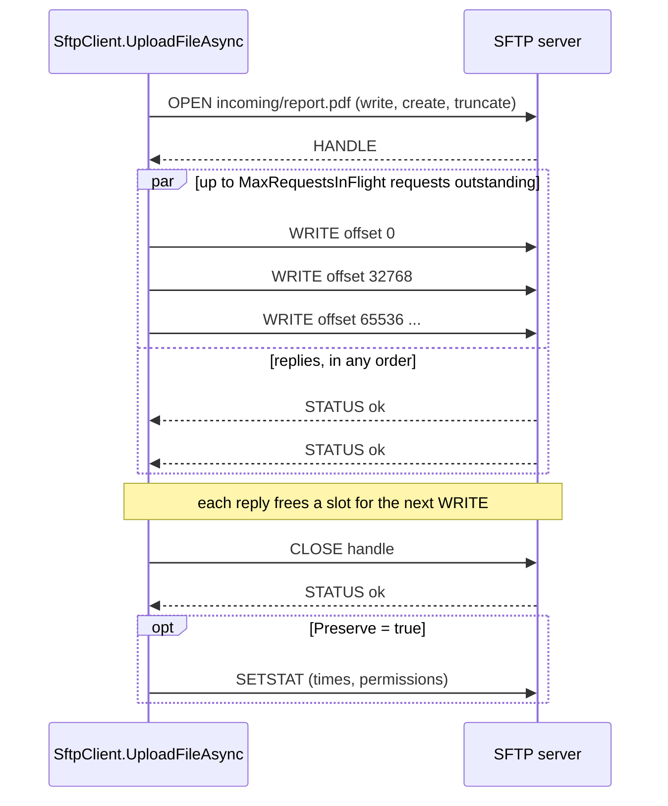
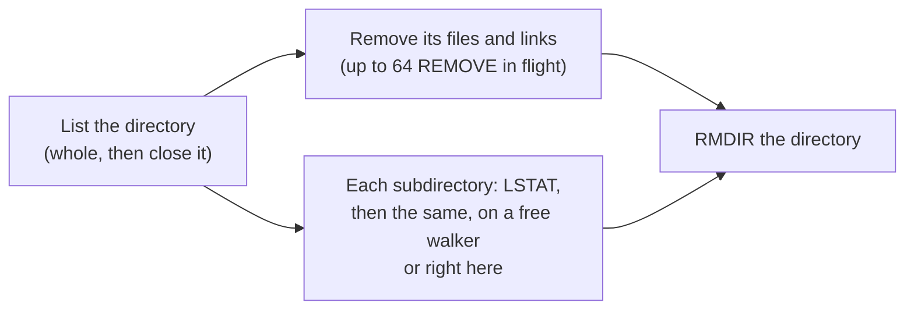
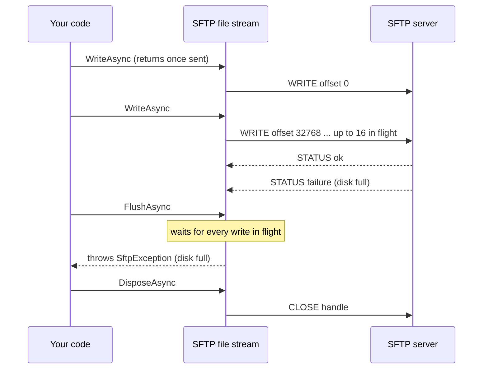

# Transfer files with SFTP

SFTP is SSH's file protocol. `client.OpenSftpAsync()` opens an SFTP session over an existing connection; the `SftpClient` it returns
uploads and downloads files, streams and whole directories, and browses and changes the server's file system.

## When to use

- Copying files to or from a server: releases, backups, reports, logs.
- Working on remote files in place: appending to a log, reading the end of a large file, renaming, setting permissions.
- Prefer SFTP to [SCP](transfer-files-scp.md) whenever the server offers it (OpenSSH always does): it can list, resume and
  change files, and OpenSSH's own `scp` command uses SFTP by default since 9.0.

## Open a session

[!code-csharp]

An `SftpClient` is one SFTP session (one SSH channel). Several can share an `SshClient`, and one can be used by several tasks at
once. Disposing it ends the session; the connection stays up.

## Upload and download

[!code-csharp]

## How a transfer runs

SFTP is a request-and-reply protocol, and on a link with latency, waiting for each reply before sending the next request would be
slow. The transfer methods keep many requests in flight at once (64 by default, as OpenSSH's `sftp` does), each as large as the
server allows (`limits@openssh.com`, or 32 KiB):

Downloads work the same way with `READ`. A transfer is still bounded by the channel's flow-control window (2 MiB), which is where
segmented transfers help (below).

## Progress, overwrite and preserved attributes

[!code-csharp]

## Resume an interrupted transfer

With `Resume = true`, a transfer sends only the part the destination lacks, as `reget` and `reput` do; a failed download keeps what
arrived. Retry in a loop, with a new connection when the old one broke:

[!code-csharp]

> [!WARNING]
> Resuming trusts that the bytes already at the destination are the start of the same file; nothing compares them. Resume only
> into a destination that nothing else writes.

## Transfer large files faster

One SFTP session moves at most about one window (2 MiB) per round trip: some 20 MiB/s at 100 ms of latency, however many requests
are in flight. `Segments` splits a download into ranges and fetches each over its own session on the same connection:

[!code-csharp]

Uploads work the same way, each session writing its range of the same remote file:

[!code-csharp]

### When to use

- Large files (tens of MiB and more) over a link with high latency (50 ms and more), or where one server process is the limit.
- Not where the bandwidth is the limit (the sessions share one TCP connection), on a fast local network, or for small files: files
  smaller than 1 MiB per segment use fewer segments.

### Notes and pitfalls

- **Sessions.** The server may allow fewer sessions than asked (sshd's `MaxSessions`, 10 by default); the ranges are then shared
  among those it opens.
- **Resume and streams.** Segments apply to `DownloadFileAsync`, `UploadFileAsync` and the directory transfers, not to
  `DownloadAsync`, `UploadAsync` or `Resume`, which need the file in order.
- **Servers that do not take parallel writers.** A server that allows one writer per file gets the upload over fewer sessions, and
  one that takes writes in order only (object storage behind SFTP) gets the rest of the file in order over the first session. The
  upload succeeds either way, without the speed-up; use `Segments = 1` for such servers.
- **A failed upload** stops every range and cuts the remote file to the part the server holds without a gap, so `Resume` can
  continue it; a server that cannot cut a file has it deleted. This cleanup waits at most `OperationTimeout` (or 5 s when it is not
  set) for each step. If it could not finish, the exception's `Data[SftpClient.UploadCleanupIncompleteKey]` is `true`: do not
  resume that file, delete it or upload it again (see [Segmented transfers](../sftp.md#segmented-transfers) for an example).
- **Readers meanwhile.** Until an upload ends, the parts still on their way read as zeros:
  upload to a temporary name and rename it (below) if others read the file meanwhile.
- **Verify** a large transfer with a hash from the server where it has one (see [Verify a transfer with a hash from the
  server](#verify-a-transfer-with-a-hash-from-the-server)).

A larger window does the same for one session, for every download (and for `Resume`): set `ChannelWindowSize` on the connection,
for example to 16 MiB. The two combine. See
[Tune and inspect a connection](tune-and-inspect-connections.md#move-more-data-per-round-trip-on-long-links).

## Copy whole directories

[!code-csharp]

Symbolic links and special files are skipped in both directions. A download treats the server as untrusted: a name that cannot be
a safe file name here is skipped and counted in `Skipped`, and a path that would land outside the target stops the download.

## Copy many small files faster

A directory transfer moves one file after another by default, and each file costs a few round trips (open, size, close) however
small it is. Over a link with latency, a tree of many small files spends most of its time waiting. `MaxConcurrentFiles` transfers
several files at once over the same session:

[!code-csharp]

### When to use

- Many small or medium files (source trees, web sites, logs) over 20 ms or more of latency: start with 8. Over 25 ms of added
  latency, uploading 61 files to OpenSSH took 14.1 s one at a time and 3.3 s with 16 at once.
- Not for a few large files: one file already keeps `MaxRequestsInFlight` requests in flight. For those, use `Segments`.

### How it interacts with the other options

- **`MaxRequestsInFlight`** is the window of the whole transfer: the files share it. Memory stays at most `MaxRequestsInFlight`
  requests (2 MiB by default, about 16 MiB with OpenSSH's larger requests) plus 64 KiB per file in flight, whatever
  `MaxConcurrentFiles` is. Raise `MaxRequestsInFlight` if larger files in the tree should keep a full window while others run.
- **`Segments`** still splits each large file of a download over sessions of its own, so the sessions add up across files. The
  server's `MaxSessions` (10 by default) caps them; a file that gets no extra session downloads over the main one.
- **`Preserve`** sets directory times and permissions after every file is in, the deepest first.
- **`Progress`** reports each file by its path, interleaved, but never from two threads at once.

### Notes and pitfalls

- The first failure stops the other files and is the exception thrown; stopped downloads are deleted, stopped uploads keep what was
  written, as for a single file. Cancelling stops every file.
- A server that limits open files (`limits@openssh.com`) gets fewer files at once.
- The single-file methods ignore `MaxConcurrentFiles`. To transfer your own list of files at once, call `UploadFileAsync` or
  `DownloadFileAsync` from several tasks on one `SftpClient`, which is safe.

## Browse and change the remote file system

[!code-csharp]

## Read and write whole files

For a small file (a configuration, a manifest, a marker), `ReadAllBytesAsync`, `ReadAllTextAsync`, `WriteAllBytesAsync` and
`WriteAllTextAsync` do it in one call, as their `File` namesakes do locally:

[!code-csharp]

- **Text** is UTF-8 by default. Reading honours a byte order mark when there is one; writing adds none unless you pass an
  `Encoding` that has one, as `File.WriteAllTextAsync` does.
- **Writing replaces the file**: it is created or truncated, then written with many writes in flight. A failure part way leaves it
  partly written; when readers must never see that, [replace it atomically](#replace-a-file-atomically) instead.
- **Reading holds the whole file in memory** (at most about 2 GiB, the largest array). For large files, use `DownloadFileAsync`
  or `DownloadAsync` into a stream.

## Create and delete directory trees

`CreateDirectoryAsync` and `DeleteDirectoryAsync` work on one directory. With `createParents: true` and `recursive: true` they work
on trees, as `mkdir -p` and `rm -r` do:

[!code-csharp]

### Create with parents

- An existing directory is not an error; a file anywhere in the path is (`SftpException`, `Status = Failure`).
- The directory is created first, and only if that fails are the directories above it looked at, up to the first that exists. An
  existing tree costs one request, and a directory above that you may not write to (a chroot's top, for example) is never touched.
- `permissions` apply to the last directory only; the parents get the server's defaults, as `mkdir -p -m` does.

### Delete recursively

Each directory is listed, emptied and then removed, with many requests in flight: up to 64 removals at once, and up to 4
directories listed at once (fewer when the server limits open handles). A tree of thousands of files costs a few round trips per
directory, not one per file.

- **Links are never followed.** A symbolic link in the tree is removed itself, even when it points to a directory; every
  subdirectory is checked with `LSTAT` before it is entered, so a server that describes a link as a directory in its listing
  cannot lead the delete out of the tree. A `path` that is itself a link removes only the link.
- **The first failure stops it.** No more requests are sent, the ones in flight finish, and that failure is thrown (for example
  `SftpException` with `PermissionDenied` and the `Path` it could not delete). What was deleted stays deleted; once the cause is
  fixed, calling again finishes the job. Cancelling stops it the same way.
- **Entries that vanish** meanwhile (deleted by someone else) are not an error, but a `path` that does not exist is
  (`NoSuchFile`).
- **Depth** is limited to 64 levels, as for directory downloads (`SshException`, `Reason = TransferFailed`).

## Fail when the server stops answering

By default, a request waits for its reply as long as the session lasts. A server that hangs (a stuck disk, a network path that
drops packets without closing the connection) then hangs your code too. Set `OperationTimeout`:

[!code-csharp]

- **It limits silence, not duration.** A request fails once the server has sent nothing at all for that long. While replies keep
  coming, a request waits on, so a large transfer over a slow link is never cut off for its size, even when a window of 64 requests
  takes longer than the timeout to work through.
- **What is thrown:** `SshException` with `Reason = Timeout`, and a `TimeoutException` as its inner exception. Your
  `CancellationToken` still works alongside it, and cancelling is an `OperationCanceledException`, never a timeout.
- **The session stays usable.** A request that timed out is abandoned, not undone: the server may still carry it out, and its
  late reply is dropped (a file it opens is closed again). A server that has really stopped answering fails the next requests too;
  reconnect, and resume transfers with `Resume = true`.
- It applies to every request of the `SftpClient`, including those of streams, listings and transfers, and to the extra sessions
  of a segmented download. Change it at any time.
- [Keep-alives](keepalive-and-reconnect.md) (`KeepAliveInterval`) detect a dead connection; `OperationTimeout` also catches a
  server that is connected but no longer answering SFTP requests.

## Replace a file atomically

Readers must never see a half-written configuration file. Upload under a temporary name and rename over the target; with
`overwrite: true` the rename is atomic (`posix-rename@openssh.com`):

[!code-csharp]

## Work with remote files as streams

`OpenAsync`, `OpenReadAsync` and `OpenWriteAsync` return a seekable `Stream` over a remote file, with `FileMode` and `FileAccess`
meaning what they do for `FileStream`:

[!code-csharp]

### Copy a stream into a remote file

When the data comes from a stream (a response body, a compressor, a database export), copy it into `OpenWriteAsync`. The stream
writes behind: `WriteAsync` sends its requests and returns without waiting for the replies, keeping up to 16 in flight, so the copy
runs close to the speed of `UploadAsync`:

[!code-csharp]

Over 25 ms of latency (the fake server in the tests, 4 MiB in 32 KiB requests), the copy took 0.40 s with write-behind, against
4.27 s when each write waited for its reply, and `UploadAsync` 0.17 s (it keeps 64 requests in flight). Against OpenSSH on the same
machine, copying 64 MiB took 9.7 s, against 17.0 s before, the same as `UploadAsync`.

- **Where errors appear.** A write the server refuses is thrown by a later call: the next `WriteAsync` that finds it, `FlushAsync`,
  a read, `SetLength`, or at the latest `DisposeAsync`. It is never lost. After that, the stream is faulted: every call throws the
  same exception, and disposing still closes the remote file. The [SFTP guide](../sftp.md#writes-in-flight) lists what each call
  waits for.
- **End with `FlushAsync`** (or rely on `await using`) to see a failure where you handle it, and to have the server write the file
  to disk where it can (`fsync@openssh.com`).
- **Cancelling a write** leaves the stream faulted, since part of the data may already be on the server: open the file again.
- **Many tiny writes** are many requests; nothing is combined. Put a `BufferedStream` in front when writing a few bytes at a time.
- **Whole files** are still simplest with `UploadFileAsync` or `UploadAsync`, which keep a wider window (64 by default) and report
  progress.

## Verify a transfer with a hash from the server

Some servers compute a file's hash where the file is (`check-file`: ProFTPD, Bitvise, Tectia; OpenSSH does not), so a transfer can
be checked without reading the file back. Compare it with a hash of the local copy:

[!code-csharp]

### When to use

- After uploading or downloading something that must arrive whole (backups, images, releases), to a server that has `check-file`.
- To check part of a file: pass `offset` and `length`.

### Notes and pitfalls

- **Check `SupportsFileHash`** first, or catch `NotSupportedException`: most servers, OpenSSH among them, have no hash extension.
  Then download the file and hash it locally, or rely on the SSH connection, which already protects the data on its way.
- **The server computes the hash**, so it shows the server holds what it was sent, as far as you trust the server. It does not
  protect against a server that lies.
- **SHA-2 by default.** Without `algorithms`, only `sha256`, `sha512`, `sha384` and `sha224` are accepted. Name `md5`, `sha1` or
  `crc32` only for a server that offers nothing better: they catch accidental damage, not a deliberate change. `Algorithm` on the
  result says which one the server used; hash the local copy with the same one.

## Call a vendor extension

`SendExtendedRequestAsync` sends any `SSH_FXP_EXTENDED` request and returns the reply as it came, for extensions this library has no
method for. Encode the request's fields as the extension defines them (an SSH string is a big-endian `uint32` length and the
bytes), and parse the reply's `Data` the same way:

[!code-csharp]

- `sftp.Extensions` lists what the server announces, with each extension's data (often a version). Call only those: most servers
  answer `OperationUnsupported` to a request they do not know, but some (Erlang/OTP's `ssh_sftpd`) end the whole SFTP session,
  failing every request on it.
- A server error comes back as `Status`, not as an exception; `EnsureSuccess()` throws it as an `SftpException`.
- The reply is the server's: parse it defensively. Avoid extensions that open handles, which only this library's own methods
  close.

## Handle errors

A request the server refuses throws `SftpException`, with the SFTP `Status` and the `Path`:

[!code-csharp]

## Notes and pitfalls

- **Paths.** Remote paths go to the server as they are: relative paths start at the login directory, and `/` is the separator
  whatever this machine uses. `GetFullPathAsync` and `ExpandPathAsync` resolve them.
- **Asynchronous streams.** SFTP file streams support only the asynchronous `Read`/`Write` methods; the synchronous ones throw
  `NotSupportedException`. For whole files, `DownloadAsync` is faster than reading a stream. Writes are written behind, so a failed
  write is thrown by a later call (at the latest by `FlushAsync` or `DisposeAsync`), usually not by the `WriteAsync` that sent it.
- **Times.** SFTP version 3 carries modification times in whole seconds.
- **Extensions.** An operation that needs an extension the server lacks (an overwriting rename, a hard link, a server-side copy, a file hash)
  throws `NotSupportedException`; `sftp.Extensions` lists what the server has.
- **A broken session** or connection throws `SshException` (`ChannelClosed` or `ConnectionClosed`); open a new `SftpClient`.

## See also

- [File transfer (SFTP)](../sftp.md) (in-depth guide: every option and operation)
- [IFileSystem and IFileProvider](file-system-adapters.md)
- [A file sync job](../scenarios/file-sync.md)
- <xref:SshSharp.Sftp.SftpClient> and <xref:SshSharp.Sftp.SftpTransferOptions> in the API reference
