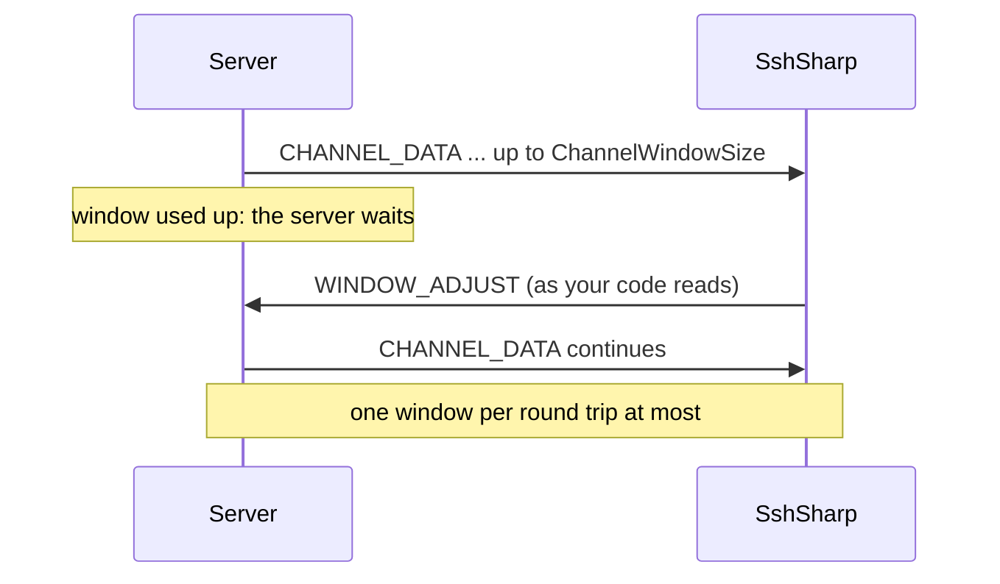
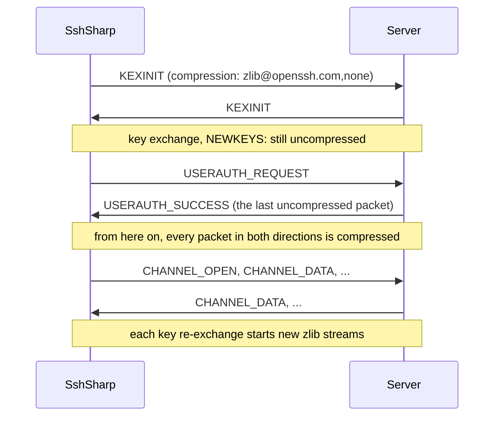

# Tune and inspect a connection

A few connection settings matter only in some environments: socket options for a network that drops idle flows or marks traffic,
a comment that tells your application's connections apart in the server's logs, a larger channel window for fast links with a
long round trip, and compression for slow ones. Once connected, `SshClient` tells you where the connection goes, how much it has carried, and lets you renew its
keys on demand.

## When to use

- A firewall or load balancer drops idle TCP flows, and you want the operating system's TCP keep-alive as well as (or instead of)
  SSH keep-alive.
- Your network marks traffic by DSCP, or the socket's buffer sizes need raising.
- Server administrators need to tell which application or job a connection comes from.
- Downloads, command output or tunnels are slow over a fast link with a long round trip (another continent, a satellite link).
- The link itself is slow (a few Mbit/s or less: a branch office, a mobile or radio link) and what crosses it is text: command
  output, logs, CSV or JSON.
- You report on connections: their endpoints, age, traffic, session id and algorithms.
- A policy asks for new keys before a sensitive transfer, or at times of your choosing.

## Set socket options

`ConfigureSocket` is called with the TCP socket before it connects, after it is bound to `LocalEndPoint` if one is set:

[!code-csharp]

Setting options before the connection is made matters for buffer sizes: TCP agrees on window scaling in its handshake, from the
receive buffer the socket has then. Keep-alive and the type of service can be set at any time, so setting them here is simply the
earliest point.

`ConfigureSocket` is called once for each socket SshSharp creates, and each address of the server that is tried gets a new socket,
of that address's family (IPv4 or IPv6, not dual-mode). For an IP address, or a name with one address, that is once. When a name
has several addresses and the first cannot be reached, the callback runs again for the socket of each further address tried, so set
the same options every time. Anything the callback throws ends the connection attempt and is thrown from `ConnectAsync` unchanged,
not wrapped as a failure to connect.

It applies only to the TCP connection that `SshClient.ConnectAsync(host, port, options)` opens itself:

- **With `JumpHosts`** it is called for the connection to the first jump host, which is the only TCP connection made from this
  machine; the later hops are channels through it.
- **Through a `Proxy`** (HTTP or SOCKS) it is not called. The socket goes to the proxy, not the server.
- **Over a stream you opened** (`ConnectAsync(stream, options)`) there is no socket for SshSharp to configure: set the options on
  your own socket before you pass its stream.
- **By `ssh_config` alias**, `SshConfigConnectOptions.ConfigureSocket` does the same, for the connection to the destination or to
  its first `ProxyJump` hop (not with a `ProxyCommand` or a `Proxy`).

### `TCPKeepAlive` and `IPQoS` from `ssh_config`

When connecting by alias, two directives set socket options before your `ConfigureSocket` runs, so what it sets wins:

[!code-csharp]

- **`TCPKeepAlive`** turns on the operating system's TCP keep-alive (`SO_KEEPALIVE`). It is on unless the configuration says
  `TCPKeepAlive no`, as in `ssh`: connecting by alias promises to do what `ssh` does with the same file, and an idle connection to a
  machine that has gone away is then noticed eventually, even without `ServerAliveInterval`. The system's idle time before the first
  probe is long (two hours by default on Linux and Windows); shorten it with `ConfigureSocket` as above, or use `ServerAliveInterval`,
  which works at the SSH level and keeps NAT and firewall state alive too. `SshClientOptions` does not turn it on: there, you choose.
- **`IPQoS`** sets the type of service (DSCP): a name such as `af21`, `cs1`, `ef` or `le`, or a number from 0 to 255; `none` leaves
  the system's. `ssh` uses the first value for interactive sessions and the second for other traffic; SshSharp sets the second (or
  the only one) when it connects, since a connection's use is not known then and is mostly commands, transfers and tunnels. Set
  `IPQoS ef` (one value) to mark everything as interactive. Unlike `ssh`, nothing is marked when `IPQoS` is not set. `ssh`'s own
  default has changed between versions, and marking traffic is a choice for the network's owner. Both directives are best effort, as
  in `ssh`: a platform that refuses an option logs it at debug level and connects without it. Windows ignores the type of service
  unless a system policy allows applications to set it.

## Identify your application to the server

`VersionAddendum` adds a comment to the identification line the client sends first, as sshd's `VersionAddendum` does on the
server side:

[!code-csharp]

OpenSSH's sshd shows the client's software version and comment in its debug log (`Remote protocol version 2.0, remote software
version ...`), and many servers and network monitors record the line. The comment is checked
when the option is set: printable US-ASCII (spaces allowed inside it), not starting or ending with a space, and short enough for the
whole line to fit RFC 4253's 255 bytes. Anything else is an `ArgumentException`.

> [!WARNING]
> The identification line is sent before encryption starts. Anyone on the network path can read it, and servers keep it in their
> logs. Put a product name and version in it, never a secret, a user name or a host name.

## Move more data per round trip on long links

Each channel (a command's session, an SFTP session, a tunnel) has a flow-control window: how much the server may send before
SshSharp has consumed some. One channel therefore moves at most one window per round trip. With the default 2 MiB, that is about
20 MiB/s at 100 ms, whatever the bandwidth. On a link whose bandwidth-delay product is larger, raise `ChannelWindowSize`. A larger
`ChannelMaxPacketSize` also lets the server send bigger packets, so there are fewer of them to process:

[!code-csharp]

To size the window, multiply the bandwidth by the round trip: 1 Gbit/s × 100 ms is 12.5 MB, so 16 MiB keeps such a link busy.

| Option | Default | Range | What it does |
|---|---|---|---|
| `ChannelWindowSize` | 2 MiB | 1 KiB to 1 GiB | How much the server may send on a channel before it waits for SshSharp to consume it. |
| `ChannelMaxPacketSize` | 32 KiB | 1 KiB to 255 KiB | The most data the server may put in one packet. Capped at the window. |

Both apply to every channel of the connection: sessions, SFTP and SCP, tunnels, and connections the server forwards to you. They
govern what SshSharp receives. What it sends is bounded by the window and packet size the server grants, which SshSharp follows.

Notes:

- **Memory.** Each channel can hold up to its window of data your code has not read yet. With many channels and a large window,
  that adds up: 100 channels with a 16 MiB window may buffer up to 1.6 GiB if nothing reads them.
- **The server's side matters too.** For uploads, the server's window limits the client the same way, and only the server can
  raise it. OpenSSH's sshd uses 2 MiB.
- **SFTP.** A larger window helps a single transfer as `Segments` does, without opening more sessions. The two combine.
- **TCP.** The operating system's TCP window has to keep up as well. Modern systems scale it automatically. Where they do not,
  raise the receive buffer with `ConfigureSocket`.

## Compress a slow link

`Compression` asks the server for OpenSSH's delayed compression, `zlib@openssh.com`, as `ssh -C` does:

[!code-csharp]

It is off by default, as in `ssh`. The server decides: OpenSSH's sshd agrees unless it is configured with `Compression no`, and
other servers may not offer it. `client.Algorithms.CompressionServerToClient` and `CompressionClientToServer` tell what was
negotiated; a server without it gives `none`, and the connection works as it would have without compression.

When connecting by alias, `Compression yes` in `ssh_config` turns it on for that host, and `SshConfigConnectOptions.Compression`
overrides the configuration for the destination, as `ssh -C` does:

[!code-csharp]

**When it helps.** Compression trades CPU for bytes. Text from a command (logs, listings, JSON, CSV) often shrinks to a third or
less, so on a link of a few Mbit/s, where the network is the limit, it arrives sooner. Interactive sessions over a slow link feel
quicker too.

**When it costs.** On a fast link (a LAN, a data center, anything where the CPU rather than the network is the limit) compression
slows transfers down: every byte is compressed on one side and decompressed on the other. Data that is already compressed or
encrypted (`.zst`, `.gz`, `.jpg`, a backup archive, a tunnel carrying TLS) does not shrink at all, and only costs CPU. Measure before
turning it on for bulk transfers.

Notes:

- **It starts after the login.** Compression begins with the first packet after the server accepts the authentication, never
  before. Plain `zlib`, which compresses from the first packet and so exposes the decompressor to an unauthenticated peer, is not
  supported, by design.
- **Huffman coding only.** What SshSharp sends is compressed with Huffman coding alone, as OpenSSH has done since September 2026, without LZ77's
  references to earlier data: it shrinks text less, but the size of a packet no longer tells whether it repeats something sent
  before on another channel. Even so, keep compression off for a connection that carries both secrets and data an attacker can
  choose; see the [threat model](../threat-model.md#compression).
- **.NET 8.** Choosing the Huffman-only strategy needs .NET 9 or later, so on .NET 8 SshSharp offers compression only for what the
  server sends (`CompressionClientToServer` is `none`). Downloads and command output, usually what benefits, are compressed either
  way.
- **Limits.** A compressed packet from the server may inflate to less than 256 KiB, the most a packet can carry. More (a
  "decompression bomb") fails the connection with `SshFailureReason.ProtocolError`, as malformed compressed data does.
- **Byte counters** (`BytesSent`, `BytesReceived` and the `sshsharp.bytes.*` metrics) count message payloads before compression and
  after decompression: what the application sent and received, not what crossed the network.
- **FIPS mode** allows it: zlib is not a cryptographic algorithm.
- **Jump hosts.** `SshConfigConnectOptions.Compression` applies to the destination only, as `ssh -C` does. A jump host carries the
  destination's packets already encrypted, and they do not compress; its own `Compression` line in `ssh_config` still applies to it.

## Inspect a connection

[!code-csharp]

| Member | What it is |
|---|---|
| `RemoteEndPoint`, `LocalEndPoint` | The TCP connection's endpoints, when there is a socket: a connection SshSharp made, or a `NetworkStream` you passed. Through an HTTP or SOCKS proxy, the remote one is the proxy. Null over other streams (a ProxyJump tunnel, a ProxyCommand). |
| `ConnectedAt` | When authentication succeeded, in UTC. |
| `SessionId` | The session identifier: the exchange hash of the first key exchange (RFC 4253 section 7.2). It stays the same across re-exchanges. It is not secret, and both sides know it, so it can correlate a connection with the server's records. A copy, readable after the client is disposed. |
| `BytesSent`, `BytesReceived` | SSH message bytes so far: each packet's payload, key exchange messages included, before compression, encryption, padding and MAC (after decryption and decompression for what is received), as the `sshsharp.bytes.*` metrics count them. |
| `ServerIdentification` | The server's identification line, for example `SSH-2.0-OpenSSH_9.9`. |
| `Algorithms` | The negotiated key exchange, host key algorithm, ciphers, MACs and compression; a re-exchange can change them. |
| `HostKey` | The host key the server proved. |

All of them are cheap to read from any thread: the byte counters are read atomically, and the rest is fixed at connect time.

## Re-key on demand

[!code-csharp]

`RekeyAsync` starts a key re-exchange, as ssh's `~R` escape does, and completes once the new keys are in use in both directions.
Open channels stay open: data waits while the keys change and then continues. If a re-exchange is already running (the server asked
for one, or `RekeyAfterBytes` or `RekeyAfterTime` was reached), it waits for that one instead of starting another. The server must
prove the same host key as at the start, or the connection fails. Keys are renewed automatically anyway, after `RekeyAfterBytes`
(1 GiB) or `RekeyAfterTime` (1 hour), so most applications never need to call it.

## Notes and pitfalls

- **TCP keep-alive is not SSH keep-alive.** TCP keep-alive keeps a firewall's state and finds a dead peer at the TCP level, but
  intervals are coarse on some systems, and a server that is up but stuck still answers it. `KeepAliveInterval` probes the SSH server
  itself. See [Keep-alive and reconnecting](keepalive-and-reconnect.md).
- **The type of service** (`SocketOptionName.TypeOfService`) is an IPv4 option. Each socket has the family of the address it
  connects to, so check `socket.AddressFamily`: an IPv6 socket takes the traffic class (`IPV6_TCLASS`) instead, which .NET sets only
  as a raw option. ssh_config's `IPQoS` sets whichever applies. Windows ignores the IPv4 option by default and marks traffic through
  QoS policies instead.
- **A larger window does not help when bandwidth is the limit,** only when the round trip is.
- **Counters cover the whole connection,** every channel together. For one transfer, take the difference before and after.

## See also

- [Tune for throughput](performance-tuning.md)
- [Connecting](../connecting.md)
- [Channels and flow control](../concepts/channels.md)
- [Transfer files with SFTP](transfer-files-sftp.md#transfer-large-files-faster)
- [Logging and diagnostics](logging-and-diagnostics.md)
- <xref:SshSharp.SshClientOptions> and <xref:SshSharp.SshClient> in the API reference
