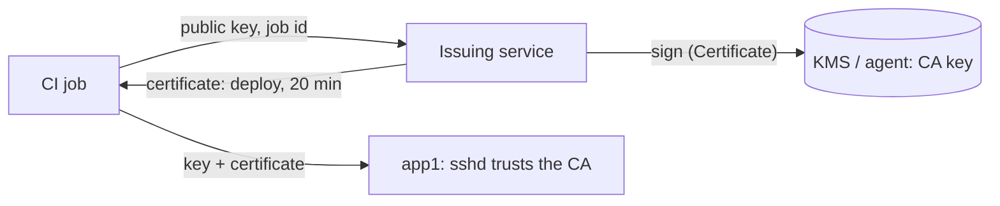

# Short-lived certificates for CI jobs

Give each CI job its own SSH access that ends with the job: a key generated for the job, and a certificate for it that your own
certificate authority issues for twenty minutes, for one user, from the build network, running one command. No long-lived deploy
key sits in the CI system's secrets, and no `authorized_keys` file lists one.

## The approach

- **The servers trust a CA, not keys.** `TrustedUserCAKeys` in `sshd_config` names the CA's public key; any certificate it issued
  for the user logs in, within its validity.
- **A key per job.** The job generates an Ed25519 key in memory. It never touches the disk and is gone when the job ends.
- **Your service is the CA.** It checks that the job may deploy (from your CI system's identity token, for example), then issues the
  certificate with `SshCertificateBuilder`. Here the issuing and the deploy are in one process for brevity.
- **The certificate carries the limits:** `Principals` (the `deploy` user only), `ValidBefore` (the job's timeout), no extensions
  (no terminal, no forwarding), `source-address` (the build network) and `force-command` (the deploy script, whatever the job
  asks to run).
- **The CA key never enters the process.** It stays in an SSH agent on the issuing host, or in a key vault or KMS through an
  `SshKeySigner` that signs only `SshSignaturePurpose.Certificate` requests.



## The code

Issuing:

[!code-csharp[](../snippets/Scenarios/CiCertificates.cs#issue)]

Using it in the job:

[!code-csharp[](../snippets/Scenarios/CiCertificates.cs#use)]

On each server, `sshd_config`:

```
TrustedUserCAKeys /etc/ssh/user_ca.pub
# Optional: which principals each account accepts (one per line), instead of the account's own name.
AuthorizedPrincipalsFile /etc/ssh/principals/%u
```

and for the job's `known_hosts`, the same or another CA for host certificates:

```
@cert-authority *.example.com ssh-ed25519 AAAAC3NzaC1lZDI1NTE5AAAA...
```

## For production

- **Who may get a certificate.** The issuing service is now what decides who can log in. Authenticate the job (an OIDC token from
  the CI system, checked for repository and branch), and log every certificate issued: key id, serial, principals, validity.
- **The CA key.** Keep it in a KMS or HSM behind an `SshKeySigner` that allows `SshSignaturePurpose.Certificate` only (see
  [Certificates](../how-to/certificates.md#keep-the-ca-key-out-of-the-process)). Rotate it by adding the new CA's key to
  `TrustedUserCAKeys` before issuing with it, and removing the old one after its last certificate has expired.
- **Serials.** Give each certificate its own `Serial` (a database sequence, or the job number) so that `RevokedKeys` can revoke one.
  With twenty-minute certificates, waiting for expiry is usually the revocation.
- **Clock skew.** `ValidAfter` defaults to one minute before signing. Servers whose clocks are further off need NTP, not a longer
  window.
- **`source-address`** must match the address the server sees: behind NAT, that is the NAT's address.

## See also

- [Certificates](../how-to/certificates.md)
- [Keys held elsewhere](../authentication.md#keys-held-elsewhere-key-vaults-hsms-tpm)
- [Threat model: certificates](../threat-model.md#certificates-the-application-checks-or-issues)
