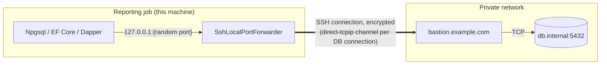

# A database through a jump host

A reporting job needs a PostgreSQL database that sits in a private network, reachable only from a bastion host. Instead of a VPN,
the job opens an SSH connection to the bastion and forwards a local port to the database, as `ssh -L` does. Any ADO.NET provider,
ORM or tool then connects to `127.0.0.1` on that port.



## The approach

- **One SSH connection, many database connections.** Each connection the provider opens (a connection pool has several) becomes
  its own channel inside the SSH connection.
- **Loopback and port 0.** The forwarder listens on `127.0.0.1` only, so no other machine can use it, on a free port the system
  picks, so concurrent jobs do not collide.
- **The database still authenticates.** The tunnel replaces network reachability, not the database's own login and TLS.

## The code

[!code-csharp[](../snippets/Scenarios/DatabaseTunnel.cs#tunnel)]

[!code-csharp[](../snippets/Scenarios/DatabaseTunnel.cs#use)]

The bastion's entry in `~/.ssh/config` (or an application's own configuration, see
[Use ssh_config and known_hosts](../how-to/ssh-config-and-known-hosts.md#ship-a-configuration-with-your-application)):

```
Host bastion
  HostName bastion.example.com
  User report
  IdentityFile ~/.ssh/report_ed25519
  ServerAliveInterval 30
```

## For production

- **Keep-alive.** `ServerAliveInterval` (or `KeepAliveInterval`) detects a dead tunnel in bounded time instead of leaving database
  calls hanging.
- **A dropped tunnel** ends every database connection through it. Watch `tunnel.Closed`, and open a new tunnel (and clear the
  provider's connection pool) when it fires; see [Keep-alive and reconnecting](../how-to/keepalive-and-reconnect.md).
- **Bastion policy.** The bastion must allow forwarding to the database (sshd's `AllowTcpForwarding`, perhaps `PermitOpen
  db.internal:5432` to allow only that).
- **Several databases** can share one bastion connection: call `ForwardLocalPortAsync` once per database.
- **No local port at all.** A client library that can take a `Stream` can use `OpenTcpTunnelAsync` instead; most database providers
  need a host and port, which is what the forwarder gives them.

## See also

- [Port forwarding and tunnels](../how-to/port-forwarding.md)
- [Jump hosts](../how-to/jump-hosts.md)
