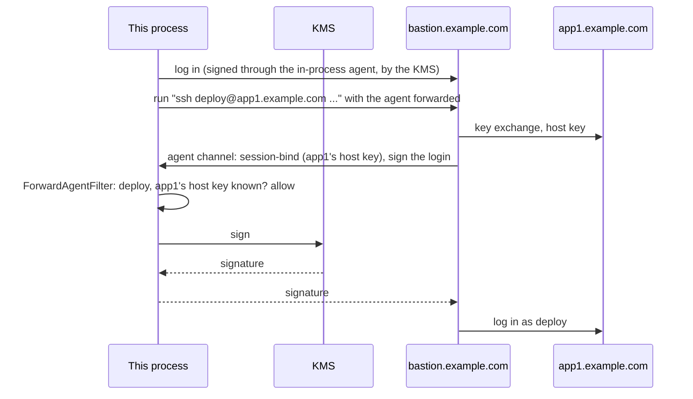

# A KMS-held key forwarded through a bastion

Deploy to application servers that are reachable only from a bastion, with a key that lives in a cloud KMS or an HSM. `ssh` on the
bastion logs in to each application server with your key, through a forwarded agent, but the private key never leaves the KMS, no
`ssh-agent` runs anywhere, and the bastion can use the key only for what you allow: logging in as `deploy` to the application
servers you know.

## The approach

- **The key stays in the KMS.** An `SshKeySigner` asks the KMS for each signature (see
  [Use a key held by a remote service](../how-to/agent-and-keys.md#use-a-key-held-by-a-remote-service)).
- **An agent in this process.** `SshAgent.FromKeys` serves that key over the agent protocol: this client authenticates to the
  bastion through it, and forwards it (`ForwardAgent`), so `ssh` on the bastion can use it.
- **A filter decides each request.** `ForwardAgentFilter` sees every request the bastion's programs make: the key, what the
  signature is for, the user name, and the host key of the server being logged in to (from the session binding that OpenSSH 8.9
  and later send). It allows logins as `deploy` to the application servers' host keys, and refuses the rest: another user, another
  server, a destination it cannot tell, a file or commit signature.

## The code

The agent:

[!code-csharp]

The filter:

[!code-csharp]

The deployment:

[!code-csharp]

## For production

- **The bastion's `ssh` must bind its sessions.** `DestinationHostKey` is known only when the program on the bastion binds its agent
  connection to the session it logs in to (OpenSSH 8.9 and later do). With an older `ssh`, this filter refuses every login; a
  looser filter has nothing but the user name to go on.
- **The filter narrows, it does not make the bastion trusted.** While you are connected, someone with root on the bastion can still
  ask for what the filter allows: a login as `deploy` to the application servers. Keep connections short, and give `deploy` only
  what deploying needs.
- **The KMS policy is a second check.** Let the KMS key sign for authentication only (the signer sees `SshSignaturePurpose`), and
  log its use on the KMS side as well.
- **Host keys.** Keep the application servers' host keys in a `known_hosts` file you control. Hosts that use host certificates
  present the certified key here: compare `DestinationHostKey` with the keys the certificates certify.
- **Without the bastion's cooperation**, `ProxyJump` (a [jump host](../how-to/jump-hosts.md)) avoids forwarding the agent at all:
  the connection to each application server is made from this process, through the bastion, and the bastion never sees a request.
  Prefer it when the bastion allows TCP forwarding.

## See also

- [Keys and the SSH agent: an agent in your process](../how-to/agent-and-keys.md#serve-an-agent-from-your-own-keys)
- [Authentication: agent forwarding](../authentication.md#agent-forwarding)
- [Threat model: agent forwarding](../threat-model.md#channels-the-server-opens)
