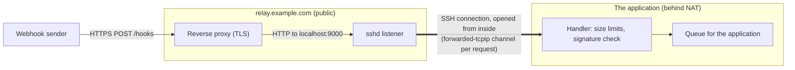

# A webhook receiver behind NAT

An application on a laptop, a build agent or a site with no public address needs webhooks from a SaaS service. Instead of
opening a port on the firewall or running a tunnelling agent, the application connects to a small public server over SSH and asks
it to listen on a port of its loopback (`ssh -R`). The public server's reverse proxy terminates TLS and passes the webhook path to
that port. Each request then arrives in the application's own code, as a stream: nothing listens on the application's machine.



## The approach

- **The connection goes out, the requests come in.** Only an outbound SSH connection is needed. `ForwardRemotePortAsync` with a
  handler makes the server listen on `localhost:9000`; every connection to it becomes a channel in that SSH connection, handed to
  the handler.
- **Everything that arrives is untrusted.** Anyone who reaches the port (the reverse proxy, but also any user or process on the
  relay) can connect. The handler bounds the header and body sizes and the time it waits, checks the sender's HMAC signature, and
  only then queues the body.
- **A cap.** `maxConnections` bounds the requests handled at once; the server's connections above it are refused at once, which the
  proxy reports as a 502 and the sender retries.
- **Small handler, separate work.** The handler only accepts and queues; the application processes the queue at its own pace.

## The code

The receiver: one request per connection, answered with `Connection: close`.

[!code-csharp[](../snippets/Scenarios/WebhookReceiver.cs#receiver)]

Starting it:

[!code-csharp[](../snippets/Scenarios/WebhookReceiver.cs#run)]

The relay's entry in `~/.ssh/config`:

```
Host relay
  HostName relay.example.com
  User webhooks
  IdentityFile ~/.ssh/webhooks_ed25519
  ServerAliveInterval 30
```

## For production

- **A dedicated account on the relay.** Restrict its key in `authorized_keys` to forwarding only, for example
  `restrict,port-forwarding,permitlisten="localhost:9000"`, so it can listen on that port and do nothing else.
- **Reconnect.** When the SSH connection drops, the handlers are cancelled and the port closes on the relay. Watch
  `relay.ConnectionClosed` and connect and forward again; see [Keep-alive and reconnecting](../how-to/keepalive-and-reconnect.md).
  A sender's retries cover the gap.
- **A full HTTP stack.** The handler above reads one small request by hand to keep the example short. For anything richer, run
  Kestrel on this machine's loopback and use the host-and-port overload (`ForwardRemotePortAsync("localhost", 9000, "127.0.0.1",
  5000)`) instead.
- **Port in use.** `sshd` refuses to listen on a port already taken on the relay (the call throws `SshException`); a second
  instance of the application needs another port.
- **Disposal.** Disposing the forwarder stops the relay listening first, then cancels the handlers and gives them up to 5 seconds
  to finish the request in progress.

## See also

- [Port forwarding and tunnels: serving a remote port from your app](../how-to/port-forwarding.md#serving-a-remote-port-from-your-app)
- [Threat model: channels the server opens](../threat-model.md#channels-the-server-opens)
